# 基于香橙派(Zero 2W)的ROS2自动定位与导航小车

基于香橙派 Zero 2W 和 ROS2 Jazzy 的自动定位与导航小车，集成激光雷达、IMU、轮式里程计和 EKF，能够实现遥控建图、激光雷达 SLAM 建图、地图保存、自主定位、路径规划和自主导航等功能。

## 目录

- [0 项目介绍](#0-项目介绍)
  - [0.1 功能简介](#01-功能简介)
  - [0.2 系统架构](#02-系统架构)
  - [0.3 软件配置](#03-软件配置)
  - [0.4 硬件参数](#04-硬件参数)
- [1 开发前准备](#1-开发前准备)
  - [1.1 BOM清单购买](#11-bom清单购买)
  - [1.2 小车组装](#12-小车组装)
  - [1.3 资料下载](#13-资料下载)
- [2 开发环境搭建](#2-开发环境搭建)
  - [2.1 香橙派烧写与配置](#21-香橙派烧写与配置)
  - [2.2 虚拟机安装与配置](#22-虚拟机安装与配置)
  - [2.3 ROS2安装与配置](#23-ros2安装与配置)
- [3 ROS2基础实操](#3-ros2基础实操)
  - [3.1 ROS与ROS2简介](#31-ros与ros2简介)
  - [3.2 ROS2基础概念理解](#32-ros2基础概念理解)
  - [3.3 ROS2实践操作](#33-ros2实践操作)
- [4 激光雷达节点发布](#4-激光雷达节点发布)
  - [4.1 激光雷达简介](#41-激光雷达简介)
  - [4.2 驱动激光雷达](#42-驱动激光雷达)
  - [4.3 可视化激光雷达点云](#43-可视化激光雷达点云)
- [5 IMU节点发布](#5-imu节点发布)
  - [5.1 IMU简介](#51-imu简介)
  - [5.2 驱动IMU](#52-驱动imu)
  - [5.3 可视化IMU姿态](#53-可视化imu姿态)
- [6 里程计节点发布](#6-里程计节点发布)
  - [6.1 里程计简介](#61-里程计简介)
  - [6.2 驱动轮式编码器](#62-驱动轮式编码器)
  - [6.3 可视化里程计](#63-可视化里程计)
- [7 EKF数据融合节点发布](#7-ekf数据融合节点发布)
  - [7.1 EKF数据融合简介](#71-ekf数据融合简介)
  - [7.2 配置EKF数据融合](#72-配置ekf数据融合)
  - [7.3 可视化EKF里程计](#73-可视化ekf里程计)
- [8 小车控制节点发布](#8-小车控制节点发布)
  - [8.1 PID控制简介](#81-pid控制简介)
  - [8.2 PID闭环控制小车](#82-pid闭环控制小车)
  - [8.3 调试PID参数](#83-调试pid参数)
- [9 URDF小车模型节点发布](#9-urdf小车模型节点发布)
  - [9.1 URDF小车模型简介](#91-urdf小车模型简介)
  - [9.2 建立URDF小车模型](#92-建立urdf小车模型)
  - [9.3 可视化URDF小车模型](#93-可视化urdf小车模型)
- [10 SLAM定位建图节点发布](#10-slam定位建图节点发布)
  - [10.1 SLAM定位建图简介](#101-slam定位建图简介)
  - [10.2 配置SLAM定位建图](#102-配置slam定位建图)
  - [10.3 可视化SLAM建图](#103-可视化slam建图)
- [11 Nav2自主导航节点发布](#11-nav2自主导航节点发布)
  - [11.1 Nav2自主导航简介](#111-nav2自主导航简介)
  - [11.2 配置Nav2自主导航](#112-配置nav2自主导航)
  - [11.3 可视化Nav2自主导航](#113-可视化nav2自主导航)
- [12 快速启动](#12-快速启动)
  - [12.1 香橙派烧写镜像](#121-香橙派烧写镜像)
  - [12.2 虚拟机导入镜像](#122-虚拟机导入镜像)
  - [12.3 建图和导航](#123-建图和导航)

## 0 项目介绍

### 0.1 功能简介

- 这是一个基于香橙派Zero 2W和ROS2 Jazzy的自动定位与导航小车项目，虚拟机负责建图、导航和可视化，香橙派负责传感器采集、底盘控制和运动执行。
- 小车支持激光雷达SLAM建图、地图保存、AMCL定位、全局路径规划、局部路径规划和自主导航，能够在室内环境中完成从建图到导航的完整流程。
- 支持用键盘遥控建图，支持EKF融合IMU和轮式里程计，支持URDF小车模型和RViz可视化，支持通过预先导入的ROS2适配镜像快速启动。
- 主要功能包括激光雷达SLAM建图与地图保存、AMCL自主定位和TF坐标变换、Nav2全局路径规划与局部路径规划、PID闭环速度控制、IMU姿态采集、轮式里程计、键盘遥控和RViz可视化。

- 小车实际运行效果：

  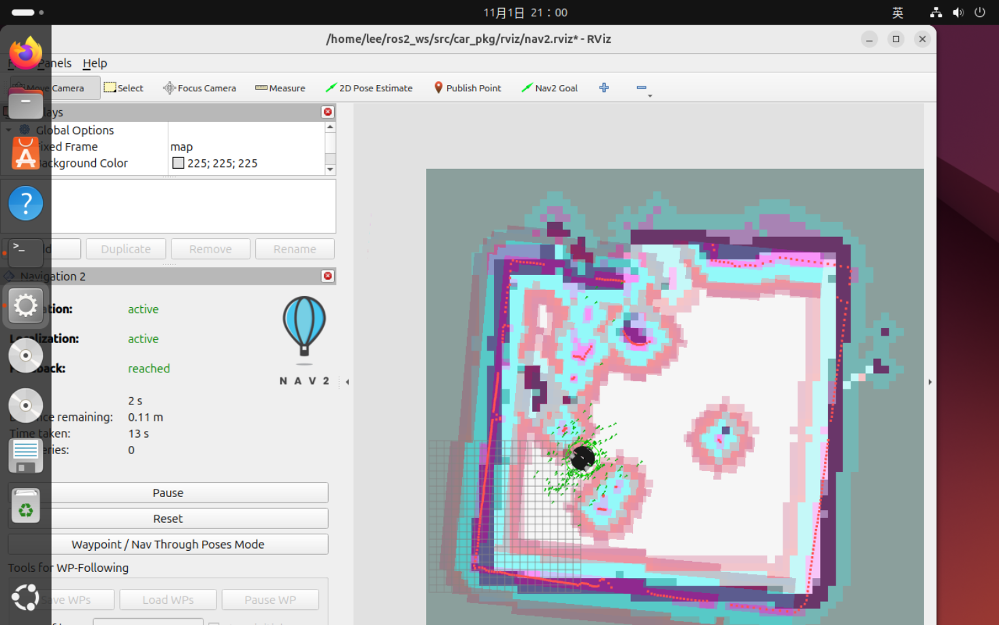

- **PS：可通过[12 快速启动](#12-快速启动)章节快速启动项目。**

### 0.2 系统架构

- 系统由虚拟机、香橙派和底层硬件三部分组成，虚拟机和香橙派通过ROS2网络通信，香橙派通过UART、SPI、GPIO和PWM连接传感器和执行器：

    ```text
    ┌──────────────────────────────────────────────┐
    │ 虚拟机 Ubuntu 24.04                          │
    │ key_node  Cartographer  Nav2  RViz           │
    │ /cmd_vel   /map  /scan  /tf                  │
    └──────────────────┬───────────────────────────┘
                       │ ROS2网络通信
    ┌──────────────────┴───────────────────────────┐
    │ 香橙派Zero 2W Ubuntu 24.04                   │
    │ cspc_lidar  imu_node  odom_node  ekf_node    │
    │ vel_node                                     │
    └──────────────────┬───────────────────────────┘
                       │ UART/SPI/GPIO/PWM
    ┌──────────────────┴───────────────────────────┐
    │ D6激光雷达  MPU6500  编码器  TB6612  电机    │
    └──────────────────────────────────────────────┘
    ```

- 虚拟机运行`key_node`、Cartographer、Nav2和RViz，负责建图、定位、规划、导航目标和可视化。

- 香橙派运行`cspc_lidar`、`imu_node`、`odom_node`、`ekf_node`和`vel_node`，负责激光雷达、IMU、轮式里程计、EKF融合和电机控制。

- 建图和导航共用同一条TF链：`map -> odom -> base_link -> laser_link`。建图时`map`到`odom`由Cartographer维护，导航时由AMCL维护。

### 0.3 软件配置

- 项目结构：

  ```
  orangepi-ros2-car/
  ├── README.md                         # 项目说明和完整教程
  ├── assets/                           # 教程图片和示意图
  ├── hardware/
  │   ├── 香橙派ROS2控制板-原理图.pdf      # 控制板原理图
  │   └── 香橙派Zero2W-原理图.pdf         # 主控板原理图
  ├── orangepi_ros2_ws/                 # 香橙派端代码和ARM交叉编译
  │   ├── README.md                     # 交叉编译说明
  │   ├── install.sh                    # 安装Docker/QEMU环境
  │   ├── build.sh                      # 选择全部或单个包编译
  │   ├── clean.sh                      # 清理构建产物
  │   ├── push.sh                       # 把install推送到ARM系统
  │   ├── docker/
  │   │   ├── Dockerfile                # ARM64 ROS2 Jazzy编译镜像
  │   │   └── entrypoint.sh
  │   ├── lib/common.sh                 # 公共shell函数
  │   └── src/
  │       ├── car_pkg/
  │       │   ├── car_pkg/
  │       │   │   ├── imu_node.py        # IMU采集节点
  │       │   │   ├── odom_node.py       # 轮式里程计节点
  │       │   │   └── vel_node.py        # PID电机控制节点
  │       │   ├── package.xml
  │       │   └── setup.py               # car_pkg安装配置
  │       ├── cspc_lidar_sdk_ros2/       # D6激光雷达ROS2 SDK
  │       ├── launch/car_start.launch.py # 香橙派底盘启动文件
  │       ├── robot_localization/        # EKF功能包
  │       └── yaml/ekf.yaml              # EKF融合参数
  └── vmware_ros2_ws/                    # 虚拟机端代码
      └── src/car_pkg/
          ├── car_pkg/key_node.py        # WASD遥控节点
          ├── launch/car_start.launch.py # 模型/建图/导航启动文件
          ├── urdf/
          │   ├── car_model.urdf         # 小车URDF模型
          │   └── base_plate.stl         # 底盘STL网格
          ├── config/
          │   ├── car_2d.lua             # Cartographer 2D配置
          │   ├── nav2_params.yaml       # Nav2参数
          │   └── ...                    # Cartographer官方Lua配置
          ├── rviz/
          │   ├── slam.rviz              # 建图RViz配置
          │   └── nav2.rviz              # 导航RViz配置
          ├── maps/
          │   ├── map1.yaml              # 地图元数据
          │   └── map1.pgm               # 栅格地图
          ├── package.xml
          └── setup.py                   # car_pkg安装配置
  ```

- 完整源码：香橙派端在`orangepi_ros2_ws/src`，虚拟机端在`vmware_ros2_ws/src`，克隆仓库即可查看和编译。
- 操作系统：虚拟机和香橙派都使用Ubuntu 24.04。
- ROS2版本：ROS2 Jazzy。
- 虚拟机软件：VMware Workstation，运行Ubuntu 24.04和RViz。
- 建图与导航：Cartographer负责2D激光SLAM，`nav2_bringup`负责定位、规划、控制和恢复行为。
- 底盘软件：`car_pkg`中的`imu_node`、`odom_node`和`vel_node`负责IMU采集、轮式里程计和电机控制，虚拟机的`key_node`负责键盘遥控，`ekf_node`来自`robot_localization`功能包。
- 交叉编译：`orangepi_ros2_ws`中的脚本使用Docker和QEMU在x86_64电脑上编译ARM64程序，再推送到香橙派。
- 模型与地图：URDF模型、Cartographer配置、Nav2参数和`map1.yaml`地图都放在虚拟机的`car_pkg`中，编译后随功能包安装。

- 软件配置层次：

  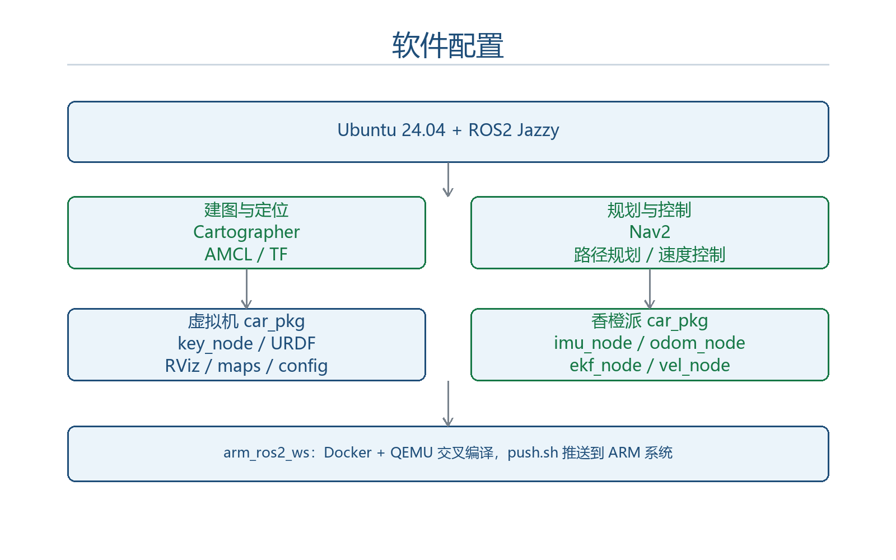

### 0.4 硬件参数

- 主控板：Orange Pi Zero 2W，1GB内存，运行Ubuntu 24.04。
- 激光雷达：国科光芯COIN-D6，5V供电，UART接口`/dev/ttyS5`，波特率230400，扫描频率10Hz，360°扫描，测量范围0.05m到12m。
- 姿态传感器：MPU6500六轴陀螺仪，SPI1接口，CS0。
- 电机与驱动：MC310直流减速电机两只，TB6612双路电机驱动，支持PWM调速和正反转。
- 编码器：每只电机13PPR，A/B两相4倍频，减速比20，轮子转一圈计数为1040。
- 底盘参数：轮胎直径48mm，轮半径24mm，轮距122mm，底盘外形约160×160mm，万向轮半径21mm，前后轮中心距78mm。
- 激光雷达尺寸约52.7×45.2×34.4mm，安装高度约24mm。
- 人机交互：控制板集成OLED、按键、LED和蜂鸣器，OLED显示IP地址、CPU温度、内存占用率和电池电量。

- 小车实物：

  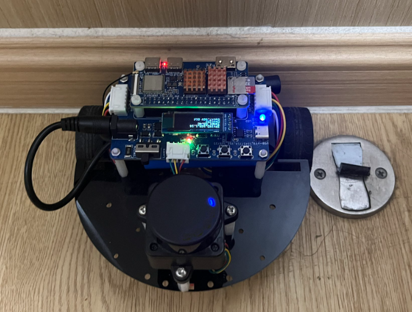

## 1 开发前准备

### 1.1 BOM清单购买

#### 1.1.1 BOM清单表

  | 名称 | 成本 |
  | --- | --- |
  | Orange Pi Zero 2W(1GB) | ￥205x1=￥205 |
  | Orange Pi Zero 2W散热片 | ￥5x1=￥5 |
  | 国科光芯COIN-D6激光雷达 | ￥216x1=￥216 |
  | 激光雷达转接线 | ￥0.32x1=￥0.32 |
  | 电机转接线 | ￥0.55x2=￥1.1 |
  | MC310直流减速电机 | ￥28x2=￥56 |
  | 48mm橡胶轮胎 | ￥1.8x2=￥3.6 |
  | MC310电机U型电机支架 | ￥7.9x1=￥7.9 |
  | 万向轮 | ￥4.8x1=￥4.8 |
  | 电池 | ￥34.99x1=￥34.99 |
  | 电池胶带 | ￥5.8x1=￥5.8 |
  | SD卡和读卡器(推荐32G及以上) | ￥94.9x1=￥94.9 |
  | 尼龙柱 | ￥4.8x1+￥5.9x1+￥4.9x1=￥15.6 |
  | 尼龙螺丝 | ￥5.8x1+￥5.5x1+￥5.7x1=￥17 |
  | 小车底盘 | ￥14.99x1=￥14.99 |
  | Orange Pi Zero 2W ROS2主控板 | ￥149x1=￥149 |
  | **总成本** | **￥832** |

#### 1.1.2 购买链接

- [Orange Pi Zero 2W(1GB)](https://item.taobao.com/item.htm?id=1011654553019&mi_id=00005t6I71Lt9gkNFDET2z2fpcIS1Cba_ucAOIJHcRnOXsg&spm=tbpc.boughtlist.suborder_itemtitle.1.6f792e8d5Iy1ku&skuId=6238197766726)：￥205x1=￥205
  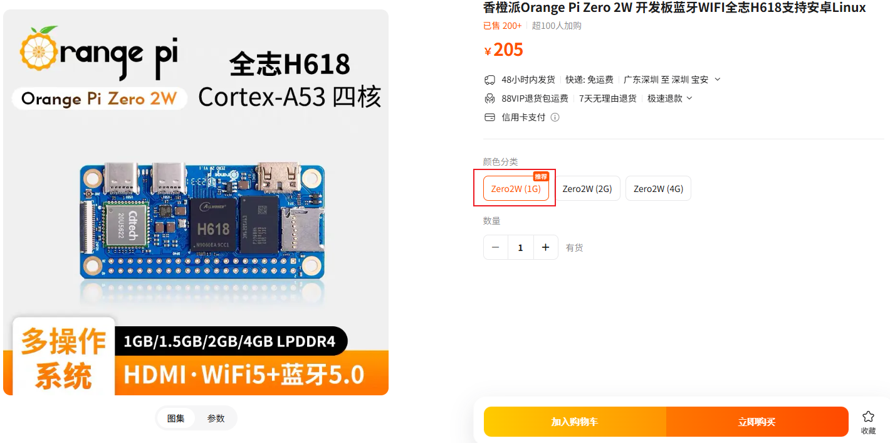

- [Orange Pi Zero 2W散热片](https://item.taobao.com/item.htm?id=744639076965&mi_id=0000So0ogVXO0eTJmcy56HufHpcuWSQhy7KfP1eXo65XrME&spm=tbpc.boughtlist.suborder_itemtitle.1.6f792e8d5Iy1ku&skuId=5309943019978)：￥5x1=￥5

  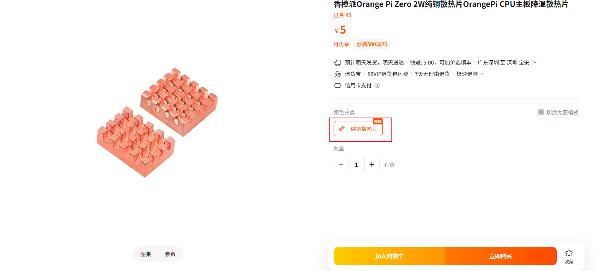

- [国科光芯COIN-D6激光雷达](https://item.taobao.com/item.htm?id=984744613845&mi_id=0000ffB79OQky0VAbWCeMSennRHCnFNJksngjJWxR0YOQs0&spm=tbpc.boughtlist.suborder_itemtitle.1.6f792e8d5Iy1ku&skuId=5946651677583)：￥216x1=￥216

  

- [激光雷达转接线](https://item.taobao.com/item.htm?id=710611571624&mi_id=0000ekshRV6bB9QW20Nuxwwe7k5sIq3C3-bOJ2Xd0OITKAk&spm=tbpc.boughtlist.suborder_itemtitle.1.6f792e8d5Iy1ku&skuId=5150599662940)：￥0.32x1=￥0.32

  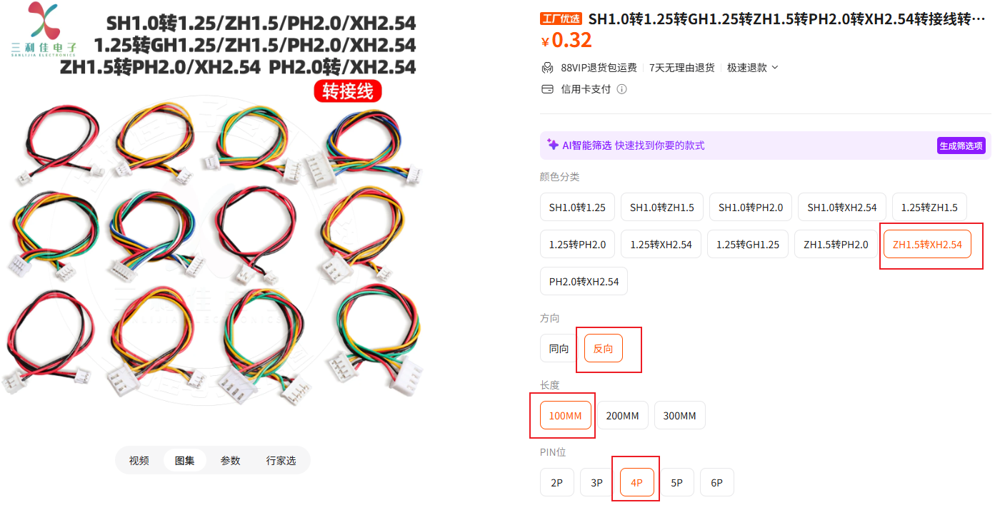

- [电机转接线](https://item.taobao.com/item.htm?id=710611571624&mi_id=0000ekshRV6bB9QW20Nuxwwe7k5sIq3C3-bOJ2Xd0OITKAk&spm=tbpc.boughtlist.suborder_itemtitle.1.6f792e8d5Iy1ku&skuId=5150599662940)：￥0.55x2=￥1.1

  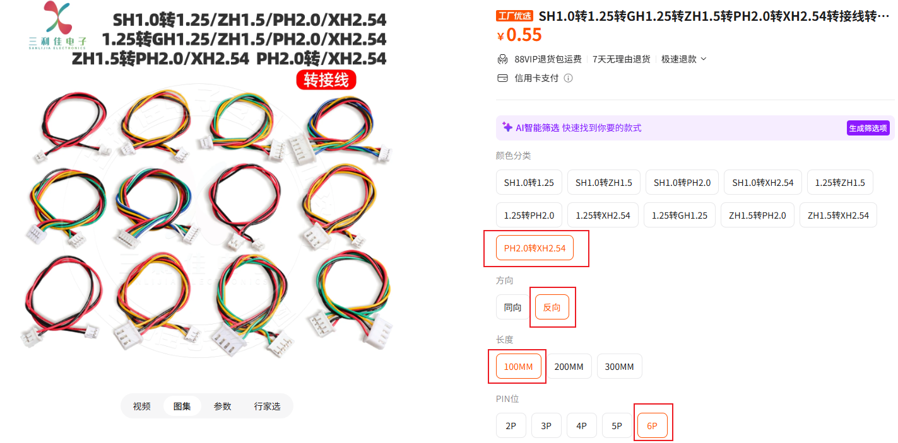

- [MC310直流减速电机](https://detail.tmall.com/item.htm?id=836294707608&mi_id=0000Vud9hhBa5gjduPHKGYtkc5FwhLvhOYzz0tY9Bn4f140&skuId=5593057680397&spm=tbpc.boughtlist.suborder_itemtitle.1.6f792e8d5Iy1ku)：￥28x2=￥56

  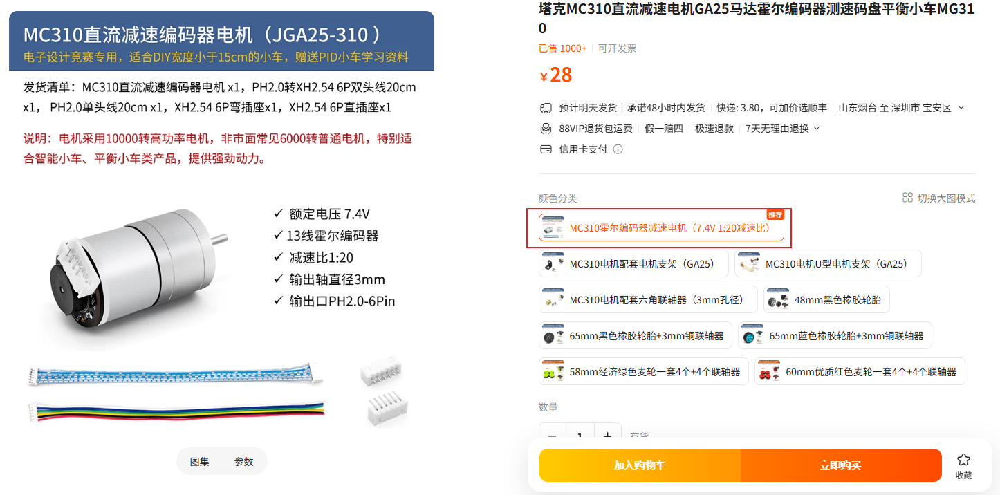

- [48mm橡胶轮胎](https://detail.tmall.com/item.htm?id=836294707608&mi_id=0000Vud9hhBa5gjduPHKGYtkc5FwhLvhOYzz0tY9Bn4f140&skuId=5593057680401&spm=tbpc.boughtlist.suborder_itemtitle.1.6f792e8d5Iy1ku)：￥1.8x2=￥3.6

  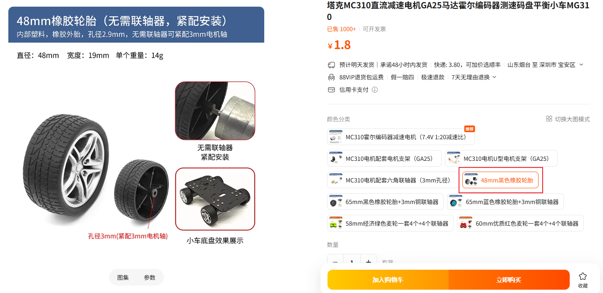

- [MC310电机U型电机支架](https://detail.tmall.com/item.htm?id=836294707608&mi_id=0000Vud9hhBa5gjduPHKGYtkc5FwhLvhOYzz0tY9Bn4f140&spm=tbpc.boughtlist.suborder_itemtitle.1.6f792e8d5Iy1ku&skuId=5593057680399)：￥7.9x1=￥7.9

  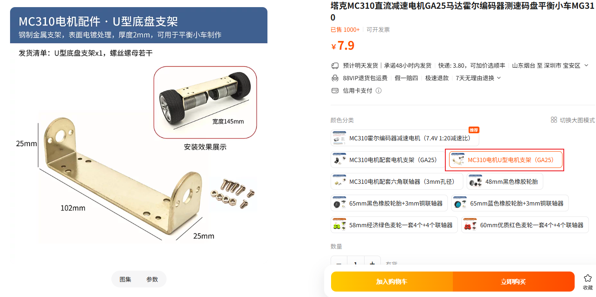

- [万向轮](https://detail.tmall.com/item.htm?id=848950170228&mi_id=0000wc3FnqXUfrO5oKF3EyPGh9aVD5evU5oPqNh5QMdTsaI&skuId=5637095556269&spm=tbpc.boughtlist.suborder_itemtitle.1.6f792e8d5Iy1ku)：￥4.8x1=￥4.8

  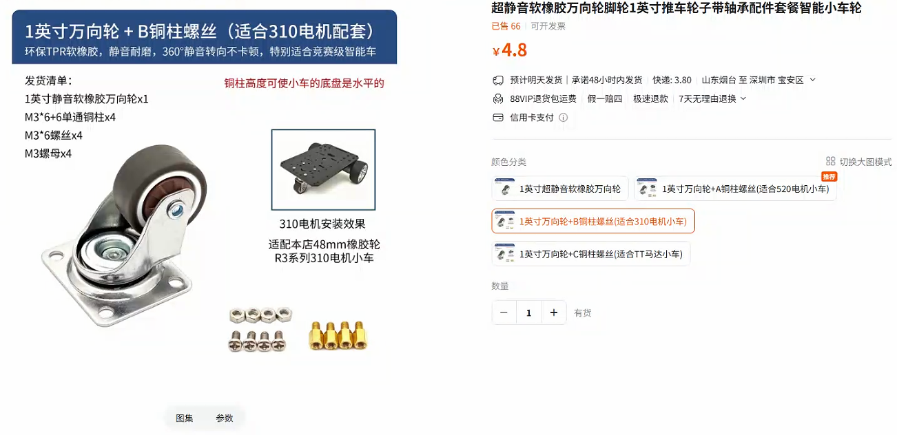

- [电池](https://item.taobao.com/item.htm?id=752200206479&mi_id=0000ievjjlYFDOqwgELtfAj5tsja3z7FaDVCSXQ78X5EKqo&spm=tbpc.boughtlist.suborder_itemtitle.1.6f792e8d5Iy1ku)：￥34.99x1=￥34.99

  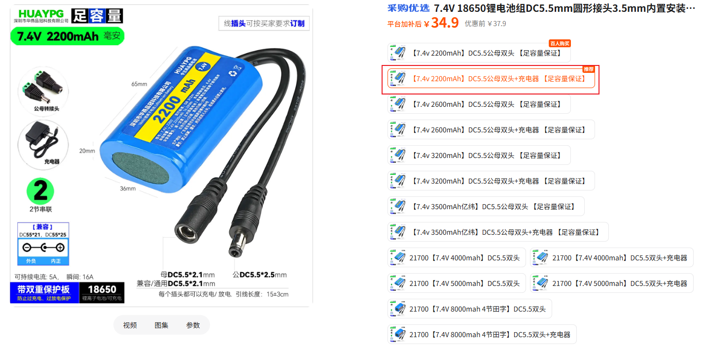

- [电池胶带](https://detail.tmall.com/item.htm?ali_refid=a3_430582_1006%3A1685026726%3AH%3A46zkPrcUBtj61eRX7H0PKEEflCmrn7J6%3Ac9b9f60db974779e0dccb5bbe378d3f0&ali_trackid=282_c9b9f60db974779e0dccb5bbe378d3f0&id=898935137339&mi_id=00007_kPg6tpKgbb3ZI1U3Vgdkyxc4aAEnKxeMwX-T5S57w&mm_sceneid=1_0_5050663976_0_0&priceTId=214783fb17922210801787230e1773&skuId=5752325384094&spm=a21n57.1.hoverItem.1&utparam={"aplus_abtest"%3A"677be7d18186d9157c449f80032dcf9f"}&xxc=ad_ztc)：￥5.8x1=￥5.8

  

- [SD卡和读卡器(推荐32G及以上)](https://detail.tmall.com/item.htm?ali_refid=a3_430582_1006%3A1110652113%3AH%3AcIdOVrRSCZcnGtMDSHfHa4eofzh3LajX%3A8fae738e091a1b14daf2972e988f83be&ali_trackid=282_8fae738e091a1b14daf2972e988f83be&id=44499258098&mi_id=0000PnXpKdRHGaEAtIyfw1o11RjRiexEmuF9frjLmgedrcM&mm_sceneid=1_0_109574910_0_0&priceTId=2147843217922218961554526e1046&skuId=6031425129581&spm=a21n57.1.hoverItem.1&utparam={"aplus_abtest"%3A"fe478bc80ea3e40a85ed3f1bbde533a6"}&xxc=ad_ztc)：￥94.9x1=￥94.9

  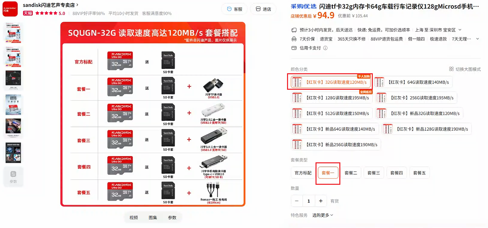

- [尼龙柱](https://detail.tmall.com/item.htm?from=cart&id=617577281395&mi_id=0000L14IRTFOLgSWUUtfKtsXfRQI-bQrV9DFMqQ_vY7N-NQ&skuId=6127935684911&spm=a1z0d.6639537%2F202410.item.d617577281395.2e097484YOgO42&upStreamPrice=259&xxc=shop)：￥4.8x1+￥5.9x1+￥4.9x1=￥15.6

  

- [尼龙螺丝](https://detail.tmall.com/item.htm?from=cart&id=618802171109&mi_id=0000N0MKOaerS__0FSkcekpiXr2BcPDQ56xzF1aEHHKzkF0&skuId=6292868931200&spm=a1z0d.6639537%2F202410.item.d618802171109.2e097484YOgO42&upStreamPrice=349&xxc=shop)：￥5.8x1+￥5.5x1+￥5.7x1=￥17

  

- [小车底盘]()：￥14.99x1=￥14.99

- [Orange Pi Zero 2W ROS2主控板]()：￥149x1=￥149

### 1.2 小车组装

#### 1.2.1 底盘组装

#### 1.2.2 香橙派组装

#### 1.2.3 激光雷达组装

### 1.3 资料下载

#### 1.3.1 香橙派官方资料

- 进入香橙派官方的Orange Pi Zero 2W资料网站：[Orange Pi Zero 2W](http://www.orangepi.cn/html/hardWare/computerAndMicrocontrollers/service-and-support/Orange-Pi-Zero-2W.html)
- 下载官方工具：
  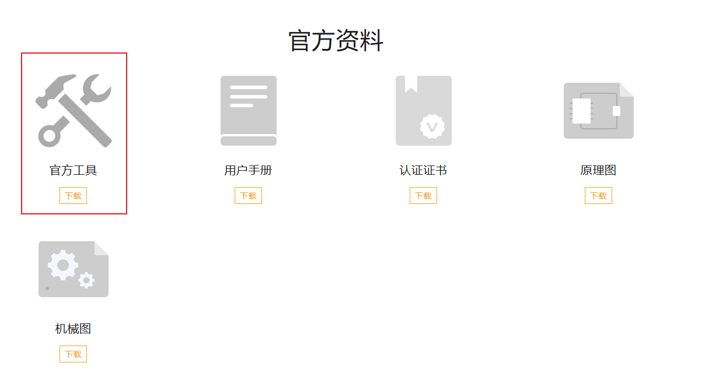

- 下载以下工具：

  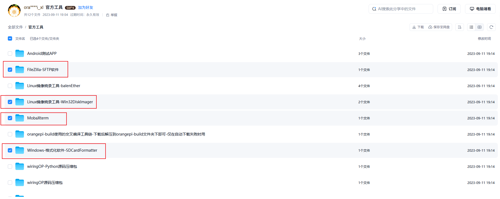

- 下载官方用户手册：

  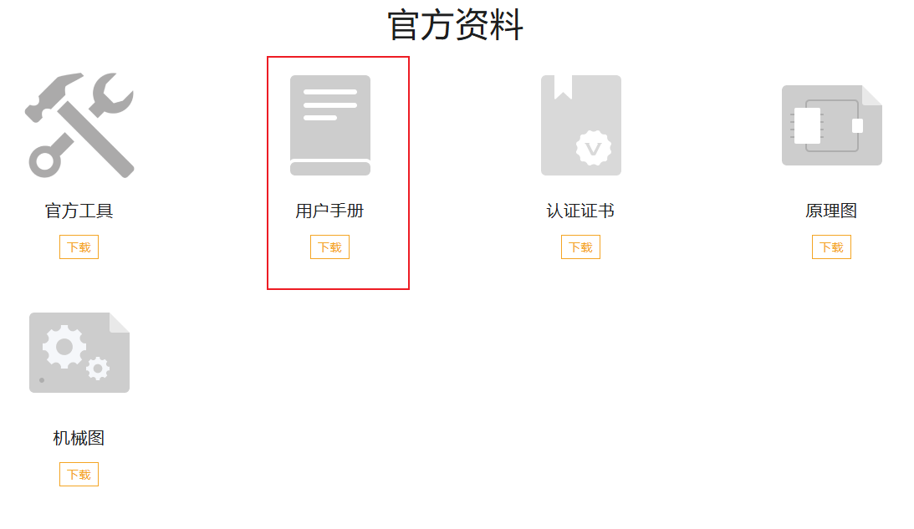

- 下载官方Ubuntu镜像：

  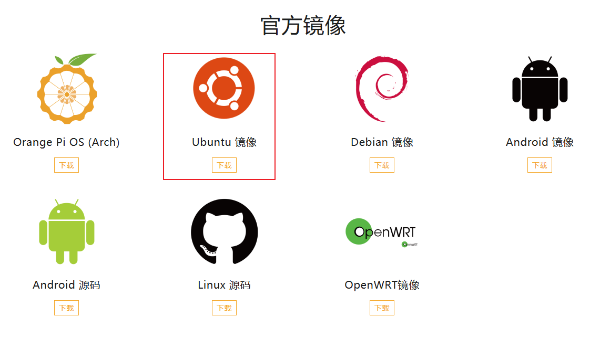

- 下载Ubuntu24.04(noble)镜像：

  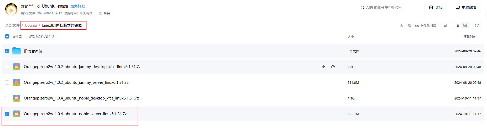

#### 1.3.2 其他资料

- 百度网盘地址：

  ```
  通过网盘分享的文件：香橙派ROS2自动定位与导航小车开发教程
  链接: https://pan.baidu.com/s/15xUv4k3La5zG6XjeU-Ex0w?pwd=77vw 提取码: 77vw 
  --来自百度网盘超级会员v7的分享
  ```

- 文档配套资料中提供了开发过程中需要的工具软件、ROS2控制板原理图等资料，也包括香橙派官方资料(但可能不是最新的，可以参照上一步骤下载)：

  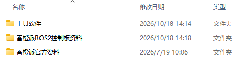

## 2 开发环境搭建

### 2.1 香橙派烧写与配置

#### 2.1.1 烧写Ubuntu镜像到香橙派

- 将**SD卡**插入**读卡器**并连接电脑。

- 解压`资料\香橙派官方资料\官方工具\Windows-格式化软件-SDCardFormatter\SDCardFormatterv5_WinEN.zip`，进入解压得到的`SDCardFormatterv5_WinEN`文件夹，双击`SD Card Formatter 5.0.2 Setup EN.exe`，按照提示安装**SD Card Formatter**。

- 打开**SD Card Formatter**，在`Select card`下拉框中选择SD卡对应的盘符(例如`F:\`)。如果电脑只插入了SD卡，软件会自动显示盘符；如果插入了多个USB存储设备，请在下拉框中手动选择，点击`Refresh`可以刷新盘符列表：

    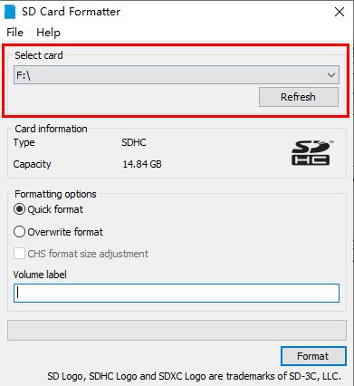

- 点击`Format`，在弹出的警告框中点击`是(Y)`，等待格式化完成。格式化会清空SD卡中的所有数据，请提前备份。

- 格式化完成后会弹出`Formatting was successfully completed.`提示框，点击`确定`：

    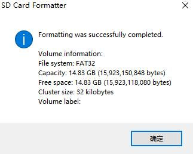

- 安装**Win32DiskImager**：双击`资料\香橙派官方资料\官方工具\Linux镜像烧录工具-Win32DiskImager\win32diskimager-1.0.0-install.exe`，按照提示安装：

    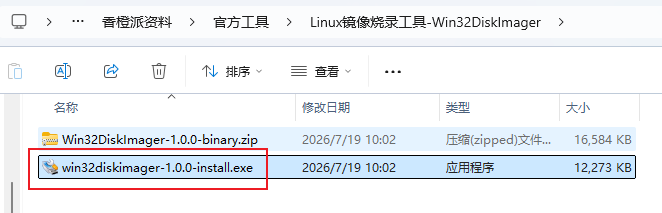

- 解压`资料\香橙派官方资料\镜像\Ubuntu\Orangepizero2w_1.0.4_ubuntu_noble_server_linux6.1.31.7z`，得到`Orangepizero2w_1.0.4_ubuntu_noble_server_linux6.1.31.img`镜像文件和同目录下的校验文件`Orangepizero2w_1.0.4_ubuntu_noble_server_linux6.1.31.img.sha`，烧写时选择其中的`.img`文件：

    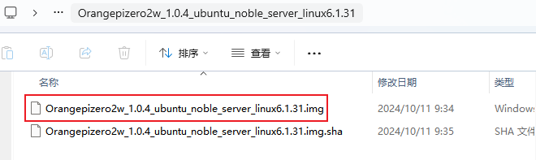

- 打开**Win32DiskImager**，在`映像文件`一栏点击右侧的文件夹图标，选择解压得到的`.img`镜像文件。

- 在`设备`一栏选择SD卡对应的盘符，确认盘符与SD卡一致(**注意不要选错，否则会清空所选磁盘的数据**)：

    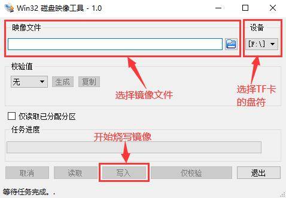

- 点击`写入`，在弹出的确认框中点击`是`，等待`任务进度`走完。镜像较大，写入过程可能需要几分钟：

    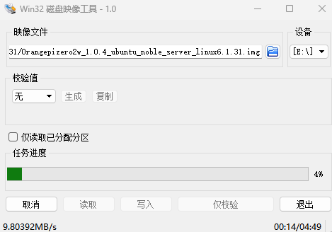

- 写入完成后点击`退出`。如果Windows弹出“需要格式化磁盘”的提示，点击`取消`，不要格式化，否则会清空刚写入的系统镜像。

- 拔出SD卡并插入香橙派的TF卡槽：

    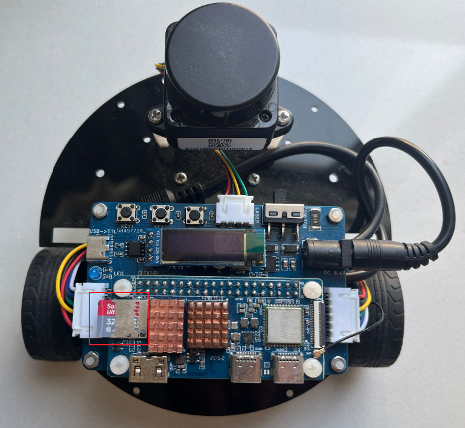

#### 2.1.2 启动并连接香橙派

- 将**TypeC数据线(要确保是数据线)**连接到控制板上的TypeC口(供电+USB转串口)，另一端连接电脑的USB口，连接后可以看到控制板和香橙派上的电源指示灯都亮起：
  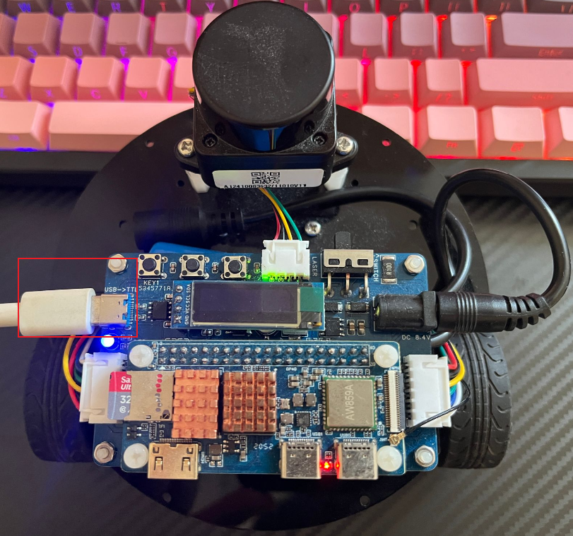

- 打开设备管理器，可以在端口中看到CH340的串口号：

  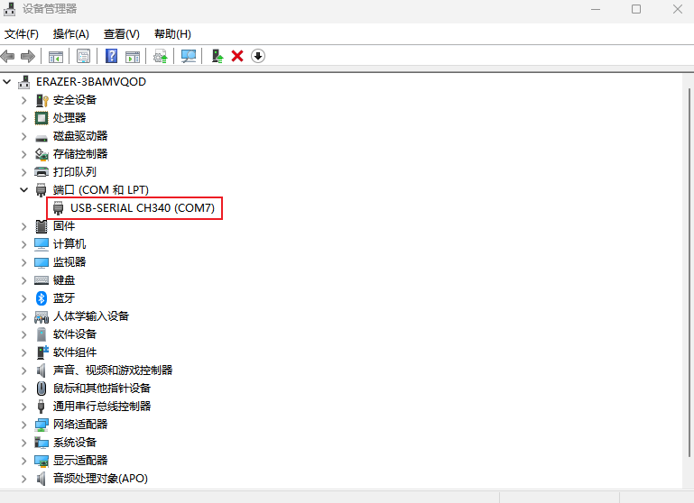

- 如果没有看到串口号，并且在其他设备中看到了USB Serial(旁边有感叹号)，则说明驱动没有安装：

  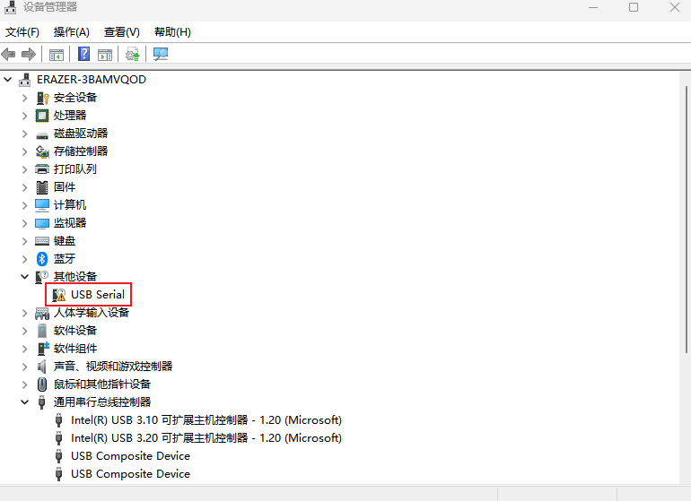

- 双击`资料\工具软件\CH341SER\CH341SER.EXE`，点击`安装`，再拔插一下**TypeC数据线**即可：

  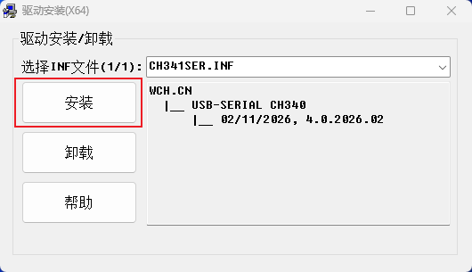

- 解压`资料\香橙派官方资料\官方工具\MobaXterm\MobaXterm_Portable_v22.2.zip`，双击解压得到的`MobaXterm_Personal_22.2.exe`(无需安装)，打开**MobaXterm**：

  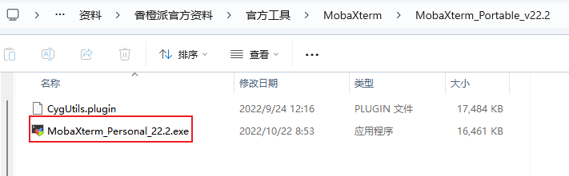

- 点击左上角的`Session`，在`Session settings`窗口中选择`Serial`，在`Serial port`下拉框中选择设备管理器中看到的CH340串口(例如`USB-SERIAL CH340 (COM7)`，图中COM口仅为示例)，将`Speed (bps)`设置为`115200`，点击`OK`：

  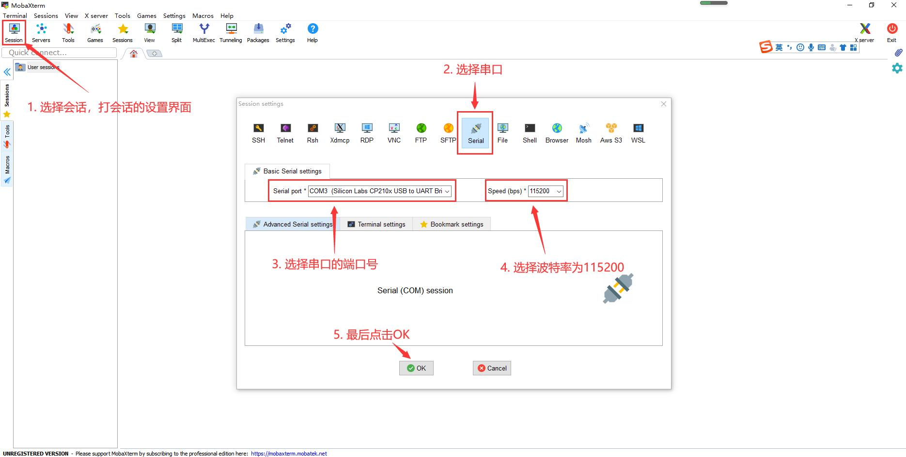

- 在串口终端中按一次回车键，如果能看到香橙派的启动打印信息或`orangepi login:`登录提示符，**说明系统烧写成功，香橙派已经启动并连接成功**：

  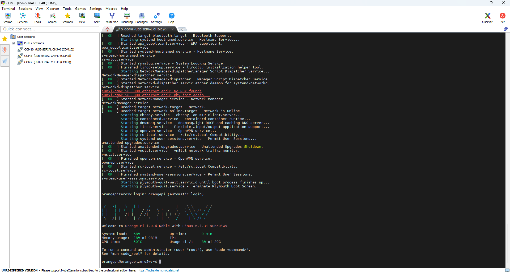

- 如果出现`orangepi login:`提示，输入用户名`orangepi`，按回车；再输入密码`orangepi`(输入密码时屏幕不会显示字符)，按回车登录。

- 如果按回车后没有任何输出，请检查TypeC线是否支持数据传输、`Serial port`是否选择了CH340对应的COM口、`Speed (bps)`是否为`115200`。

#### 2.1.3 连接WiFi网络

- 登录香橙派后，在MobaXterm串口终端中输入以下命令扫描周围的WiFi热点(扫描完成后Ctrl+C退出)：

    ```
    nmcli dev wifi
    ```

- 在扫描结果中找到要连接的WiFi名称，输入以下命令连接WiFi(将`WiFi名称`和`WiFi密码`替换为实际值)：

    ```
    sudo nmcli dev wifi connect "WiFi名称" password "WiFi密码"
    ```

    > [!CAUTION]
    >
    > 连接的WiFi网络必须和电脑是同一个WiFi网络。

- 第一次执行`sudo`命令时会提示输入密码，输入`orangepi`并按回车即可(输入时屏幕不会显示字符)：

    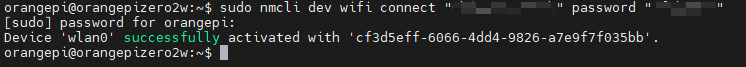

- 连接成功后，输入以下命令查看`wlan0`的IP地址：

    ```
    ip a s wlan0 
    ```

- 输出中`inet`后面的IPv4地址就是香橙派的**WiFi IP地址**，例如`192.168.x.xx`：

    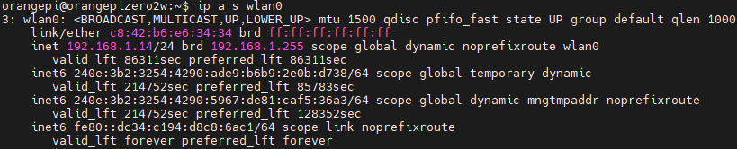

- 输入以下命令测试WiFi网络连通性：

    ```
    ping www.orangepi.org -I wlan0
    ```

- 能看到`64 bytes from`开头的回复说明网络已经连通，按`Ctrl+C`停止：

    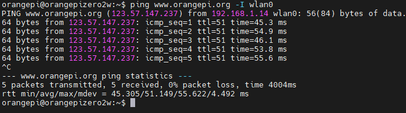

- 最后更新软件包列表并升级系统：

    ```
    sudo apt update && sudo apt upgrade
    ```

- 升级过程可能需要几分钟，如果提示`Do you want to continue? [Y/n]`，输入`Y`并按回车：

    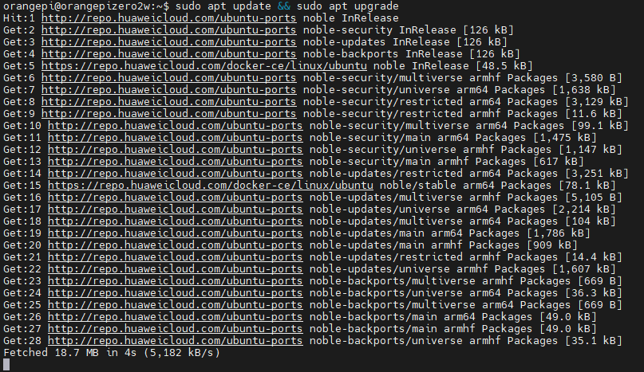

- 如果出现这个界面，则选择第一个(键盘↑↓选择)，然后按回车：

  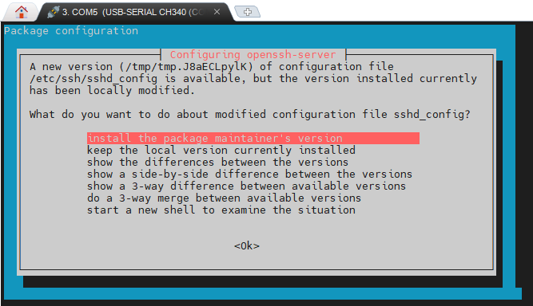

- 升级完成后可使用`sudo shutdown now`关机或使用`sudo reboot now`重启：

  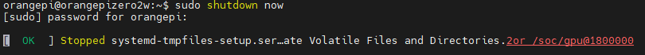

- 尽量不要直接拔掉电源来关机，很容易导致数据丢失，正确步骤是使用命令关机，然后再拔掉电源。

#### 2.1.4 安装人机交互脚本

- 香橙派ROS2控制板上集成了OLED、按键、LED和蜂鸣器，用于人机交互：OLED可以查看香橙派的IP地址、CPU温度、内存占用率和电池电量，按键可以关机/重启，LED和蜂鸣器用于状态提示。

- 人机交互脚本使用的外设：OLED(显示)、INA219(采集电池电量)、LED(提示)、按键(交互)和蜂鸣器(提示)，引脚定义可以查看`资料\香橙派ROS2控制板资料\原理图.pdf`：

    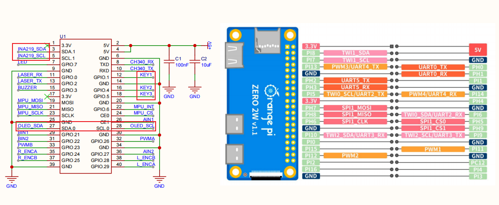

- OLED接在i2c2总线上，INA219接在i2c1总线上，LED接在pwm3上，因此需要在`orangepi-config`中打开i2c1、i2c2和pwm3。

- 启动香橙派，连接串口终端，输入以下命令打开香橙派配置工具：

    ```
    sudo orangepi-config
    ```

- 选择`System`，按回车：

    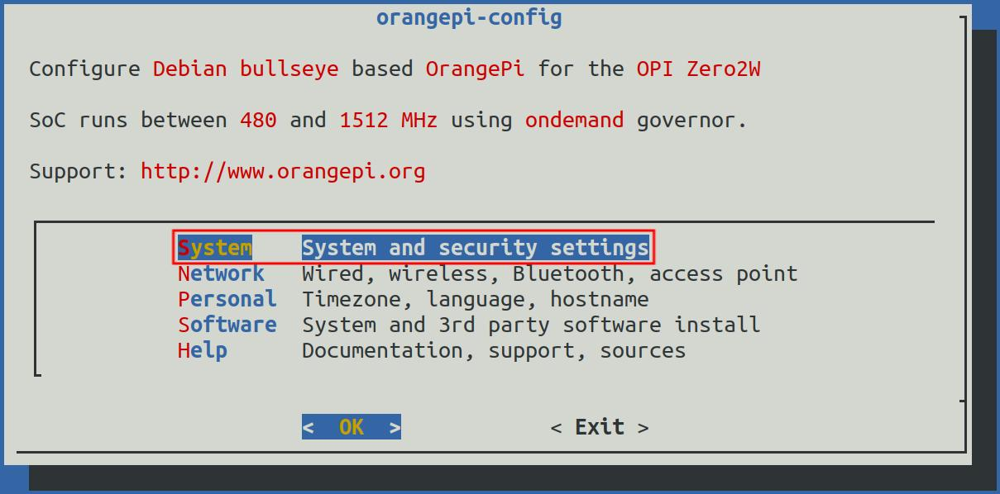

- 选择`Hardware`，按回车：

    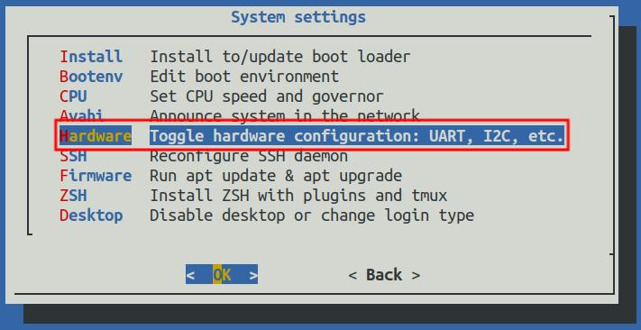

- 使用方向键定位到`pi-i2c1`和`pi-i2c2`(对应40pin的i2c1和i2c2)，分别按空格键选中：

    

- 再定位到`pi-pwm3`(对应40pin的PWM3)，按空格键选中：

    

- 注意只打开`pi-i2c1`、`pi-i2c2`和`pi-pwm3`，不要打开`pi-i2c0`或`pi-pwm4`，否则会占用蜂鸣器和KEY2的引脚。

- 选择`Save`保存，选择`Back`返回，再选择`Reboot`重启香橙派使配置生效：

    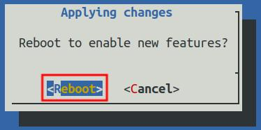

- 重启后输入以下命令确认I2C设备节点已经生成：

    ```
    ls /dev/i2c-*
    ```

- 正常可以看到`/dev/i2c-2`和`/dev/i2c-3`，分别对应INA219和OLED：

    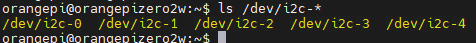

- 输入以下命令安装i2c-tools并检测设备地址：

    ```
    sudo apt update
    sudo apt install -y i2c-tools
    sudo i2cdetect -y 2
    sudo i2cdetect -y 3
    ```

- `i2cdetect -y 2`应能看到地址`0x42`(INA219)，`i2cdetect -y 3`应能看到地址`0x3C`(OLED)：

    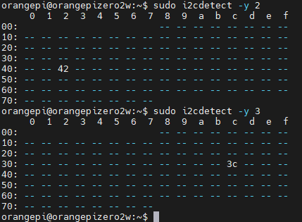

- 克隆`orangepi-oled-monitor`仓库：

    ```
    cd ~
    git clone https://github.com/Lee-Stone/orangepi-oled-monitor.git
    cd orangepi-oled-monitor
    ```

- 编译并前台运行，确认OLED显示正常：

    ```
    make
    sudo ./main
    ```

- OLED会显示IP地址、CPU温度、内存占用率和电池电压/电量，LED会以2秒周期呼吸。确认正常后按`Ctrl+C`退出：

    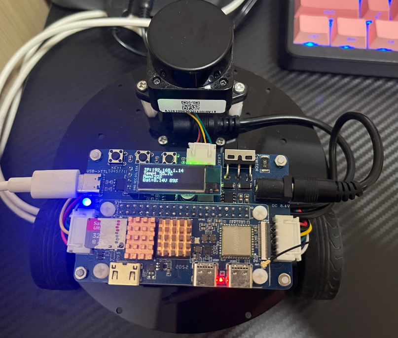

- 安装为开机自启服务：

    ```
    sudo bash install.sh -enable
    ```

- 脚本会自动编译、创建`oled-monitor`服务并启动：

    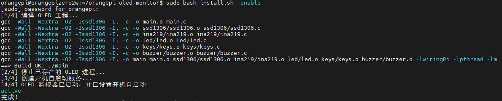

- 按键功能：`KEY1`确认关机(3秒内再按一次执行关机)，`KEY2`确认重启(3秒内再按一次执行重启)，`KEY3`返回状态监视。

- 电量报警功能：电量低于20%时，蜂鸣器会每隔10秒响三声；电量恢复后自动停止。

- 如果需要停止并卸载开机自启服务：

    ```
    sudo bash install.sh -disable
    ```

### 2.2 虚拟机安装与配置

#### 2.2.1 新建Ubuntu虚拟机

- 双击`资料\工具软件\VMware\VMware-workstation-full-17.5.0-22583795.exe`，打开VMware安装向导：

  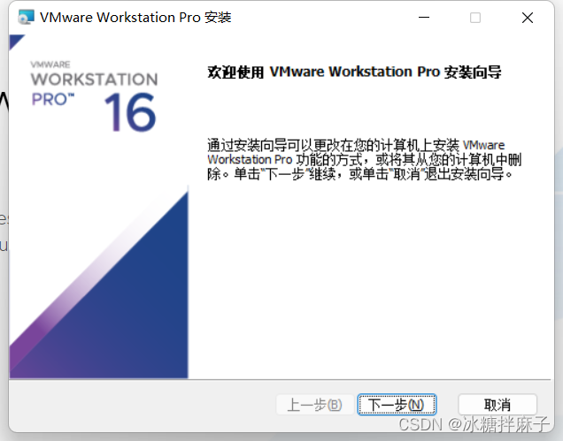

- 点击`下一步`，勾选`我接受许可协议中的条款`，点击`下一步`。

- 点击`更改...`选择VMware的安装位置(建议不要安装在C盘)，点击`下一步`：

  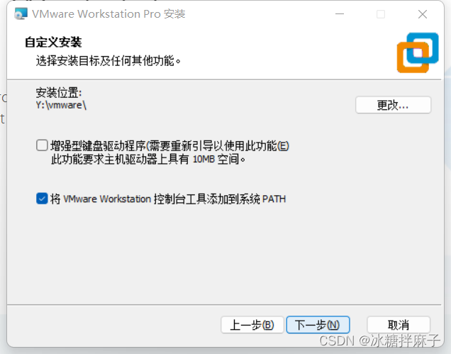

- 其余选项保持默认，按照向导继续点击`下一步`，最后点击`安装`，等待安装完成后点击`完成`。

- 下载**Ubuntu24.04**镜像：[Ubuntu24.04](https://mirrors.ustc.edu.cn/ubuntu-releases/24.04/)，选择`ubuntu-24.04.4-desktop-amd64.iso`桌面版镜像下载：

  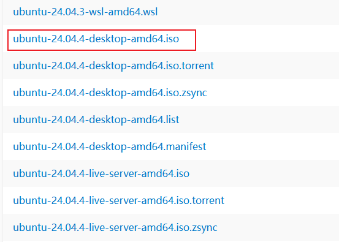

  

- 打开VMware Workstation，点击`创建新的虚拟机`，打开新建虚拟机向导：

  

- 选择`自定义(高级)`，点击`下一步`：

  

- 硬件兼容性保持默认，点击`下一步`：

  

- 选择`稍后安装操作系统`，点击`下一步`：

  

- 客户机操作系统选择`Linux`，版本选择`Ubuntu 64位`，点击`下一步`：

  

- 填写虚拟机名称`Ubuntu24.04`，点击`浏览...`选择安装位置(建议不要放在C盘)，点击`下一步`：

  

- 根据电脑配置设置处理器数量，点击`下一步`：

  

- 设置虚拟机内存大小(建议`8GB`)，点击`下一步`：

  

- 网络类型保持默认`使用网络地址转换(NAT)`，点击`下一步`：

  

- 控制器类型保持默认，点击`下一步`：

  

- 磁盘类型保持默认，点击`下一步`：

  

- 选择`创建新虚拟磁盘`，点击`下一步`：

  

- 最大磁盘大小设置为`40GB`，选择`将虚拟磁盘拆分成多个文件`，点击`下一步`：

  

- 磁盘文件保持默认，点击`下一步`：

  

- 查看虚拟机配置摘要，点击`完成`：

  

- 点击`编辑虚拟机设置`，选择`CD/DVD (SATA)`，选择`使用ISO映像文件`，点击`浏览...`选择下载的Ubuntu镜像，勾选`启动时连接`，点击`确定`：

  

#### 2.2.2 启动并配置虚拟机

- 点击`开启此虚拟机`，选择第一个启动项，等待进入Ubuntu安装界面：

  

- 安装VMware Tools，点击`虚拟机` -> `安装VMware Tools`：

  

- 语言选择`中文(简体)`，点击`下一步`：

  

- 可访问性设置保持默认，点击`下一步`：

  

- 键盘布局选择`Chinese`或`汉语`，点击`继续`或`下一步`：

  

  

- 网络连接选择`有线连接`，点击`下一步`：

  

- 选择`安装Ubuntu`，点击`下一步`：

  

- 选择`交互安装`，点击`下一步`：

  

- 选择`默认集合`，点击`下一步`：

  

- 应用选择保持默认，点击`下一步`：

  

- 选择`擦除磁盘并安装Ubuntu`，点击`下一步`(注意不要选错磁盘)：

  

- 设置姓名、用户名和密码(记住密码，登录和`sudo`都会用到)，点击`下一步`：

  

- 时区选择`Shanghai`，点击`下一步`：

  

- 查看安装摘要，点击`安装`：

  

- 等待安装完成，安装时间与电脑性能和网速有关：

  

- 安装完成后点击`立即重启`：

  

- 重启后在桌面按一次回车，进入Ubuntu桌面，并将虚拟机的`CD/DVD`切换回`自动检测`：

  

- 关闭虚拟机，退出VMware，右键选择`以管理员身份运行`。
- 点击新建的`Ubuntu24.04`虚拟机 -> `编辑虚拟机设置` -> `网络适配器` -> 将网络连接设置为`桥接模式` -> `确定`：

  

- 点击`编辑` -> `虚拟网络编辑器`，将`桥接模式`的外部网络设置为`WiFi`，点击`应用`和`确定`：

  

#### 2.2.3 更换系统网络源

- 启动`Ubuntu24.04`虚拟机，按`Ctrl+Alt+T`**打开命令终端输入命令**：

  

- 安装VMWare Tools：

    ```
    sudo apt-get install open-vm-tools -y
    sudo apt-get install open-vm-tools-desktop -y
    ```

- 安装完成后，更换系统源(鱼香ROS开源的一键安装工具)：

    ```
    wget http://fishros.com/install -O fishros && . fishros
    ```

- 输入密码后选择`[5]一键配置:系统源`：

  

- 然后选择`[2]:更换系统源并清理第三方源`：

  

- 接着选择`[1]:自动测速选择最快的源`：

    

- 完成后选择`[2]:不添加ROS/ROS2源`：

    

- 最后更新软件包列表并升级系统：
    ```
    sudo apt update && sudo apt upgrade
    ```

- 升级过程可能需要几分钟，如果提示`您希望继续执行吗? [Y/n]`，输入`Y`并按回车：

  

#### 2.2.4 安装并配置VSCode

- 启动`Ubuntu24.04`虚拟机，打开浏览器进入[VSCode官网](https://code.visualstudio.com/)：

  

- 点击`Download for linux(.deb)`下载VSCode安装包：

  

- 下载完成后，双击安装包即可跳转到应用中心安装：

  

- 打开VSCode，在左侧Extensions中搜索安装必要的插件：Chinese(中文包，安装完需重启)、Remote-SSH(远程连接香橙派的工具)、C/C++ Extension Pack(提供代码高亮、智能提示等功能)

  

#### 2.2.5 远程连接香橙派

- 启动香橙派，在串口终端中输入`ifconfig`来获取**香橙派的IP地址**：

  

- 在虚拟机中打开**Remote-SSH**扩展，点击`+`新建远程连接：

  

- 在弹出来的输入框中输入`ssh orangepi@香橙派的ip地址`，回车确认：

  

- 点击`->`在当前窗口中远程连接香橙派：

  

- 弹出来是否确认连接的提示，回车确认，然后输入香橙派的密码`orangepi`，再回车确认：

  

- 等待连接成功后，就可以远程操控香橙派，远程传输文件、读写文件、操作终端等等：

  

### 2.3 ROS2安装与配置

#### 2.3.1 虚拟机安装ROS2

- 启动`Ubuntu24.04`虚拟机，按`Ctrl+Alt+T`**打开命令终端输入命令**：

  

- 使用鱼香ROS开源的ROS一键安装工具：

  ```
  wget http://fishros.com/install -O fishros && . fishros 
  ```

- 选择 `[1]:一键安装:ROS `：
  

- 然后选择换源 `[2]:不更换系统源继续安装`：
  

- 然后选择 ROS镜像源`[1]:中科大镜像源`：
  

- 接着选择安装 `[1]:Jazzy(ROS2)` 并选择 `桌面版`：
  ​

- 安装完成后在终端输入 `ros2` 验证是否安装成功：

  

#### 2.3.2 香橙派安装ROS2

- 启动香橙派，连接串口终端，同样输入鱼香ROS开源的ROS一键安装命令：

  ```
  wget http://fishros.com/install -O fishros && . fishros 
  ```

- 选择 `[1]:一键安装:ROS `：
  

- 然后选择换源 `[2]:不更换系统源继续安装`：
  

- 然后选择 ROS镜像源`[1]:中科大镜像源`：
  

- 接着选择安装 `[1]:Jazzy(ROS2)` 并选择 `基础版`：
  

- 安装完成后在终端输入 `ros2` 验证是否安装成功：

  

## 3 ROS2基础实操

### 3.1 ROS与ROS2简介

#### 3.1.1 什么是ROS

- ROS的全称是Robot Operating System，中文通常叫机器人操作系统。它并不是一个真正的操作系统，而是一套用于机器人软件开发的中间件、工具链和开源生态。
- ROS最核心的思想是“分布式”：把机器人拆成很多个独立运行的小程序，每个程序只负责一件事，这些程序之间通过话题、服务、动作等机制交换数据。
- ROS提供通信机制、消息定义、坐标变换、可视化、仿真、导航、SLAM等大量现成功能包。开发者可以把精力放在自己的业务逻辑上，而不是从零实现底层通信。
- ROS支持Python和C++两种主要语言。本教程全部使用Python，便于快速上手和修改。
- 本教程后续会用到的激光雷达驱动、里程计、Cartographer建图、Navigation2导航，都是ROS2生态中的功能包。

#### 3.1.2 ROS与ROS2的区别

- ROS1诞生于2007年，代表版本是Noetic，主要运行在Ubuntu20.04上。ROS1依赖一个中心化的master节点，通信基于TCPROS/UDPROS，对实时性、安全性和多平台支持都比较有限。
- ROS2从2017年开始发展，底层改用DDS(数据分发服务)，不再需要master节点，节点之间可以自动发现。ROS2支持QoS服务质量、实时控制、DDS安全加密，并且可以运行在Linux、Windows、macOS和嵌入式平台上。
- ROS2使用Python3，ROS1大量代码仍然基于Python2。对于新项目，尤其是Ubuntu24.04，应该直接选择ROS2。
- ROS2的版本和Ubuntu版本是绑定的。Ubuntu22.04对应Humble，Ubuntu24.04对应Jazzy。本教程使用的就是Ubuntu24.04加ROS2 Jazzy。
- Jazzy是ROS2的LTS版本，官方支持到2029年，适合作为学习和产品开发的基础。

| 对比项 | ROS1 | ROS2 |
| --- | --- | --- |
| 通信架构 | 依赖master节点 | DDS去中心化 |
| 实时性 | 较弱 | 支持实时和QoS |
| 安全性 | 基本没有 | 支持DDS-Security |
| Python版本 | Python2为主 | Python3 |
| 平台支持 | 主要Ubuntu | Linux、Windows、macOS、嵌入式 |
| 代表版本 | Noetic | Humble、Jazzy |

#### 3.1.3 ROS2实操环境

- 在进入小车项目之前，先在虚拟机里完成ROS2基础实操。自动定位与导航小车会把激光雷达、里程计、建图和导航串起来，如果连节点、话题、服务、编译和运行都不熟悉，直接上项目会非常吃力。先把这些基础操作练熟，结合香橙派做小车时就会得心应手很多。
- 操作系统：Ubuntu24.04，运行在VMware虚拟机中。
- ROS版本：ROS2 Jazzy。
- 开发工具：VSCode，Python3.12。
- 新开的终端需要自动加载ROS2环境变量。输入以下命令检查`.bashrc`中是否已经有这一行：

    ```
    grep -n "source /opt/ros/jazzy/setup.bash" ~/.bashrc
    ```

- 如果终端没有输出，说明还没有配置，输入以下命令手动添加，然后让配置立即生效：

    ```
    echo "source /opt/ros/jazzy/setup.bash" >> ~/.bashrc
    source ~/.bashrc
    ```

- 输入以下命令验证ROS2环境是否生效：

    ```
    echo $ROS_DISTRO
    ```

- 终端会显示`jazzy`，`.bashrc`中也能看到对应的source行：

  

### 3.2 ROS2基础概念理解

#### 3.2.1 Turtlesim简介

- Turtlesim是ROS2自带的小乌龟仿真器，界面简单，但包含了节点、话题、服务、动作和参数这些核心概念，非常适合第一次接触ROS2时边学边练。
- 打开一个终端，输入以下命令启动小乌龟节点：

    ```
    cd ~/ros2_ws
    ros2 run turtlesim turtlesim_node
    ```

- 启动后可以看到窗口和一只小乌龟：

  

- 再打开一个终端，输入以下命令启动键盘控制节点：

    ```
    cd ~/ros2_ws
    ros2 run turtlesim turtle_teleop_key
    ```

- 保持键盘控制终端处于焦点状态，使用方向键就可以控制小乌龟移动。终端里会打印当前速度指令。

#### 3.2.2 节点

- 节点(Node)是ROS2中最基本的运行单元，通常一个节点就是一个独立进程，负责一件具体的事情。例如Turtlesim窗口本身就是一个节点。
- 节点通过名字区分，例如`/turtlesim`。可以用`ros2 node list`查看当前正在运行的节点，用`ros2 node info`查看某个节点发布了哪些话题、提供了哪些服务。
- 输入以下命令查看节点：

    ```
    cd ~/ros2_ws
    ros2 node list
    ```

- 再输入以下命令查看话题：

    ```
    cd ~/ros2_ws
    ros2 topic list
    ```

- 终端里可以看到`/turtlesim`节点，以及`/turtle1/cmd_vel`、`/turtle1/pose`等话题：

  

#### 3.2.3 话题

- 话题(Topic)是节点之间传递数据的命名通道，采用发布/订阅模型。
- 发布者(Publisher)把消息发到某个话题，订阅者(Subscriber)订阅这个话题并接收消息。发布者和订阅者互相不知道对方的存在，只认话题名字和消息类型。
- 话题是异步的，适合持续传输的数据，例如激光雷达点云、速度指令、电池电压。
- 输入以下命令实时查看乌龟的位置和姿态：

    ```
    cd ~/ros2_ws
    ros2 topic echo /turtle1/pose
    ```

- 终端会不断打印`x`、`y`、`theta`、`linear_velocity`和`angular_velocity`：

  

- 按`Ctrl+C`停止打印。除了“看数据”，也可以直接向`/turtle1/cmd_vel`话题发布速度指令。输入以下命令让乌龟走一个圆弧：

    ```
    cd ~/ros2_ws
    ros2 topic pub --rate 1 /turtle1/cmd_vel geometry_msgs/msg/Twist "{linear: {x: 1.0}, angular: {z: 0.5}}"
    ```

- 终端会显示正在发布的速度指令：

  

- 小乌龟会沿圆弧移动并留下轨迹：

  

- `linear.x`是前进速度，单位是米每秒；`angular.z`是绕Z轴的角速度，单位是弧度每秒。正数表示左转，负数表示右转。按`Ctrl+C`停止发布。

#### 3.2.4 服务

- 服务(Service)采用请求/响应模型，客户端发送一个请求，服务端处理完成后返回一个响应。
- 服务和话题最大的区别是：服务是同步的、一次性的，适合“查一下”“算一下”这种明确的任务，例如让服务端生成一只新乌龟。
- 输入以下命令查看Turtlesim提供的服务：

    ```
    cd ~/ros2_ws
    ros2 service list
    ```

- 终端会列出Turtlesim提供的所有服务：

  

- 其中`/spawn`用于在指定位置生成一只新乌龟。输入以下命令调用服务：

    ```
    cd ~/ros2_ws
    ros2 service call /spawn turtlesim/srv/Spawn "{x: 2.0, y: 2.0, theta: 0.0, name: 'turtle2'}"
    ```

- 服务调用成功后，窗口里会多出一只名为`turtle2`的乌龟，终端会返回新乌龟的名字。和话题不同，服务调用会等待服务端返回结果，适合“生成一只乌龟”这种一次性操作。

#### 3.2.5 动作

- 动作(Action)用于执行耗时较长的任务，例如“导航到某个目标点”“机械臂抓取物体”。

- 动作包含目标(Goal)、反馈(Feedback)和结果(Result)三部分，客户端可以在任务执行过程中收到进度，也可以取消任务。

- Turtlesim自带一个旋转动作，输入以下命令查看动作列表和动作信息：

    ```
    cd ~/ros2_ws
    ros2 action list
    ros2 action info /turtle1/rotate_absolute
    ```

- 终端会显示动作名、动作客户端数量和动作服务端：

  

#### 3.2.6 参数

- 参数(Parameter)是节点的配置项，例如发布周期、话题名称、报警阈值。参数可以在启动节点时传入，也可以在节点运行过程中动态修改。
- Turtlesim的背景就是参数。输入以下命令查看、读取和修改参数：

    ```
    cd ~/ros2_ws
    ros2 param list /turtlesim
    ros2 param get /turtlesim background_r
    ros2 param set /turtlesim background_r 255
    ```

- 终端会显示参数列表、当前值和修改结果，小乌龟的背景也会跟着变化：

  

#### 3.2.7 工作空间与功能包

- 工作空间(Workspace)是存放ROS2项目的目录，标准结构包含`src`、`build`、`install`和`log`四个目录。
- `src`存放源代码和功能包，`build`存放编译中间文件，`install`存放编译后的可执行文件和环境脚本，`log`存放编译日志。
- 功能包(Package)是ROS2代码组织的基本单位，一个功能包可以包含多个节点、launch文件、配置文件和消息定义。
- Python功能包使用`ament_python`作为编译类型，核心文件是`package.xml`和`setup.py`。`package.xml`声明依赖，`setup.py`声明可执行入口。

### 3.3 ROS2实践操作

#### 3.3.1 创建工作空间和功能包

- 打开终端，创建工作空间和`src`目录：

    ```
    mkdir -p ~/ros2_ws/src
    cd ~/ros2_ws/src
    ```

- 使用`ros2 pkg create`创建Python功能包，依赖`rclpy`、`std_msgs`和`example_interfaces`：

    ```
    cd ~/ros2_ws/src
    ros2 pkg create demo_pkg --build-type ament_python --dependencies rclpy std_msgs example_interfaces
    ```

- 创建完成后，用VSCode打开`~/ros2_ws`目录。左侧资源管理器可以看到`build`、`install`、`log`和`src`，展开`src/demo_pkg`还能看到`package.xml`、`setup.py`和`demo_pkg`代码目录：

  

- 编译功能包：

    ```
    cd ~/ros2_ws
    colcon build --packages-select demo_pkg
    ```

- 编译完成后加载工作空间环境。此时功能包里还没有节点，`ros2 pkg executables demo_pkg`暂时没有输出；等后面把本节所有节点写完，再运行同样的命令，就能看到这些程序：

    ```
    cd ~/ros2_ws
    source install/setup.bash
    ros2 pkg executables demo_pkg
    ```

- 完成全部节点后，终端会列出`demo_pkg`下的所有节点程序：

  

- `colcon build`只编译当前工作空间。每次修改Python代码后都需要重新执行`colcon build`，再`source install/setup.bash`，否则运行的还是旧代码。也可以把`source ~/ros2_ws/install/setup.bash`加入`~/.bashrc`，这样新终端会自动加载工作空间。

#### 3.3.2 编写发布者节点

- 进入`src/demo_pkg/demo_pkg`目录并创建`publisher_node.py`：

    ```
    cd ~/ros2_ws/src/demo_pkg/demo_pkg
    touch publisher_node.py
    ```

- 在`publisher_node.py`中写入完整代码：

    ```python
    #!/usr/bin/env python3
    import rclpy
    from rclpy.node import Node
    from rclpy.executors import ExternalShutdownException
    from std_msgs.msg import String
    
    
    class PublisherNode(Node):
        def __init__(self):
            super().__init__('publisher_node')
            self.publisher_ = self.create_publisher(String, 'chatter', 10)
            self.timer = self.create_timer(1.0, self.timer_callback)
            self.count = 0
            self.get_logger().info('发布者节点已启动，正在发布话题 /chatter')
    
        def timer_callback(self):
            msg = String()
            msg.data = f'Hello ROS2: {self.count}'
            self.publisher_.publish(msg)
            self.get_logger().info(f'发布: "{msg.data}"')
            self.count += 1
    
    
    def main(args=None):
        rclpy.init(args=args)
        node = PublisherNode()
        try:
            rclpy.spin(node)
        except (KeyboardInterrupt, ExternalShutdownException):
            pass
        finally:
            node.destroy_node()
            if rclpy.ok():
                rclpy.shutdown()
    
    
    if __name__ == '__main__':
        main()
    ```

- 代码的关键部分如下：
- `super().__init__('publisher_node')`设置节点名字，这个名字会出现在`ros2 node list`里。
- `create_publisher(String, 'chatter', 10)`创建一个发布者，消息类型是`std_msgs/msg/String`，话题名是`chatter`，队列长度是10。
- `create_timer(1.0, self.timer_callback)`创建一个1秒周期的定时器，每隔1秒调用一次`timer_callback`。
- `self.publisher_.publish(msg)`把消息真正发送到话题上。
- `rclpy.spin(node)`让节点保持运行，持续处理定时器、订阅等回调。

- 打开`setup.py`，在`entry_points`的`console_scripts`中加入发布者入口：

    ```python
    entry_points={
        'console_scripts': [
            'publisher_node = demo_pkg.publisher_node:main',
        ],
    },
    ```

- 在VSCode中打开`setup.py`，可以在文件末尾看到新增的入口：

  

- 重新编译并运行：

    ```
    cd ~/ros2_ws
    colcon build --packages-select demo_pkg
    source install/setup.bash
    ros2 run demo_pkg publisher_node
    ```

- 终端会每秒打印一条发布日志：

  

- 另开一个终端，输入以下命令查看节点和话题：

    ```
    cd ~/ros2_ws
    ros2 node list
    ros2 topic list
    ```

- 终端里可以看到`/publisher_node`和`/chatter`：

  

- 输入`ros2 topic echo /chatter`可以实时看到发布的消息内容。

#### 3.3.3 编写订阅者节点

- 在同一个目录下创建`subscriber_node.py`：

    ```
    cd ~/ros2_ws/src/demo_pkg/demo_pkg
    touch subscriber_node.py
    ```

- 在`subscriber_node.py`中写入完整代码：

    ```python
    #!/usr/bin/env python3
    import rclpy
    from rclpy.node import Node
    from rclpy.executors import ExternalShutdownException
    from std_msgs.msg import String
    
    
    class SubscriberNode(Node):
        def __init__(self):
            super().__init__('subscriber_node')
            self.subscription = self.create_subscription(
                String, 'chatter', self.listener_callback, 10)
            self.get_logger().info('订阅者节点已启动，正在订阅话题 /chatter')
    
        def listener_callback(self, msg):
            self.get_logger().info(f'收到: "{msg.data}"')
    
    
    def main(args=None):
        rclpy.init(args=args)
        node = SubscriberNode()
        try:
            rclpy.spin(node)
        except (KeyboardInterrupt, ExternalShutdownException):
            pass
        finally:
            node.destroy_node()
            if rclpy.ok():
                rclpy.shutdown()
    
    
    if __name__ == '__main__':
        main()
    ```

- `create_subscription(String, 'chatter', self.listener_callback, 10)`创建一个订阅者，话题名和消息类型必须和发布者一致。
- `listener_callback`是收到消息后的回调函数，参数`msg`就是发布者发来的消息对象。订阅者不需要知道发布者是谁，只认话题名字和消息类型。
- 在`setup.py`的`entry_points`中再加入订阅者入口：

    ```python
    'subscriber_node = demo_pkg.subscriber_node:main',
    ```

- 重新编译，然后打开两个终端，分别运行发布者和订阅者：

    ```
    cd ~/ros2_ws
    # 终端1
    source ~/ros2_ws/install/setup.bash
    ros2 run demo_pkg publisher_node
    
    # 终端2
    source ~/ros2_ws/install/setup.bash
    ros2 run demo_pkg subscriber_node
    ```

- 订阅者终端会打印收到的每一条消息：

  

- 发布者发什么，订阅者就收到什么。如果订阅者先启动、发布者后启动，订阅者会一直等待；发布者启动后会自动建立连接。这说明ROS2的节点是松耦合的，启动顺序不固定。

#### 3.3.4 编写服务端和客户端

- 创建服务端和客户端文件：

    ```
    cd ~/ros2_ws/src/demo_pkg/demo_pkg
    touch add_two_ints_server.py add_two_ints_client.py
    ```

- 服务端文件`add_two_ints_server.py`的完整代码如下：

    ```python
    #!/usr/bin/env python3
    import rclpy
    from rclpy.node import Node
    from rclpy.executors import ExternalShutdownException
    from example_interfaces.srv import AddTwoInts
    
    
    class AddTwoIntsServer(Node):
        def __init__(self):
            super().__init__('add_two_ints_server')
            self.srv = self.create_service(
                AddTwoInts, 'add_two_ints', self.add_callback)
            self.get_logger().info('服务端已启动，服务名: /add_two_ints')
    
        def add_callback(self, request, response):
            response.sum = request.a + request.b
            self.get_logger().info(
                f'收到请求: a={request.a}, b={request.b}, sum={response.sum}')
            return response
    
    
    def main(args=None):
        rclpy.init(args=args)
        node = AddTwoIntsServer()
        try:
            rclpy.spin(node)
        except (KeyboardInterrupt, ExternalShutdownException):
            pass
        finally:
            node.destroy_node()
            if rclpy.ok():
                rclpy.shutdown()
    
    
    if __name__ == '__main__':
        main()
    ```

- `create_service(AddTwoInts, 'add_two_ints', self.add_callback)`创建服务，服务名是`add_two_ints`，接口类型是`example_interfaces/srv/AddTwoInts`。
- `add_callback`接收`request`，把`request.a + request.b`写入`response.sum`，然后返回`response`。
- 客户端文件`add_two_ints_client.py`的完整代码如下：

    ```python
    #!/usr/bin/env python3
    import sys
    import rclpy
    from rclpy.node import Node
    from rclpy.executors import ExternalShutdownException
    from example_interfaces.srv import AddTwoInts
    
    
    class AddTwoIntsClient(Node):
        def __init__(self):
            super().__init__('add_two_ints_client')
            self.client = self.create_client(AddTwoInts, 'add_two_ints')
            while not self.client.wait_for_service(timeout_sec=1.0):
                self.get_logger().info('等待服务 /add_two_ints 上线...')
            self.request = AddTwoInts.Request()
    
        def send_request(self, a, b):
            self.request.a = a
            self.request.b = b
            future = self.client.call_async(self.request)
            rclpy.spin_until_future_complete(self, future)
            return future.result()
    
    
    def main(args=None):
        rclpy.init(args=args)
        node = AddTwoIntsClient()
        try:
            a = int(sys.argv[1]) if len(sys.argv) > 1 else 3
            b = int(sys.argv[2]) if len(sys.argv) > 2 else 5
            response = node.send_request(a, b)
            node.get_logger().info(f'{a} + {b} = {response.sum}')
        except (KeyboardInterrupt, ExternalShutdownException):
            pass
        finally:
            node.destroy_node()
            if rclpy.ok():
                rclpy.shutdown()
    
    
    if __name__ == '__main__':
        main()
    ```

- 在`setup.py`中加入服务端和客户端入口：

    ```python
    'add_two_ints_server = demo_pkg.add_two_ints_server:main',
    'add_two_ints_client = demo_pkg.add_two_ints_client:main',
    ```

- 重新编译，先运行服务端，再调用服务：

    ```
    cd ~/ros2_ws
    colcon build --packages-select demo_pkg
    source install/setup.bash
    ros2 run demo_pkg add_two_ints_server
    ```

- 另开一个终端，使用命令行调用服务：

    ```
    cd ~/ros2_ws
    source ~/ros2_ws/install/setup.bash
    ros2 service call /add_two_ints example_interfaces/srv/AddTwoInts "{a: 3, b: 5}"
    ```

- 也可以运行Python客户端：

    ```
    cd ~/ros2_ws
    ros2 run demo_pkg add_two_ints_client 4 6
    ```

- 服务端终端会打印收到的请求，客户端会收到结果：

  

- 话题是“持续广播”，服务是“问一次答一次”。后面的激光雷达数据用话题，地图保存等一次性操作可能会用服务。

#### 3.3.5 参数与Launch

- 创建参数节点文件：

    ```
    cd ~/ros2_ws/src/demo_pkg/demo_pkg
    touch param_node.py
    ```

- 参数节点`param_node.py`的完整代码如下：

    ```python
    #!/usr/bin/env python3
    import rclpy
    from rclpy.node import Node
    from rclpy.executors import ExternalShutdownException
    from std_msgs.msg import String
    
    
    class ParamNode(Node):
        def __init__(self):
            super().__init__('param_node')
            self.declare_parameter('message', 'Hello ROS2')
            self.publisher_ = self.create_publisher(String, 'param_chatter', 10)
            self.timer = self.create_timer(1.0, self.timer_callback)
            self.get_logger().info('参数节点已启动，参数名: message')
    
        def timer_callback(self):
            msg = String()
            msg.data = self.get_parameter('message').value
            self.publisher_.publish(msg)
            self.get_logger().info(f'发布: "{msg.data}"')
    
    
    def main(args=None):
        rclpy.init(args=args)
        node = ParamNode()
        try:
            rclpy.spin(node)
        except (KeyboardInterrupt, ExternalShutdownException):
            pass
        finally:
            node.destroy_node()
            if rclpy.ok():
                rclpy.shutdown()
    
    
    if __name__ == '__main__':
        main()
    ```

- `declare_parameter('message', 'Hello ROS2')`声明一个名为`message`的字符串参数，默认值是`Hello ROS2`。`get_parameter('message').value`在每次定时器回调中读取参数当前值，通过`ros2 param set`修改后，下一次发布就会使用新值。
- 在`setup.py`中加入参数节点入口：

    ```python
    'param_node = demo_pkg.param_node:main',
    ```

- 编译并运行参数节点：

    ```
    cd ~/ros2_ws
    colcon build --packages-select demo_pkg
    source install/setup.bash
    ros2 run demo_pkg param_node
    ```

- 另开一个终端查看和修改参数：

    ```
    cd ~/ros2_ws
    source ~/ros2_ws/install/setup.bash
    ros2 param list
    ros2 param get /param_node message
    ros2 param set /param_node message "Hello Jazzy"
    ```

- 终端会列出`/param_node`的参数`message`：

  

- 参数修改后，参数节点会开始发布`Hello Jazzy`：

  

- Launch文件用于一次性启动多个节点，并给节点传参数。先创建`launch`目录和`demo.launch.py`：

    ```
    mkdir -p ~/ros2_ws/src/demo_pkg/launch
    touch ~/ros2_ws/src/demo_pkg/launch/demo.launch.py
    ```

- `demo.launch.py`的完整代码如下：

    ```python
    from launch import LaunchDescription
    from launch_ros.actions import Node
    
    
    def generate_launch_description():
        return LaunchDescription([
            Node(
                package='demo_pkg',
                executable='publisher_node',
                name='publisher_node',
                output='screen',
            ),
            Node(
                package='demo_pkg',
                executable='subscriber_node',
                name='subscriber_node',
                output='screen',
            ),
            Node(
                package='demo_pkg',
                executable='param_node',
                name='param_node',
                output='screen',
                parameters=[{'message': 'Hello from launch'}],
            ),
        ])
    ```

- `Node`的`package`和`executable`指定要启动的程序，`name`指定节点名，`parameters`给参数节点传入`message`参数。
- 运行Launch文件：

    ```
    cd ~/ros2_ws
    source install/setup.bash
    ros2 launch demo_pkg demo.launch.py
    ```

- 一个终端里会同时启动发布者、订阅者和参数节点，日志会带节点名前缀：

  

- 按`Ctrl+C`可以一次性停止Launch启动的所有节点。Launch的好处是不用开很多终端，也不用手动记录每个节点的启动命令。

#### 3.3.6 常用调试命令

- 查看节点：`ros2 node list`列出当前节点，`ros2 node info /publisher_node`查看节点的发布者、订阅者、服务和动作。

- 输入以下命令查看节点信息：

    ```
    cd ~/ros2_ws
    ros2 node list
    ros2 node info /publisher_node
    ```

- 终端会显示节点名、发布的话题、提供的服务和动作：

  

- 查看话题：`ros2 topic list`列出所有话题，`ros2 topic info /chatter`查看消息类型和发布/订阅数量，`ros2 topic hz /chatter`查看发布频率。

- 输入以下命令查看话题信息：

    ```
    cd ~/ros2_ws
    ros2 topic list
    ros2 topic info /chatter
    ros2 topic hz /chatter
    ```

- 终端会显示话题列表、消息类型和发布者数量：

  

- 查看服务：`ros2 service list`列出所有服务，`ros2 service call`调用服务。

- 输入以下命令查看和调用服务：

    ```
    cd ~/ros2_ws
    ros2 service list
    ros2 service call /add_two_ints example_interfaces/srv/AddTwoInts "{a: 1, b: 2}"
    ```

- 终端会显示服务列表和调用结果：

  

- 查看参数和接口：`ros2 param list`、`ros2 param get`、`ros2 param set`用于参数，`ros2 interface show`用于查看消息或服务的字段定义。

- 输入以下命令查看参数和接口：

    ```
    cd ~/ros2_ws
    ros2 param list
    ros2 param get /param_node message
    ros2 param set /param_node message "Hello debug"
    ros2 interface show std_msgs/msg/String
    ros2 interface show example_interfaces/srv/AddTwoInts
    ```

- 终端会显示参数值、设置结果和接口字段：

  

- 查看节点连接图：`ros2 run rqt_graph rqt_graph`会打开图形界面，用连线显示节点和话题之间的发布/订阅关系，适合检查发布者和订阅者是否连上。

- 检查环境：`ros2 doctor`会检查ROS2环境、网络和常见配置问题；如果环境正常，它会给出检查结果，发现问题时会给出提示。

- 录制和回放数据：`ros2 bag record --topics /chatter -o demo_bag`录制话题数据，`ros2 bag info demo_bag`查看录制信息，`ros2 bag play demo_bag`回放数据。后面调试激光雷达时可以用它保存现场数据。

## 4 激光雷达节点发布

### 4.1 激光雷达简介

#### 4.1.1 什么是激光雷达

- 激光雷达是Light Detection and Ranging的缩写，中文叫激光探测与测距。它通过发射激光脉冲并接收目标反射回来的光，测量激光往返的时间，再根据光速计算目标距离。
- 单次测距公式是`d=c*t/2`，其中`d`是距离，`c`是光速，`t`是激光从发射到接收的往返时间。雷达内部电机带动光学窗口旋转，就能连续获得一圈不同角度上的距离，形成二维点云。
- COIN-D6是一款360°单线激光雷达，外观如下：

  

- D6使用ToF测距原理，激光发射、反射和距离计算的过程如下：

  

- D6的扫描频率是10Hz，每转一圈大约得到400个距离点，角度分辨率为0.9°。这些点按角度排列后，就是机器人看到的一圈环境轮廓。

#### 4.1.2 激光雷达在ROS2中的作用

- 激光雷达是ROS2机器人最重要的环境感知传感器之一。驱动节点把雷达的原始串口数据解析成标准ROS2消息，其他节点不需要关心串口协议，只订阅话题即可。
- D6驱动节点发布两个话题：`/scan`使用`sensor_msgs/msg/LaserScan`，保存每个角度的距离和强度，适合二维SLAM、避障和导航；`/point_cloud`使用`sensor_msgs/msg/PointCloud2`，把距离和角度转换成三维点云，适合RViz显示和点云处理。
- SLAM模块用`/scan`构建地图并估计机器人位置，Nav2用`/scan`或代价地图做路径规划和避障，RViz用`/point_cloud`把周围环境画出来。数据在ROS2中的流向如下：

  

- 因为使用的是ROS2标准消息，雷达驱动可以和Cartographer、Nav2、RViz等现成功能包直接配合，不需要为每个程序单独写一套串口解析代码。

#### 4.1.3 COIN-D6激光雷达参数

- 国科光芯COIN-D6的主要参数如下：

  

- 需要重点关注：测距原理为ToF，扫描频率10Hz，扫描角度360°，角度分辨率0.9°，测量范围0.05m到12m，通信接口为标准异步串口，波特率固定为230400bps，供电典型值5V。
- 驱动配置中，串口设备使用香橙派的`/dev/ttyS5`，波特率保持230400，不能改成其他值。

### 4.2 驱动激光雷达

#### 4.2.1 编译激光雷达SDK

- 香橙派Zero 2W只有1GB内存，H618的CPU性能也有限。D6的ROS2驱动依赖PCL、rclcpp等库，直接在香橙派上执行`colcon build`很容易内存不足，甚至把系统卡死。

- 解决办法是在x86电脑的Ubuntu虚拟机里用Docker加QEMU运行ARM64编译环境，把激光雷达SDK编译成aarch64程序，再把`install/`目录传到香橙派。这样香橙派只负责运行节点，不参与编译。

- 交叉编译工作空间已经整理成GitHub仓库，包含`install.sh`、`build.sh`、`clean.sh`和`push.sh`四个脚本。在虚拟机主文件夹中克隆仓库：

    ```
    cd ~
    git clone https://github.com/Lee-Stone/arm_ros2_ws.git
    ```

- 克隆完成后会得到`~/arm_ros2_ws`目录：

  

- 仓库里的`src/`默认是空的，只保留`.gitkeep`。SDK压缩包在Windows项目目录下的`资料\COIN-D6激光雷达资料\2 ROS和ROS2功能包资料\cspc_lidar_sdk_ros2_D4_20250731.tar.gz`。

- 虚拟机已开启SSH服务。在Windows项目根目录打开PowerShell，用`scp`把压缩包直接传到虚拟机的`~/arm_ros2_ws/src/`，按提示输入虚拟机用户的密码(用户名和密码要替换为实际的)：

    ```
    scp ".\资料\COIN-D6激光雷达资料\2 ROS和ROS2功能包资料\cspc_lidar_sdk_ros2_D4_20250731.tar.gz" lee@192.168.x.xx:~/arm_ros2_ws/src/
    ```

- 如果虚拟机没有SSH服务，先在虚拟机中安装并启动：

    ```
    sudo apt install -y openssh-server
    sudo systemctl enable --now ssh
    ```

- 传输完成后，虚拟机`src`目录下会出现压缩包：

  

- 进入`src`目录解压SDK：

    ```
    cd ~/arm_ros2_ws/src
    tar -xf cspc_lidar_sdk_ros2_D4_20250731.tar.gz
    ```

- 解压后`src`下会出现`cspc_lidar_sdk_ros2`目录。这个压缩包虽然后缀是`.tar.gz`，实际是普通tar包，所以用`tar -xf`解压即可：

  

- 这个SDK不能直接编译使用。香橙派的激光雷达接在UART5上，对应设备节点是`/dev/ttyS5`：

    
    
- 而SDK默认使用`/dev/laser_scan`，打开`params/cspc_lidar.yaml`，把`port`改为`/dev/ttyS5`：

    ```
    cd ~/arm_ros2_ws/src/cspc_lidar_sdk_ros2
    sed -i 's#/dev/laser_scan#/dev/ttyS5#' params/cspc_lidar.yaml
    grep -n "port:\|baudrate:" params/cspc_lidar.yaml
    ```

- 确认输出中的端口是`/dev/ttyS5`，波特率是`230400`：

  

- 这里只需要修改端口，不需要改动SDK的其他代码。

- 回到工作空间根目录，运行`install.sh`安装交叉编译环境。第一次运行会拉取ARM64的ROS2 Jazzy基础镜像，并在镜像里安装PCL等依赖，通常需要10到30分钟：

    ```
    cd ~/arm_ros2_ws
    ./install.sh
    ```

- 安装开始时会检查CPU架构、Ubuntu版本、Docker、QEMU和基础镜像：

  

- 安装完成后会验证镜像架构和ROS2环境，看到`镜像架构: aarch64`和`ROS2环境: jazzy`就说明环境可用：

  

- 运行`build.sh`编译激光雷达包。不带参数时会先列出`src`下的ROS包，再选择全部编译或只编译其中一个：

    ```
    cd ~/arm_ros2_ws
    ./build.sh
    ```

- 菜单中会显示`cspc_lidar`，输入`0`编译全部包，或者输入`1`只编译`cspc_lidar`：

  

- 编译完成后会显示`Finished <<< cspc_lidar`、`Summary`和架构检查结果，产物在当前目录的`install/`下：

  

- `clean.sh`用于清除构建产物。运行`./clean.sh`会显示和`build.sh`类似的菜单，可以选择全部清除，也可以只清除某个包的`build`、`install`和日志；运行`./clean.sh -p cspc_lidar -y`只清除雷达包。

#### 4.2.2 修正香橙派串口波特率

- 启动香橙派，连接串口终端。登录后先确认UART5已经启用，香橙派Linux系统默认关闭大部分UART，需要在`orangepi-config`里手动打开：

    ```
    sudo orangepi-config
    ```

- 依次选择`System`、`Hardware`，在列表里用空格勾选`ph-uart5`，然后选择`Save`保存：

  

- 保存后选择`Back`，再选择`Reboot`重启系统，让设备树配置生效：

  

- 重启后确认`/dev/ttyS5`存在，并且串口参数能正常读取：

    ```
    ls -l /dev/ttyS5
    stty -F /dev/ttyS5 -a
    dmesg | grep ttyS5
    ```

- 正常情况下会看到`/dev/ttyS5`、`speed 230400 baud`以及内核注册`ttyS5`的日志：

  

- 接下来修正U-Boot的串口时钟。D6的串口波特率固定为230400，而香橙派原来的U-Boot把APB2和UART时钟按24MHz初始化，H618实际使用的时钟是30MHz，导致U-Boot阶段和后续串口的波特率存在偏差，雷达数据会出现错误。修正包把U-Boot的APB2时钟源改为PLL6分频，并把NS16550时钟改为30MHz。

- 把`资料\香橙派串口修复包`里的`linux-u-boot-next-orangepizero2w_1.0.4_arm64_new.deb`和`apply_uboot_fix.sh`复制到香橙派主目录，保持原文件名：

    ```
    scp ".\资料\香橙派串口修复包\linux-u-boot-next-orangepizero2w_1.0.4_arm64_new.deb" orangepi@IP:~/
    scp ".\资料\香橙派串口修复包\apply_uboot_fix.sh" orangepi@IP:~/
    ```

- 注意这里的IP要换成实际的香橙派IP，在Windows终端中运行：

    

- 登录香橙派安装deb包。这个包只负责把新的U-Boot文件放到`/usr/lib`，安装本身不会写入SD卡：

    ```
    sudo dpkg -i ~/linux-u-boot-next-orangepizero2w_1.0.4_arm64_new.deb
    ```

- 安装过程会显示`Unpacking`和`Setting up`，版本仍然是1.0.4：

  

- 运行`apply_uboot_fix.sh`，它会根据根分区自动找到启动盘，调用包里自带的`write_uboot_platform`写入U-Boot，并且从SD卡读回数据进行SHA256校验：

    ```
    sudo bash ~/apply_uboot_fix.sh
    ```

- 脚本会先打印`DEVICE`和分区表，写入完成后输出`VERIFY_OK`，说明SD卡里的U-Boot和安装文件完全一致：

  

- 注意启动盘不一定是`/dev/mmcblk0`，香橙派可能把它枚举成`/dev/mmcblk1`。`apply_uboot_fix.sh`会从`/proc/cmdline`和`findmnt /`自动判断，不需要手动写死设备名。脚本运行前会检查根分区的父设备和`DEVICE`是否一致，不一致会拒绝写入。

- 写入完成后重启香橙派，新的U-Boot才会生效。重启后串口终端的启动信息和115200波特率下的登录提示应该正常。

#### 4.2.3 启动激光雷达节点

- 在香橙派上创建ROS2工作空间目录：

    ```
    mkdir -p ~/ros2_ws
    ```

- 回到虚拟机的`~/arm_ros2_ws`，用`push.sh`把编译好的`install/`传到香橙派，把`192.168.x.xx`换成香橙派实际IP。`push.sh`会覆盖香橙派`~/ros2_ws/install`，有`rsync`时使用`rsync --delete`，没有时用`tar`：

    ```
    cd ~/arm_ros2_ws
    ./push.sh -u orangepi -i 192.168.x.xx -p "~/ros2_ws"
    ```

- 推送计划会显示本地`install`大小、目标路径和覆盖提示，确认后开始传输：

  

- 推送完成后在香橙派上查看`~/ros2_ws/install`，确认有`cspc_lidar`和`setup.bash`：

    ```
    ls -l ~/ros2_ws/install
    ```

  

- 在香橙派上加载ROS2环境和编译产物，启动激光雷达节点：

    ```
    cd ~/ros2_ws
    source /opt/ros/jazzy/setup.bash
    source ~/ros2_ws/install/setup.bash
    ros2 launch cspc_lidar lidar_launch.py
    ```

- 节点启动后会打印串口`/dev/ttyS5`、`TOF雷达启动`以及每圈的`full----- count=...`日志，说明串口数据和雷达扫描都正常：

  

- 同时也能看到小车上的激光雷达开始转动，并且有光效。

- 打开另一个终端，加载同样的环境，查看节点和话题：

    ```
    cd ~/ros2_ws
    source /opt/ros/jazzy/setup.bash
    source ~/ros2_ws/install/setup.bash
    ros2 node list
    ros2 topic list
    ros2 topic hz /scan
    ```

- 话题列表中应该有`/scan`、`/point_cloud`、`/lidar_status`和`/lsd_error`，`/scan`的频率约为10Hz：

  

- 查看一帧激光雷达数据：

    ```
    cd ~/ros2_ws
    ros2 topic echo /scan --once
    ```

- 消息里会包含`frame_id: laser_link`、`angle_min`、`angle_max`、`ranges`数组和每个角度的距离值：

  

### 4.3 可视化激光雷达点云

#### 4.3.1 ROS2分布式通信

- ROS2没有ROS1那样的中心Master，节点之间通过DDS自动发现。开发环境搭建时已经把虚拟机的`网络适配器`设置为`桥接模式`，虚拟机和香橙派在同一个局域网，所以虚拟机可以直接发现香橙派发布的节点和话题，不需要把数据先拷贝到虚拟机。

- 在虚拟机中加载ROS2环境，然后查看话题：

    ```
    cd ~/ros2_ws
    source /opt/ros/jazzy/setup.bash
    ros2 topic list
    ```

- 如果虚拟机改动过网络设置，确认`网络适配器`仍然是`桥接模式`，并且虚拟机和香橙派能互相`ping`通。

- 话题列表里会出现香橙派发布的`/scan`和`/point_cloud`：

  

#### 4.3.2 RViz查看点云

- RViz2是ROS2的3D可视化工具，可以订阅`LaserScan`、`PointCloud2`、`TF`等话题，把传感器数据画成点云、栅格和机器人模型。香橙派只有1GB内存，不适合运行RViz2，所以在虚拟机里显示。

- 在虚拟机上加载ROS2环境并启动RViz2：

    ```
    cd ~/ros2_ws
    source /opt/ros/jazzy/setup.bash
    source ~/ros2_ws/install/setup.bash
    rviz2
    ```

- 在RViz2左侧把`Fixed Frame`改为`laser_link`，点击`Add`，选择`By topic`，找到`/scan`下的`LaserScan`，点击`OK`。

    

- 把点云的`Size`设置大一点，设为`0.03`，就可以看到香橙派传过来的360°点云：

  

- 如果点云不显示，先在虚拟机执行`ros2 topic hz /scan`确认有数据，再检查桥接网络和防火墙。点云显示出来后，可以拖动鼠标旋转视角，用滚轮缩放，观察雷达周围物体的距离和轮廓。

## 5 IMU节点发布

### 5.1 IMU简介

#### 5.1.1 什么是IMU

- IMU是Inertial Measurement Unit的缩写，中文叫惯性测量单元。它通常由三轴陀螺仪和三轴加速度计组成，陀螺仪测量绕X、Y、Z轴的角速度，加速度计测量三个方向的线加速度。
- 陀螺仪积分可以得到姿态变化，加速度计可以利用重力方向估计横滚角和俯仰角；两者结合可以做姿态解算。六轴IMU没有磁力计，所以偏航角会随时间缓慢漂移。
- 香橙派ROS2控制板使用MPU6500六轴陀螺仪，数据手册的产品概述如下：

  

#### 5.1.2 IMU在ROS2中的作用

- ROS2使用`sensor_msgs/msg/Imu`描述IMU数据，消息里包含`orientation`四元数、`angular_velocity`角速度和`linear_acceleration`线加速度，以及对应的协方差。
- IMU驱动节点把MPU6500的SPI原始数据转换成`/imu`话题，其他节点不需要关心寄存器地址和SPI时序，直接订阅标准消息即可。
- IMU常用于机器人姿态估计、里程计融合、SLAM和导航。Cartographer可以用IMU辅助建图，robot_localization可以把IMU和轮式里程计融合，Nav2可以用姿态信息做定位和姿态控制。
- MPU6500是六轴IMU，没有磁力计，`orientation`中的偏航角只能靠陀螺仪积分得到，长时间运行会有漂移，这是六轴IMU的正常现象。

#### 5.1.3 MPU6500六轴陀螺仪参数

- MPU6500的陀螺仪参数如下：

  

- MPU6500的加速度计参数如下：

  

- 关键参数：陀螺仪量程可选±250、±500、±1000、±2000dps，加速度计量程可选±2g、±4g、±8g、±16g；两者都是16位ADC；陀螺仪噪声密度为0.01dps/√Hz，加速度计噪声密度为300µg/√Hz。
- MPU6500的供电范围是1.71V到3.6V，支持I2C和SPI，SPI访问寄存器时最高1MHz；封装为3mm×3mm×0.9mm的24脚QFN，内部有512字节FIFO和DMP。
- 驱动里使用±250dps和±2g量程，对应的陀螺仪灵敏度是131LSB/(°/s)，加速度计灵敏度是16384LSB/g。

### 5.2 驱动IMU

#### 5.2.1 编写IMU节点程序

- 打开控制板原理图`资料\香橙派ROS2控制板资料\原理图.pdf`，找到MPU6500部分。MPU6500的SPI引脚连接如下：

  

- U10的24脚`SDA/SDI`接`MPU_MOSI`，23脚`SCL/SCLK`接`MPU_SCLK`，22脚`nCS`接`MPU_CS`，9脚`SDO/AD0`接`MPU_MISO`，12脚`INT`接`MPU_INT`，VDD和VDDIO接3.3V，GND接地。
- 再看24pin排针的引脚分配，`MPU_CS`连接到24pin的24脚`CE0`，也就是SPI1的`SPI1_CS0`；`MPU_INT`连接到22脚`GPIO6`，也就是`PI6`引脚。SPI1的MOSI、MISO、SCLK分别是PH6、PH7、PH8：

  

- 因此MPU6500挂在SPI1的CS0上，对应的Linux设备节点是`/dev/spidev1.0`。`MPU_INT`接在PI6上，这个Python驱动使用轮询方式读取数据，暂时不使用中断引脚，接好即可。
- 启动香橙派，连接串口终端。香橙派默认没有打开SPI1，需要在`orangepi-config`里启用：

    ```
    sudo orangepi-config
    ```

- 依次选择`System`、`Hardware`，在硬件列表里找到`spi1-cs0-spidev`，按空格勾选，然后选择`Save`保存并`Back`返回，最后选择`Reboot`重启：

  

- 重启后确认SPI设备节点存在：

    ```
    ls -l /dev/spidev1.0
    ```

- 给SPI设备增加普通用户读写权限，并安装Python的`spidev`库：

    ```
    echo 'SUBSYSTEM=="spidev", KERNEL=="spidev1.0", MODE="0666"' | sudo tee /etc/udev/rules.d/90-spidev.rules
    sudo udevadm control --reload-rules
    sudo udevadm trigger
    sudo apt install -y python3-spidev
    ```

- 用一个小脚本读取MPU6500的`WHO_AM_I`寄存器，确认SPI通信正常：

    ```
    python3 - <<'PY'
    import spidev
    spi = spidev.SpiDev()
    spi.open(1, 0)
    spi.max_speed_hz = 500000
    spi.mode = 3
    print('WHO_AM_I=' + hex(spi.xfer2([0xF5, 0x00])[1]))
    spi.close()
    PY
    ```

- 正常情况下会看到`/dev/spidev1.0`和`WHO_AM_I=0x70`：

  

- 在虚拟机的`~/arm_ros2_ws/src`下创建`car_pkg`功能包：

    ```
    cd ~/arm_ros2_ws/src
    ros2 pkg create car_pkg --build-type ament_python --license MIT
    ```

- 命令会创建功能包并输出包名、路径和生成的文件：

  

- 用`find`查看创建后的文件结构：

    ```
    find car_pkg -maxdepth 3 | sort
    ```

  

- 创建IMU节点文件：

    ```
    touch ~/arm_ros2_ws/src/car_pkg/car_pkg/imu_node.py
    ```

- 在`imu_node.py`中写入IMU节点代码，完整代码如下：

    ```python
    #!/usr/bin/env python3
    import math
    import time
    
    import rclpy
    from rclpy.node import Node
    from rclpy.executors import ExternalShutdownException
    from sensor_msgs.msg import Imu
    from geometry_msgs.msg import PoseStamped
    
    import spidev
    
    
    class ImuNode(Node):
        # MPU6500寄存器地址
        WHO_AM_I = 0x75
        PWR_MGMT_1 = 0x6B
        SMPLRT_DIV = 0x19
        CONFIG = 0x1A
        GYRO_CONFIG = 0x1B
        ACCEL_CONFIG = 0x1C
        ACCEL_XOUT_H = 0x3B
    
        def __init__(self):
            super().__init__('imu_node')
            # 标准IMU消息供后续融合使用，PoseStamped供RViz显示姿态
            self.publisher_ = self.create_publisher(Imu, 'imu', 10)
            self.pose_publisher_ = self.create_publisher(PoseStamped, 'imu_pose', 10)
            self.spi = spidev.SpiDev()
            # SPI1片选0对应/dev/spidev1.0，MPU6500使用模式3
            self.spi.open(1, 0)
            self.spi.max_speed_hz = 500000
            self.spi.mode = 3
    
            self.roll = 0.0
            self.pitch = 0.0
            self.yaw = 0.0
            self.last_time = time.monotonic()
    
            if not self.init_mpu():
                raise RuntimeError('MPU6500初始化失败')
    
            # 50Hz定时读取一次加速度和角速度
            self.timer = self.create_timer(0.02, self.timer_callback)
            self.get_logger().info('IMU节点已启动，正在发布话题/imu')
    
        def read_reg(self, reg):
            data = self.spi.xfer2([reg | 0x80, 0x00])
            return data[1]
    
        def read_bytes(self, reg, length):
            data = self.spi.xfer2([reg | 0x80] + [0x00] * length)
            return data[1:]
    
        def write_reg(self, reg, value):
            self.spi.xfer2([reg & 0x7F, value & 0xFF])
    
        def init_mpu(self):
            who = self.read_reg(self.WHO_AM_I)
            self.get_logger().info(f'MPU6500 WHO_AM_I=0x{who:02X}')
            if who != 0x70:
                self.get_logger().error('WHO_AM_I不是0x70，请检查SPI接线和CS')
                return False
    
            self.write_reg(self.PWR_MGMT_1, 0x80)   # 复位
            time.sleep(0.1)
            self.write_reg(self.PWR_MGMT_1, 0x01)   # 唤醒，选择PLL时钟
            self.write_reg(self.CONFIG, 0x03)        # DLPF 44Hz
            self.write_reg(self.SMPLRT_DIV, 0x09)    # 1kHz / 10 = 100Hz
            self.write_reg(self.GYRO_CONFIG, 0x00)   # ±250 dps
            self.write_reg(self.ACCEL_CONFIG, 0x00)  # ±2g
            time.sleep(0.1)
            return True
    
        def get_word(self, data, index):
            value = (data[index] << 8) | data[index + 1]
            if value >= 0x8000:
                value -= 0x10000
            return value
    
        def timer_callback(self):
            data = self.read_bytes(self.ACCEL_XOUT_H, 14)
            ax_raw = self.get_word(data, 0)
            ay_raw = self.get_word(data, 2)
            az_raw = self.get_word(data, 4)
            gx_raw = self.get_word(data, 8)
            gy_raw = self.get_word(data, 10)
            gz_raw = self.get_word(data, 12)
    
            ax = ax_raw / 16384.0 * 9.80665
            ay = ay_raw / 16384.0 * 9.80665
            az = az_raw / 16384.0 * 9.80665
            gx = gx_raw / 131.0 * math.pi / 180.0
            gy = gy_raw / 131.0 * math.pi / 180.0
            gz = gz_raw / 131.0 * math.pi / 180.0
    
            now = time.monotonic()
            dt = now - self.last_time
            self.last_time = now
    
            # 加速度计估计横滚/俯仰，陀螺仪积分做短期补偿
            roll_acc = math.atan2(ay, az)
            pitch_acc = math.atan2(-ax, math.sqrt(ay * ay + az * az))
            self.roll = 0.98 * (self.roll + gx * dt) + 0.02 * roll_acc
            self.pitch = 0.98 * (self.pitch + gy * dt) + 0.02 * pitch_acc
            self.yaw += gz * dt
    
            cy = math.cos(self.yaw * 0.5)
            sy = math.sin(self.yaw * 0.5)
            cp = math.cos(self.pitch * 0.5)
            sp = math.sin(self.pitch * 0.5)
            cr = math.cos(self.roll * 0.5)
            sr = math.sin(self.roll * 0.5)
    
            msg = Imu()
            msg.header.stamp = self.get_clock().now().to_msg()
            # IMU消息直接使用base_link坐标系
            msg.header.frame_id = 'base_link'
            msg.orientation.w = cr * cp * cy + sr * sp * sy
            msg.orientation.x = sr * cp * cy - cr * sp * sy
            msg.orientation.y = cr * sp * cy + sr * cp * sy
            msg.orientation.z = cr * cp * sy - sr * sp * cy
            msg.angular_velocity.x = gx
            msg.angular_velocity.y = gy
            msg.angular_velocity.z = gz
            msg.linear_acceleration.x = ax
            msg.linear_acceleration.y = ay
            msg.linear_acceleration.z = az
            # 协方差表示数据可信程度，为后续融合提供权重依据
            msg.orientation_covariance[0] = 0.01
            msg.orientation_covariance[4] = 0.01
            msg.orientation_covariance[8] = 0.01
            msg.angular_velocity_covariance[0] = 0.01
            msg.angular_velocity_covariance[4] = 0.01
            msg.angular_velocity_covariance[8] = 0.01
            msg.linear_acceleration_covariance[0] = 0.01
            msg.linear_acceleration_covariance[4] = 0.01
            msg.linear_acceleration_covariance[8] = 0.01
            self.publisher_.publish(msg)
    
            # 同一姿态发布为PoseStamped，方便RViz用Pose显示
            pose = PoseStamped()
            pose.header.stamp = msg.header.stamp
            pose.header.frame_id = 'base_link'
            pose.pose.orientation = msg.orientation
            self.pose_publisher_.publish(pose)
    
        def close(self):
            self.spi.close()
    
    
    def main(args=None):
        rclpy.init(args=args)
        node = None
        try:
            node = ImuNode()
            rclpy.spin(node)
        except (KeyboardInterrupt, ExternalShutdownException):
            pass
        finally:
            if node is not None:
                node.close()
                node.destroy_node()
            if rclpy.ok():
                rclpy.shutdown()
    
    
    if __name__ == '__main__':
        main()
    ```

- 代码的主要部分：
- `spi.open(1, 0)`打开SPI1的CS0设备`/dev/spidev1.0`，`spi.mode=3`和`500000`Hz是MPU6500的SPI时序设置。
- `read_reg(0x75)`读取`WHO_AM_I`，MPU6500返回`0x70`；如果返回值不对，先检查`MPU_CS`、`MPU_MISO`和SPI1是否启用。
- `init_mpu()`先复位，再设置`PWR_MGMT_1=0x01`唤醒，`CONFIG=0x03`设置数字低通滤波，`SMPLRT_DIV=0x09`把采样率设为100Hz，`GYRO_CONFIG=0x00`选择±250dps，`ACCEL_CONFIG=0x00`选择±2g。
- `read_bytes(0x3B, 14)`一次读出加速度、温度、陀螺仪的14字节数据，`get_word()`把两个字节拼成有符号16位整数。
- 加速度原始值除以16384再乘9.80665得到m/s²，陀螺仪原始值除以131再乘π/180得到rad/s。
- 横滚角和俯仰角用加速度计估计，陀螺仪积分做短期补偿；`/imu`发布标准`Imu`消息，`/imu_pose`发布同样姿态的`PoseStamped`，方便RViz用`Pose`显示。
- 在`setup.py`的`entry_points`中加入IMU节点入口：

    ```python
    entry_points={
        'console_scripts': [
            'imu_node = car_pkg.imu_node:main',
        ],
    },
    ```

- 在`setup.py`中的修改位置如下：

  

- 在`package.xml`中加入`rclpy`、`sensor_msgs`、`geometry_msgs`和`python3-spidev`依赖：

  

- 在虚拟机中编译激光雷达和car_pkg两个功能包：

    ```
    cd ~/arm_ros2_ws
    ./build.sh -a -y
    ```

- 编译完成后会看到`Finished <<< car_pkg`，`Summary`显示2个包完成：

  

#### 5.2.2 启动IMU节点

- 回到虚拟机的`~/arm_ros2_ws`，用`push.sh`把新的`install/`传到香橙派，把`192.168.x.xx`换成香橙派实际IP：

    ```
    cd ~/arm_ros2_ws
    ./push.sh -u orangepi -i 192.168.x.xx -p "~/ros2_ws"
    ```

- 推送计划中会显示`2个包目录`，确认后开始传输：

  

- 在香橙派上加载ROS2环境和编译产物，启动IMU节点：

    ```
    cd ~/ros2_ws
    source /opt/ros/jazzy/setup.bash
    source ~/ros2_ws/install/setup.bash
    ros2 run car_pkg imu_node
    ```

- 节点启动后会发布`/imu`和`/imu_pose`。在另一个终端查看节点、话题和频率：

    ```
    cd ~/ros2_ws
    source /opt/ros/jazzy/setup.bash
    source ~/ros2_ws/install/setup.bash
    ros2 node list
    ros2 topic list
    ros2 topic hz /imu
    ```

- 可以看到`/imu_node`节点、`/imu`和`/imu_pose`话题，`/imu`的频率约为50Hz：

  

- 查看一帧IMU数据，只取前20行：

    ```
    cd ~/ros2_ws
    ros2 topic echo /imu --once | head -20
    ```

- 消息里包含`header.frame_id: base_link`、`orientation`四元数和对应的协方差：

  

- 单独查看三轴角速度：

    ```
    cd ~/ros2_ws
    ros2 topic echo /imu --once --field angular_velocity
    ```

- 角速度的x、y、z三个值单位为rad/s，静止时接近0：

  

- 单独查看三轴线加速度：

    ```
    cd ~/ros2_ws
    ros2 topic echo /imu --once --field linear_acceleration
    ```

- 加速度的x、y、z三个值单位为m/s²，静止时z轴约为9.8m/s²：

  

### 5.3 可视化IMU姿态

#### 5.3.1 RViz查看姿态

- ROS2 Jazzy默认的RViz没有IMU显示插件，所以IMU节点同时发布`/imu_pose`，类型是`geometry_msgs/msg/PoseStamped`，RViz用现成的`Pose`显示就能看到三轴姿态。

- 保持香橙派上的IMU节点运行，在虚拟机上启动RViz2：

    ```
    cd ~/ros2_ws
    source /opt/ros/jazzy/setup.bash
    source ~/ros2_ws/install/setup.bash
    rviz2
    ```

- 在RViz2左侧把`Fixed Frame`设为`base_link`，点击`Add`，选择`By topic`，找到`/imu_pose`下的`Pose`，点击`OK`：

    

- 在`Pose`显示里把`Shape`设为`Axes`，调整`Axes Length`和`Axes Radius`，就能看到随IMU姿态变化的三轴坐标：

  

- 其中，x轴、y轴、z轴对应的是香橙派ROS2控制板上的IMU方向：

    

- 可以看到，控制板上的x轴是指向车尾，那么将小车托起来向前倾的时候，x轴就会向后仰；于此同理，控制板上的y轴是指向车右，将小车托起来向左倾的时候，y轴就会向右倾。这个现象是正常的，后面到了数据融合这一步，会将方向修正，当然，大家也可以直接在节点程序中将x和y轴坐标取反来修正。

## 6 里程计节点发布

### 6.1 里程计简介

#### 6.1.1 什么是里程计

- 里程计是机器人根据轮子转动情况估计自身位置、姿态和速度的功能。
- 香橙派小车的左右驱动轮各装有一个编码器，轮子转动时编码器输出A、B两相脉冲，控制器通过脉冲数量和相位判断轮子转了多少、往哪个方向转。
- 编码器转一圈输出的计数是固定的，知道轮子半径和每圈计数，就能把编码器计数换算成轮子走过的距离。
- 轮式里程计和激光雷达是两回事：里程计只计算小车自己走了多远、转了多少角度，激光雷达负责感知周围环境，建图和定位会同时用到两者。

#### 6.1.2 里程计在ROS2中的作用

- ROS2使用`nav_msgs/msg/Odometry`描述里程计数据，`/odom`消息里包含位置、姿态、线速度和角速度。
- 里程计节点还会发布`odom`到`base_link`的TF，让RViz和导航模块知道小车相对里程计坐标系的位置。
- 建图和导航需要连续的位姿估计，轮式里程计更新频率高、短距离精度好，是Cartographer和Nav2的重要输入。
- 轮式里程计会随着距离增加产生累计误差，可以用IMU的角速度和激光雷达的扫描匹配做融合修正。

#### 6.1.3 轮式编码器与里程计参数

- 轮式编码器安装在驱动电机的尾部，码盘和电机轴一起转动，码盘上的透光缝经过光电或霍尔传感器时会产生脉冲。
- 本教程使用的MC310减速电机尾部带13线霍尔编码器，减速比20，编码器随电机轴转动，最终反映的是轮子的转动：

  

- 编码器输出A、B两相方波，两相相差90°；A超前B还是B超前A，可以判断轮子是正转还是反转。
- 轮子转得越快，脉冲越密；每圈脉冲数固定，知道轮子转了多少圈，就能算出轮子走过的距离。
- 轮半径`r=0.024m`，对应48mm轮胎的直径；轮距`L=0.122m`，是左右驱动轮中心之间的距离，这两个值都按实际小车测量。
- 编码器计数`N=1040`，由编码器13PPR、A/B两相4倍频和电机减速比20得到：`13×4×20=1040`。
- 左右轮位移按`d_l=2πr×ΔN_l/N`和`d_r=2πr×ΔN_r/N`计算，其中`ΔN_l`、`ΔN_r`是两次读取之间的编码器计数差。
- 车体位移取左右轮平均：`Δs=(d_l+d_r)/2`；航向变化取左右轮差：`Δθ=(d_r-d_l)/L`。
- 由位移和航向变化可以得到线速度`v=Δs/Δt`和角速度`ω=Δθ/Δt`，再积分得到`x`、`y`和`yaw`。
- 反过来，已知目标线速度`v`和目标角速度`ω`，左右轮目标速度是`v_l=v-ωL/2`、`v_r=v+ωL/2`，这个关系用于给电机做闭环控制：

  

### 6.2 驱动轮式编码器

#### 6.2.1 编写里程计节点程序

- 打开控制板原理图`资料\香橙派ROS2控制板资料\原理图.pdf`，找到CN1和CN2编码器接口。CN1对应左轮，CN2对应右轮：

  

- CN1上有`L_ENCA`和`L_ENCB`，CN2上有`R_ENCA`和`R_ENCB`；AO1、AO2和BO1、BO2是左右电机的驱动线，编码器的A、B相单独接到香橙派GPIO。
- 再看24pin排针的引脚分配，`L_ENCA`接`PI3`，`L_ENCB`接`PI4`，`R_ENCA`接`PI2`，`R_ENCB`接`PI16`，对应`gpiochip0`的偏移259、260、258、272：

  

- 启动香橙派，连接串口终端。香橙派默认只有root用户能访问`/dev/gpiochip0`，先安装Python的GPIO库并添加udev规则：

    ```
    sudo apt install -y python3-libgpiod
    echo 'SUBSYSTEM=="gpio", KERNEL=="gpiochip*", MODE="0666"' | sudo tee /etc/udev/rules.d/91-gpio.rules
    sudo udevadm control --reload-rules
    sudo udevadm trigger
    ls -l /dev/gpiochip0
    ```

- 看到`gpiochip0`权限变成`crw-rw-rw-`，并且能用`gpiod`申请到编码器引脚，就说明GPIO配置完成：

  

- 创建里程计节点文件：

    ```
    touch ~/arm_ros2_ws/src/car_pkg/car_pkg/odom_node.py
    ```

- 在`odom_node.py`中写入里程计节点代码，完整代码如下：

    ```python
    #!/usr/bin/env python3
    import math
    import select
    import threading
    
    import gpiod
    import rclpy
    from rclpy.node import Node
    from nav_msgs.msg import Odometry
    from geometry_msgs.msg import TransformStamped
    from tf2_ros import TransformBroadcaster
    
    # 底盘实测参数：轮半径、轮距、轮子转一圈的编码器计数
    WHEEL_RADIUS = 0.024
    WHEEL_BASE = 0.122
    COUNTS_PER_REV = 1040
    GPIO_CHIP = 'gpiochip0'
    # gpiochip0偏移：左A/B、右A/B
    LEFT_A, LEFT_B = 259, 260
    RIGHT_A, RIGHT_B = 258, 272
    
    
    # 读取一路编码器的A/B相，用状态跳变做4倍频计数
    class WheelEncoder:
        def __init__(self, a_offset, b_offset, name, invert=False):
            self.count = 0
            self.lock = threading.Lock()
            self.running = True
            self.invert = invert
            self.chip = gpiod.Chip(GPIO_CHIP)
            self.a = self.chip.get_line(a_offset)
            self.b = self.chip.get_line(b_offset)
            # 双边沿触发，A、B相各触发一次，一个周期得到4个计数
            for line, label in ((self.a, name + '_a'), (self.b, name + '_b')):
                line.request(consumer=label, type=gpiod.LINE_REQ_EV_BOTH_EDGES,
                             flags=gpiod.LINE_REQ_FLAG_BIAS_PULL_UP)
            self.a_fd, self.b_fd = self.a.event_get_fd(), self.b.event_get_fd()
            self.state = (self.a.get_value() << 1) | self.b.get_value()
            self.thread = threading.Thread(target=self.run, daemon=True)
            self.thread.start()
    
        def run(self):
            # 16种(A,B)状态跳变对应的方向：+1正转，-1反转，0不计数
            quad = (0, -1, 1, 0, 1, 0, 0, -1, -1, 0, 0, 1, 0, 1, -1, 0)
            while self.running:
                ready, _, _ = select.select([self.a_fd, self.b_fd], [], [], 0.1)
                for fd in ready:
                    line = self.a if fd == self.a_fd else self.b
                    event = line.event_read()
                    level = 1 if event.type == 1 else 0
                    if line is self.a:
                        cur = (level << 1) | self.b.get_value()
                    else:
                        cur = (self.a.get_value() << 1) | level
                    delta = quad[(self.state << 2) | cur]
                    if self.invert:
                        delta = -delta
                    self.state = cur
                    with self.lock:
                        self.count += delta
    
        def read(self):
            with self.lock:
                return self.count
    
        def close(self):
            self.running = False
            self.thread.join(timeout=1.0)
            self.a.release()
            self.b.release()
            self.chip.close()
    
    
    class OdomNode(Node):
        def __init__(self):
            super().__init__('odom_node')
            # 单独运行时发布/odom，并通过TF发布odom到base_link
            self.pub = self.create_publisher(Odometry, '/odom', 10)
            self.tf = TransformBroadcaster(self)
            self.left = WheelEncoder(LEFT_A, LEFT_B, 'left_enc', invert=True)
            self.right = WheelEncoder(RIGHT_A, RIGHT_B, 'right_enc')
            self.x = self.y = self.theta = 0.0
            self.last_left = self.left.read()
            self.last_right = self.right.read()
            self.last_time = self.get_clock().now()
            # 50Hz读取一次编码器并更新位姿
            self.create_timer(0.02, self.update)
            self.get_logger().info('里程计节点已启动')
    
        def update(self):
            now = self.get_clock().now()
            dt = (now - self.last_time).nanoseconds * 1e-9
            if dt <= 0:
                return
            l, r = self.left.read(), self.right.read()
            # 计数差换算成左右轮走过的弧长
            dl = (l - self.last_left) / COUNTS_PER_REV * 2.0 * math.pi * WHEEL_RADIUS
            dr = (r - self.last_right) / COUNTS_PER_REV * 2.0 * math.pi * WHEEL_RADIUS
            self.last_left, self.last_right = l, r
            self.last_time = now
    
            # 差速运动学：平均位移给线速度，左右轮差给角速度
            v = (dl + dr) / (2.0 * dt)
            w = (dr - dl) / (WHEEL_BASE * dt)
            self.theta += w * dt
            self.x += v * math.cos(self.theta) * dt
            self.y += v * math.sin(self.theta) * dt
    
            msg = Odometry()
            msg.header.stamp = now.to_msg()
            # 位姿在odom坐标系，twist相对base_link
            msg.header.frame_id = 'odom'
            msg.child_frame_id = 'base_link'
            msg.pose.pose.position.x = self.x
            msg.pose.pose.position.y = self.y
            msg.pose.pose.orientation.z = math.sin(self.theta / 2.0)
            msg.pose.pose.orientation.w = math.cos(self.theta / 2.0)
            msg.twist.twist.linear.x = v
            msg.twist.twist.angular.z = w
            self.pub.publish(msg)
    
            tf = TransformStamped()
            tf.header.stamp = msg.header.stamp
            tf.header.frame_id = 'odom'
            tf.child_frame_id = 'base_link'
            tf.transform.translation.x = self.x
            tf.transform.translation.y = self.y
            tf.transform.rotation = msg.pose.pose.orientation
            self.tf.sendTransform(tf)
    
    
    def main(args=None):
        rclpy.init(args=args)
        node = OdomNode()
        try:
            rclpy.spin(node)
        except KeyboardInterrupt:
            pass
        finally:
            node.left.close()
            node.right.close()
            node.destroy_node()
            if rclpy.ok():
                rclpy.shutdown()
    
    
    if __name__ == '__main__':
        main()
    ```

- `WHEEL_RADIUS`、`WHEEL_BASE`和`COUNTS_PER_REV`就是上面测量的轮半径、轮距和每圈计数。
- `LEFT_A`、`LEFT_B`、`RIGHT_A`、`RIGHT_B`是四个编码器引脚在`gpiochip0`上的偏移，和排针上的PI2、PI3、PI4、PI16一一对应。
- `WheelEncoder`在初始化时用`gpiod`申请A、B两相，设置为双边沿触发和内部上拉；`run()`用`select`同时等待两相事件，再用四倍频查表根据上一状态和当前状态计算方向。
- `update()`每20ms读取一次左右轮计数，把计数差换算成`dl`和`dr`，再计算`v`、`ω`并积分出`x`、`y`、`theta`。
- `Odometry`消息的`header.frame_id`是`odom`，`child_frame_id`是`base_link`；姿态只绕Z轴旋转，所以四元数只用`sin(theta/2)`和`cos(theta/2)`。
- `TransformBroadcaster`把同样的位姿发布成`odom`到`base_link`的TF，RViz和导航模块直接使用这个TF。

- 在`setup.py`的`console_scripts`中加入`odom_node = car_pkg.odom_node:main`：

  

- 在`package.xml`中加入`nav_msgs`、`tf2_ros`和`python3-libgpiod`依赖：

  

- 在虚拟机中编译car_pkg：

    ```
    cd ~/arm_ros2_ws
    ./build.sh -p car_pkg -y
    ```

- 编译完成后会看到`Finished <<< car_pkg`，并安装`imu_node`和`odom_node`两个入口：

  

#### 6.2.2 启动里程计节点

- 回到虚拟机的`~/arm_ros2_ws`，用`push.sh`把新的`install/`传到香橙派，把`192.168.x.xx`换成香橙派实际IP：

    ```
    cd ~/arm_ros2_ws
    ./push.sh -u orangepi -i 192.168.x.xx -p "~/ros2_ws"
    ```

- 推送计划中会显示`2个包目录`，确认后开始传输：

  

- 在香橙派上加载ROS2环境和编译产物，启动里程计节点：

    ```
    cd ~/ros2_ws
    source /opt/ros/jazzy/setup.bash
    source ~/ros2_ws/install/setup.bash
    ros2 run car_pkg odom_node
    ```

- 在另一个终端查看节点、话题和频率：

    ```
    cd ~/ros2_ws
    source /opt/ros/jazzy/setup.bash
    source ~/ros2_ws/install/setup.bash
    ros2 node list
    ros2 topic list
    ros2 topic hz /odom
    ```

- 可以看到`/odom_node`节点、`/odom`和`/tf`话题，`/odom`的频率约为50Hz：

  

- 查看一帧里程计位姿：

    ```
    cd ~/ros2_ws
    ros2 topic echo /odom --once --field pose.pose
    ```

- 转动小车的轮子，可以看到`position.x`、`position.y`和姿态四元数随轮子转动变化：

  

- 查看一帧速度：

    ```
    cd ~/ros2_ws
    ros2 topic echo /odom --once --field twist.twist
    ```

- 轮子转动时`linear.x`和`angular.z`不为0，轮子停止后又回到0：

  

- 查看`odom`到`base_link`的TF：

    ```
    cd ~/ros2_ws
    ros2 topic echo /tf --once
    ```

- 输出中的`frame_id`是`odom`，`child_frame_id`是`base_link`，平移就是里程计位置，四元数就是小车航向：

  

### 6.3 可视化里程计

#### 6.3.1 RViz查看里程计

- 保持香橙派上的里程计节点运行，在虚拟机上启动RViz2：

    ```
    cd ~/ros2_ws
    source /opt/ros/jazzy/setup.bash
    source ~/ros2_ws/install/setup.bash
    rviz2
    ```

- 在RViz2左侧把`Fixed Frame`设为`odom`，点击`Add`，选择`By topic`，找到`/odom`下的`Odometry`，点击`OK`：

    

- 把`Shape`设为`Arrow`，就能看到从`odom`原点指向`base_link`的箭头：

  

- 按住小车转动，尽量让轮子受摩擦力也转动，可以看到箭头位置和方向会随轮子转动变化：

  <video src="assets/1.mp4"></video>

## 7 EKF数据融合节点发布

### 7.1 EKF数据融合简介

#### 7.1.1 什么是数据融合

- 轮式编码器能直接反映轮子转动，但存在计数分辨率、轮径误差和轮子打滑，单独用它算出来的速度和位姿会有噪声。
- IMU的陀螺仪短时间角速度比较稳定，但存在零偏和温漂，单独积分又会产生偏航角漂移。
- 数据融合就是把多个传感器的数据放在一起，利用它们各自的优点，得到一个比单个传感器更稳定、更可靠的状态估计。
- 这里的融合不是简单把两个数取平均，而是用EKF根据每个传感器的噪声和可信度分配权重，输出连续的线速度、角速度和位姿：

  

#### 7.1.2 数据融合在ROS2中的作用

- 控制环需要稳定的`linear.x`和`angular.z`作为反馈，如果只用轮式编码器的左右轮差，低速和打滑时角速度会比较抖。
- 融合后的`/odom`既保留了编码器的线速度，又利用了IMU的角速度，控制节点可以直接订阅`/odom.twist`做闭环。
- 融合节点还负责发布`odom`到`base_link`的TF，建图和导航都在这棵TF树上工作。
- 数据融合只能提高局部估计的平滑性和短期精度，不能消除绝对位姿的累计漂移，最终还要靠激光雷达或地图做修正。

#### 7.1.3 EKF和robot_localization功能包

- EKF是扩展卡尔曼滤波，它用上一时刻的状态预测当前状态，再用传感器观测修正预测值，核心是预测和更新两个步骤：

  

- EKF运行在香橙派上，`/imu`和`/wheel_odom`的采集与融合都在板上完成，虚拟机只运行RViz2显示融合结果：

  

- 选用`robot_localization`功能包里的`ekf_node`。它是ROS2里成熟的融合方案，Nav2的Jazzy文档也直接用它做轮式odom和IMU融合。
- 坐标系这样安排：轮式odom发布`/wheel_odom`，不再发布TF；`ekf_node`输出`/odom`并发布`odom`到`base_link`的TF；IMU消息的`frame_id`直接设为`base_link`。
- 融合只使用轮式odom的`vx`和IMU的`vyaw`，不使用IMU的绝对`orientation.yaw`，避免把会漂移的偏航角直接塞进滤波器。
- EKF的状态量包含`x`、`y`、`yaw`、`vx`和`ω`，输出位姿和速度；控制节点只使用`twist`，建图和导航再使用位姿和TF。

### 7.2 配置EKF数据融合

#### 7.2.1 修改IMU节点和里程计节点

- IMU节点在启动时先静止采样200次，计算陀螺仪三轴零偏，后续角速度都减去零偏：

    ```python
    self.gx_bias = 0.0
    self.gy_bias = 0.0
    self.gz_bias = 0.0
    ...
    self.calibrate_gyro()
    ```

- 在`imu_node.py`中增加零偏校准方法：

    ```python
    def calibrate_gyro(self, samples=200):
        sx = sy = sz = 0.0
        for _ in range(samples):
            data = self.read_bytes(self.ACCEL_XOUT_H, 14)
            sx += self.get_word(data, 8)
            sy += self.get_word(data, 10)
            sz += self.get_word(data, 12)
            time.sleep(0.002)
        self.gx_bias = sx / samples
        self.gy_bias = sy / samples
        self.gz_bias = sz / samples
    ```

- 角速度换算改成先减零偏：

    ```python
    gx = (gx_raw - self.gx_bias) / 131.0 * math.pi / 180.0
    gy = (gy_raw - self.gy_bias) / 131.0 * math.pi / 180.0
    gz = (gz_raw - self.gz_bias) / 131.0 * math.pi / 180.0
    ```

- 零偏变量和校准调用修改如下：

  

- 校准方法在`init_mpu()`之后、定时器之前执行，保证发布第一帧数据前已经完成校准：

  

- 修改后的完整`imu_node.py`如下：

    ```python
    #!/usr/bin/env python3
    import math
    import time
    
    import rclpy
    from rclpy.node import Node
    from rclpy.executors import ExternalShutdownException
    from sensor_msgs.msg import Imu
    from geometry_msgs.msg import PoseStamped
    
    import spidev
    
    
    class ImuNode(Node):
        # MPU6500寄存器地址
        WHO_AM_I = 0x75
        PWR_MGMT_1 = 0x6B
        SMPLRT_DIV = 0x19
        CONFIG = 0x1A
        GYRO_CONFIG = 0x1B
        ACCEL_CONFIG = 0x1C
        ACCEL_XOUT_H = 0x3B
    
        def __init__(self):
            super().__init__('imu_node')
            # 标准IMU消息供EKF使用，另发PoseStamped供RViz显示姿态
            self.publisher_ = self.create_publisher(Imu, 'imu', 10)
            self.pose_publisher_ = self.create_publisher(PoseStamped, 'imu_pose', 10)
            self.spi = spidev.SpiDev()
            # SPI1片选0对应/dev/spidev1.0，MPU6500使用模式3
            self.spi.open(1, 0)
            self.spi.max_speed_hz = 500000
            self.spi.mode = 3
    
            self.roll = 0.0
            self.pitch = 0.0
            self.yaw = 0.0
            self.last_time = time.monotonic()
            self.gx_bias = 0.0
            self.gy_bias = 0.0
            self.gz_bias = 0.0
    
            if not self.init_mpu():
                raise RuntimeError('MPU6500初始化失败')
    
            # 上电后先静止校准零偏，再开始50Hz定时读取
            self.calibrate_gyro()
            self.timer = self.create_timer(0.02, self.timer_callback)
            self.get_logger().info('IMU节点已启动，正在发布话题/imu')
    
        def read_reg(self, reg):
            data = self.spi.xfer2([reg | 0x80, 0x00])
            return data[1]
    
        def read_bytes(self, reg, length):
            data = self.spi.xfer2([reg | 0x80] + [0x00] * length)
            return data[1:]
    
        def write_reg(self, reg, value):
            self.spi.xfer2([reg & 0x7F, value & 0xFF])
    
        # 复位、唤醒并配置量程和低通滤波
        def init_mpu(self):
            who = self.read_reg(self.WHO_AM_I)
            self.get_logger().info(f'MPU6500 WHO_AM_I=0x{who:02X}')
            if who != 0x70:
                self.get_logger().error('WHO_AM_I不是0x70，请检查SPI接线和CS')
                return False
    
            self.write_reg(self.PWR_MGMT_1, 0x80)   # 复位
            time.sleep(0.1)
            self.write_reg(self.PWR_MGMT_1, 0x01)   # 唤醒，选择PLL时钟
            self.write_reg(self.CONFIG, 0x03)        # DLPF 44Hz
            self.write_reg(self.SMPLRT_DIV, 0x09)    # 1kHz / 10 = 100Hz
            self.write_reg(self.GYRO_CONFIG, 0x00)   # ±250 dps
            self.write_reg(self.ACCEL_CONFIG, 0x00)  # ±2g
            time.sleep(0.1)
            return True
    
        # 静止采样求陀螺仪零偏，EKF融合前先去掉固定偏置
        def calibrate_gyro(self, samples=200):
            sx = sy = sz = 0.0
            for _ in range(samples):
                data = self.read_bytes(self.ACCEL_XOUT_H, 14)
                sx += self.get_word(data, 8)
                sy += self.get_word(data, 10)
                sz += self.get_word(data, 12)
                time.sleep(0.002)
            self.gx_bias = sx / samples
            self.gy_bias = sy / samples
            self.gz_bias = sz / samples
            self.get_logger().info(
                f'陀螺仪零偏gx={self.gx_bias:.1f} gy={self.gy_bias:.1f} gz={self.gz_bias:.1f}')
    
        def get_word(self, data, index):
            value = (data[index] << 8) | data[index + 1]
            if value >= 0x8000:
                value -= 0x10000
            return value
    
        def timer_callback(self):
            data = self.read_bytes(self.ACCEL_XOUT_H, 14)
            ax_raw = self.get_word(data, 0)
            ay_raw = self.get_word(data, 2)
            az_raw = self.get_word(data, 4)
            gx_raw = self.get_word(data, 8)
            gy_raw = self.get_word(data, 10)
            gz_raw = self.get_word(data, 12)
    
            ax = ax_raw / 16384.0 * 9.80665
            ay = ay_raw / 16384.0 * 9.80665
            az = az_raw / 16384.0 * 9.80665
            # 减去零偏后按±250dps量程换算成rad/s
            gx = (gx_raw - self.gx_bias) / 131.0 * math.pi / 180.0
            gy = (gy_raw - self.gy_bias) / 131.0 * math.pi / 180.0
            gz = (gz_raw - self.gz_bias) / 131.0 * math.pi / 180.0
    
            now = time.monotonic()
            dt = now - self.last_time
            self.last_time = now
    
            # 加速度计估计横滚/俯仰，陀螺仪积分做短期补偿
            roll_acc = math.atan2(ay, az)
            pitch_acc = math.atan2(-ax, math.sqrt(ay * ay + az * az))
            self.roll = 0.98 * (self.roll + gx * dt) + 0.02 * roll_acc
            self.pitch = 0.98 * (self.pitch + gy * dt) + 0.02 * pitch_acc
            self.yaw += gz * dt
    
            cy = math.cos(self.yaw * 0.5)
            sy = math.sin(self.yaw * 0.5)
            cp = math.cos(self.pitch * 0.5)
            sp = math.sin(self.pitch * 0.5)
            cr = math.cos(self.roll * 0.5)
            sr = math.sin(self.roll * 0.5)
    
            msg = Imu()
            msg.header.stamp = self.get_clock().now().to_msg()
            # IMU消息直接使用base_link坐标系
            msg.header.frame_id = 'base_link'
            msg.orientation.w = cr * cp * cy + sr * sp * sy
            msg.orientation.x = sr * cp * cy - cr * sp * sy
            msg.orientation.y = cr * sp * cy + sr * cp * sy
            msg.orientation.z = cr * cp * sy - sr * sp * cy
            msg.angular_velocity.x = gx
            msg.angular_velocity.y = gy
            msg.angular_velocity.z = gz
            msg.linear_acceleration.x = ax
            msg.linear_acceleration.y = ay
            msg.linear_acceleration.z = az
            # 协方差表示数据可信程度，EKF会参考这些值分配权重
            msg.orientation_covariance[0] = 0.01
            msg.orientation_covariance[4] = 0.01
            msg.orientation_covariance[8] = 0.01
            msg.angular_velocity_covariance[0] = 0.01
            msg.angular_velocity_covariance[4] = 0.01
            msg.angular_velocity_covariance[8] = 0.01
            msg.linear_acceleration_covariance[0] = 0.01
            msg.linear_acceleration_covariance[4] = 0.01
            msg.linear_acceleration_covariance[8] = 0.01
            self.publisher_.publish(msg)
    
            # 同一姿态发布为PoseStamped，方便RViz用Pose显示
            pose = PoseStamped()
            pose.header.stamp = msg.header.stamp
            pose.header.frame_id = 'base_link'
            pose.pose.orientation = msg.orientation
            self.pose_publisher_.publish(pose)
    
        def close(self):
            self.spi.close()
    
    
    def main(args=None):
        rclpy.init(args=args)
        node = None
        try:
            node = ImuNode()
            rclpy.spin(node)
        except (KeyboardInterrupt, ExternalShutdownException):
            pass
        finally:
            if node is not None:
                node.close()
                node.destroy_node()
            if rclpy.ok():
                rclpy.shutdown()
    
    
    if __name__ == '__main__':
        main()
    ```

- 轮式里程计节点改名发布`/wheel_odom`，并增加`twist`协方差；同时删除原来的`TransformBroadcaster`和TF发布，避免和EKF抢`odom`到`base_link`的TF：

    ```python
    self.pub = self.create_publisher(Odometry, '/wheel_odom', 10)
    ...
    msg.twist.covariance[0] = 0.01
    msg.twist.covariance[35] = 0.02
    self.pub.publish(msg)
    ```

- `/wheel_odom`和去掉TF后的发布部分如下：

  

- 修改后的完整`odom_node.py`如下：

    ```python
    #!/usr/bin/env python3
    import math
    import select
    import threading
    
    import gpiod
    import rclpy
    from rclpy.node import Node
    from nav_msgs.msg import Odometry
    
    # 底盘实测参数：轮半径、轮距、轮子转一圈的编码器计数
    WHEEL_RADIUS = 0.024
    WHEEL_BASE = 0.122
    COUNTS_PER_REV = 1040
    GPIO_CHIP = 'gpiochip0'
    # gpiochip0偏移：左A/B、右A/B
    LEFT_A, LEFT_B = 259, 260
    RIGHT_A, RIGHT_B = 258, 272
    
    
    # 读取一路编码器的A/B相，用状态跳变做4倍频计数
    class WheelEncoder:
        def __init__(self, a_offset, b_offset, name, invert=False):
            self.count = 0
            self.lock = threading.Lock()
            self.running = True
            self.invert = invert
            self.chip = gpiod.Chip(GPIO_CHIP)
            self.a = self.chip.get_line(a_offset)
            self.b = self.chip.get_line(b_offset)
            # 双边沿触发，A、B相各触发一次，一个周期得到4个计数
            for line, label in ((self.a, name + '_a'), (self.b, name + '_b')):
                line.request(consumer=label, type=gpiod.LINE_REQ_EV_BOTH_EDGES,
                             flags=gpiod.LINE_REQ_FLAG_BIAS_PULL_UP)
            self.a_fd, self.b_fd = self.a.event_get_fd(), self.b.event_get_fd()
            self.state = (self.a.get_value() << 1) | self.b.get_value()
            self.thread = threading.Thread(target=self.run, daemon=True)
            self.thread.start()
    
        def run(self):
            quad = (0, -1, 1, 0, 1, 0, 0, -1, -1, 0, 0, 1, 0, 1, -1, 0)
            while self.running:
                ready, _, _ = select.select([self.a_fd, self.b_fd], [], [], 0.1)
                for fd in ready:
                    line = self.a if fd == self.a_fd else self.b
                    event = line.event_read()
                    level = 1 if event.type == 1 else 0
                    if line is self.a:
                        cur = (level << 1) | self.b.get_value()
                    else:
                        cur = (self.a.get_value() << 1) | level
                    delta = quad[(self.state << 2) | cur]
                    if self.invert:
                        delta = -delta
                    self.state = cur
                    with self.lock:
                        self.count += delta
    
        def read(self):
            with self.lock:
                return self.count
    
        def close(self):
            self.running = False
            self.thread.join(timeout=1.0)
            self.a.release()
            self.b.release()
            self.chip.close()
    
    
    class OdomNode(Node):
        def __init__(self):
            super().__init__('odom_node')
            # 融合前的轮式odom只发布/wheel_odom，TF由EKF统一发布
            self.pub = self.create_publisher(Odometry, '/wheel_odom', 10)
            # 左轮A/B接线方向相反，计数取反后前进为正
            self.left = WheelEncoder(LEFT_A, LEFT_B, 'left_enc', invert=True)
            self.right = WheelEncoder(RIGHT_A, RIGHT_B, 'right_enc')
            self.x = self.y = self.theta = 0.0
            self.last_left = self.left.read()
            self.last_right = self.right.read()
            self.last_time = self.get_clock().now()
            # 50Hz读取一次编码器并发布/wheel_odom
            self.create_timer(0.02, self.update)
            self.get_logger().info('轮式里程计节点已启动，正在发布/wheel_odom')
    
        def update(self):
            now = self.get_clock().now()
            dt = (now - self.last_time).nanoseconds * 1e-9
            if dt <= 0:
                return
            l, r = self.left.read(), self.right.read()
            # 计数差换算成左右轮走过的弧长
            dl = (l - self.last_left) / COUNTS_PER_REV * 2.0 * math.pi * WHEEL_RADIUS
            dr = (r - self.last_right) / COUNTS_PER_REV * 2.0 * math.pi * WHEEL_RADIUS
            self.last_left, self.last_right = l, r
            self.last_time = now
    
            # 差速运动学：平均位移给线速度，左右轮差给角速度
            v = (dl + dr) / (2.0 * dt)
            w = (dr - dl) / (WHEEL_BASE * dt)
            self.theta += w * dt
            self.x += v * math.cos(self.theta) * dt
            self.y += v * math.sin(self.theta) * dt
    
            msg = Odometry()
            msg.header.stamp = now.to_msg()
            # 位姿在odom坐标系，twist相对base_link
            msg.header.frame_id = 'odom'
            msg.child_frame_id = 'base_link'
            msg.pose.pose.position.x = self.x
            msg.pose.pose.position.y = self.y
            msg.pose.pose.orientation.z = math.sin(self.theta / 2.0)
            msg.pose.pose.orientation.w = math.cos(self.theta / 2.0)
            msg.twist.twist.linear.x = v
            msg.twist.twist.angular.z = w
            # 给EKF使用的twist协方差：线速度和角速度不要被当成绝对正确
            msg.twist.covariance[0] = 0.01
            msg.twist.covariance[35] = 0.02
            self.pub.publish(msg)
    
    
    def main(args=None):
        rclpy.init(args=args)
        node = OdomNode()
        try:
            rclpy.spin(node)
        except KeyboardInterrupt:
            pass
        finally:
            node.left.close()
            node.right.close()
            node.destroy_node()
            if rclpy.ok():
                rclpy.shutdown()
    
    
    if __name__ == '__main__':
        main()
    ```

#### 7.2.2 编译robot_localization功能包

- 在`~/arm_ros2_ws/src`下下载`robot_localization`的Jazzy分支：

    ```
    cd ~/arm_ros2_ws/src
    git clone -b jazzy-devel https://github.com/cra-ros-pkg/robot_localization.git
    ```

- 在`~/arm_ros2_ws`下编译所有包：

    ```
    cd ~/arm_ros2_ws
    ./build.sh -a -y
    ```

- 编译完成后会看到`car_pkg`、`cspc_lidar`和`robot_localization`三个包都完成：

  

- 把新的`install/`推送到香橙派，把`192.168.x.xx`换成香橙派实际IP：

    ```
    cd ~/arm_ros2_ws
    ./push.sh -u orangepi -i 192.168.x.xx -p "~/ros2_ws"
    ```

- 推送计划会显示`3个包目录`：

  

- 创建`yaml`和`launch`目录，再创建参数文件和启动文件：

    ```
    mkdir -p ~/arm_ros2_ws/src/yaml
    touch ~/arm_ros2_ws/src/yaml/ekf.yaml
    mkdir -p ~/arm_ros2_ws/src/launch
    touch ~/arm_ros2_ws/src/launch/car_start.launch.py
    ```

- 创建后的`yaml`、`launch`目录和`robot_localization`源码如下：

  

- 在`~/arm_ros2_ws/src/yaml/ekf.yaml`中写入EKF参数：

    ```yaml
    # robot_localization的EKF参数文件：声明输入话题、使用哪些数据以及输出坐标系
    ekf_filter_node:
      ros__parameters:
        # 滤波输出频率50Hz，和IMU、轮式里程计的发布频率一致
        frequency: 50.0
        # 超过0.1秒没有收到某个传感器数据就暂时不使用它
        sensor_timeout: 0.1
        # 小车只在平面上运动，强制z、roll、pitch为0，减少不必要的状态量
        two_d_mode: true
        # 由EKF发布odom到base_link的TF，轮式里程计节点不再发布TF
        publish_tf: true
        print_diagnostics: true
    
        # 里程计坐标系、车体坐标系和融合结果的世界坐标系
        odom_frame: odom
        base_link_frame: base_link
        world_frame: odom
    
        # 第一个输入：轮式里程计/wheel_odom
        odom0: /wheel_odom
        # 15个开关依次为x,y,z,roll,pitch,yaw,vx,vy,vz,vroll,vpitch,vyaw,ax,ay,az
        # 只使用线速度vx和角速度vyaw，位置由EKF自己积分，避免重复使用轮式位置
        odom0_config: [false, false, false,
                       false, false, false,
                       true,  false, false,
                       false, false, true,
                       false, false, false]
        # 轮式里程计已经是相对起点的累计值，不再做差分或相对处理
        odom0_differential: false
        odom0_relative: false
    
        # 第二个输入：IMU的/imu
        imu0: /imu
        # 只使用角速度vyaw，用陀螺仪短时间内的角速度修正轮式里程计的航向
        # 不使用IMU的绝对yaw，因为MPU6500没有磁力计，yaw会随时间漂移
        imu0_config: [false, false, false,
                      false, false, false,
                      false, false, false,
                      false, false, true,
                      false, false, false]
        imu0_differential: false
        # IMU原始加速度包含重力分量，EKF使用前先去掉重力加速度
        imu0_remove_gravitational_acceleration: true
    ```

- 终端里查看的配置内容如下：

  

- `ekf.yaml`是`ekf_node`的参数文件，节点启动时读取这些值来初始化滤波器，不需要在Python代码里写死参数。

- `frequency`设为`50.0`，EKF每秒输出50次融合结果，和IMU、轮式里程计的50Hz发布频率一致。

- `sensor_timeout`设为`0.1`，某个传感器超过0.1秒没有新数据时，EKF暂时不使用它，避免拿旧数据反复计算。

- `print_diagnostics`设为`true`，串口终端会打印传感器超时和配置检查信息，方便排查话题没有数据的问题。

- `two_d_mode`设为`true`，小车在平面上运动，只估计`x`、`y`和`yaw`，把`z`、`roll`、`pitch`固定为0，减少状态量。

- `publish_tf`设为`true`，由EKF发布`odom`到`base_link`的TF；轮式里程计节点已经删掉TF发布，两个节点不会抢同一个坐标系。

- `odom_frame`、`base_link_frame`和`world_frame`分别设为`odom`、`base_link`和`odom`，融合结果在`odom`坐标系下，车体位姿以`base_link`为基准。

- `odom0`设为`/wheel_odom`，`odom0_config`的15个开关依次对应`x`、`y`、`z`、`roll`、`pitch`、`yaw`、`vx`、`vy`、`vz`、`vroll`、`vpitch`、`vyaw`、`ax`、`ay`、`az`。

- `odom0_config`只把`vx`和`vyaw`设为`true`，轮式里程计提供平移速度和粗略角速度，位置和航向由EKF根据速度积分得到，避免把轮式位置和速度重复当成两个独立观测。

- `imu0`设为`/imu`，`imu0_config`只把`vyaw`设为`true`，用陀螺仪的角速度修正轮式里程计的航向。

- 不融合IMU的`orientation.yaw`，因为MPU6500没有磁力计，偏航角由陀螺仪积分得到，时间一长会漂移；融合角速度可以只用它短时间内的稳定性。

- `odom0_differential`和`odom0_relative`都设为`false`，`/wheel_odom`已经是从起点开始累计的里程计，不需要再差分或减去第一帧。

- `imu0_differential`设为`false`，IMU输出的是相对自身坐标系的角速度，不需要再做差分。

- `imu0_remove_gravitational_acceleration`设为`true`，以后打开加速度融合时EKF会先去掉重力分量；当前只用角速度，这个开关不影响融合结果。

- `ekf.yaml`顶层的`ekf_filter_node`必须和launch文件里`name='ekf_filter_node'`一致，否则参数不会加载到这个节点。

- `car_start.launch.py`是启动文件，作用是用一条`ros2 launch`命令按顺序启动IMU节点、轮式里程计节点和EKF。`Node`里的`package`、`executable`对应安装后的包和可执行文件，`name`统一节点名，`output='screen'`把节点日志打印到当前终端。

- `parameters=[config]`把`ekf.yaml`路径传给EKF，`remappings`把EKF固定的`odometry/filtered`输出改成`/odom`。

- `config`用`__file__`定位launch文件所在目录，再回到上一级进入`yaml`，所以无论源码在虚拟机的`~/arm_ros2_ws`还是复制到香橙派的`~/ros2_ws`，都能找到同一个配置文件。

- `TimerAction`用来错开启动时间：IMU立即启动，轮式里程计延后1秒，EKF延后3秒。EKF开始滤波时，`/imu`和`/wheel_odom`已经有数据。

- 以后增加速度控制节点，在`LaunchDescription`里再加一个`Node`或`TimerAction`即可，启动文件的结构不用改。

- 在`~/arm_ros2_ws/src/launch/car_start.launch.py`中写入启动代码：

    ```python
    # car_start.launch.py：一次启动IMU、轮式里程计和EKF三个节点
    # launch文件只负责启动顺序和参数文件路径，节点逻辑仍在各自的Python程序里
    import os
    
    from launch import LaunchDescription
    from launch.actions import TimerAction
    from launch_ros.actions import Node
    
    
    def generate_launch_description():
        # ekf.yaml放在src/yaml，和launch文件不在同一目录，需要先回到上一级再进入yaml
        config = os.path.join(
            os.path.dirname(os.path.realpath(__file__)),
            '..', 'yaml', 'ekf.yaml'
        )
    
        # IMU先启动，EKF启动时才有/imu可以订阅
        imu = Node(
            package='car_pkg',
            executable='imu_node',
            name='imu_node',
            output='screen',
        )
        # 编码器要打开/dev/gpiochip0并启动读取线程，延后1秒再启动
        odom = Node(
            package='car_pkg',
            executable='odom_node',
            name='odom_node',
            output='screen',
        )
        # EKF最后启动，此时/imu和/wheel_odom都已发布；输出话题由/odometry/filtered改为/odom
        ekf = Node(
            package='robot_localization',
            executable='ekf_node',
            name='ekf_filter_node',
            output='screen',
            parameters=[config],
            remappings=[('odometry/filtered', '/odom')],
        )
    
        # 以后增加新的节点，按启动顺序加到LaunchDescription里即可
        return LaunchDescription([
            imu,
            TimerAction(period=1.0, actions=[odom]),
            TimerAction(period=3.0, actions=[ekf]),
        ])
    ```

- 把`launch`和`yaml`两个目录一起复制到香橙派的`~/ros2_ws/src`，保持launch文件里的相对路径`../yaml/ekf.yaml`能找到配置，把`192.168.x.xx`换成香橙派实际IP：

    ```
    scp -r ~/arm_ros2_ws/src/launch ~/arm_ros2_ws/src/yaml orangepi@192.168.x.xx:~/ros2_ws/src/
    ```

#### 7.2.3 启动EKF节点

- 启动香橙派，连接串口终端。安装`robot_localization`运行需要的库：

  ```
  sudo apt install -y libgeographiclib26 ros-jazzy-diagnostic-updater ros-jazzy-geographic-msgs
  ```

- 在香橙派上直接运行`car_start.launch.py`，它会按延迟依次启动IMU节点、里程计节点和EKF：

    ```
    cd ~/ros2_ws
    source /opt/ros/jazzy/setup.bash
    source ~/ros2_ws/install/setup.bash
    ros2 launch ~/ros2_ws/src/launch/car_start.launch.py
    ```

- 启动后可以看到`/ekf_filter_node`、`/imu_node`、`/odom_node`，`/odom`约50Hz：

  

- 查看融合后的位姿：

    ```
    cd ~/ros2_ws
    ros2 topic echo /odom --once --field pose.pose
    ```

- `pose`里的位置和四元数会随着轮子转动更新：

  

- 查看融合后的速度：

    ```
    cd ~/ros2_ws
    ros2 topic echo /odom --once --field twist.twist
    ```

- 轮子转动时`linear.x`和`angular.z`都有值，轮子停止后回到0：

  

- 查看节点和话题的关系图：

    ```
    cd ~/ros2_ws
    ros2 run rqt_graph rqt_graph
    ```

- 图中可以看到`/imu_node`发布`/imu`、`/odom_node`发布`/wheel_odom`，两个话题进入`/ekf_filter_node`，融合后的`/odom`再送给`/rviz2`和后续的`/vel_node`：

  

### 7.3 可视化EKF里程计

#### 7.3.1 RViz查看EKF融合后的里程计

- 保持香橙派上的里程计节点运行，在虚拟机上启动RViz2：

    ```
    cd ~/ros2_ws
    source /opt/ros/jazzy/setup.bash
    source ~/ros2_ws/install/setup.bash
    rviz2
    ```

- 在RViz2左侧把`Fixed Frame`设为`odom`，点击`Add`，选择`By topic`，找到`/odom`下的`Odometry`，点击`OK`：

    

- 把`Shape`设为`Arrow`，就能看到从`odom`原点指向`base_link`的箭头：

    

- 按住小车转动，尽量让轮子受摩擦力也转动，可以看到箭头位置和方向会随轮子转动变化，并且看到的转动角度比没有融合前的更加精准：

    <video src="assets/1.mp4"></video>

## 8 小车控制节点发布

### 8.1 PID控制简介

#### 8.1.1 什么是PID控制

- PID是一种闭环控制算法，它把目标值和实际值的差作为误差，根据误差的大小、累计量和变化趋势计算控制量。
- 控制量写成`u(t)=Kp·e(t)+Ki·∫e(t)dt+Kd·de(t)/dt`，其中`e(t)`是目标值减实际值，`Kp`、`Ki`、`Kd`分别是比例、积分、微分系数。
- 比例项`Kp·e`负责根据当前误差立即给出响应，误差越大输出越大。
- 积分项`Ki·∫e`负责累计历史误差，用来消除电池电压下降、轮子摩擦和左右电机差异造成的稳态误差。
- 微分项`Kd·de/dt`负责根据误差变化速度提前修正，但速度信号本身有噪声，微分会把噪声放大，所以小车不使用D。
- PID计算出的控制量还要做限幅，否则误差大时输出会超过电机允许的范围：

  

- 小车使用位置式PID，每次定时器触发时重新计算一次控制量，控制周期为20ms，对应50Hz。
- 速度环和角度环都做输出限幅，速度环的积分项也做限幅，避免轮子堵转或悬空时积分越积越大。

#### 8.1.2 PID在ROS2中的作用

- `/cmd_vel`是目标速度，`linear.x`是目标线速度，`angular.z`是目标角速度。
- `/odom`是反馈速度，`twist.twist.linear.x`是实际线速度，`twist.twist.angular.z`是实际角速度。
- `vel_node`同时订阅这两个话题，在每个控制周期计算一次PID，再把左右轮速度转换成TB6612的方向电平和PWM占空比。
- `key_node`只负责产生`/cmd_vel`目标和调整PID参数，不直接驱动电机，这样调参和底层电机控制可以分开。
- 从`/cmd_vel`到车轮的完整链路如下，编码器的反馈先经过EKF变成`/odom`，再回到`vel_node`：

  

#### 8.1.3 速度环与角度环

- 速度环控制小车前进和后退的速度，输入是目标线速度`v*`和实际线速度`v`，误差为`e_v=v*-v`。
- 角度环控制小车转向的角速度，输入是目标角速度`ω*`和实际角速度`ω`，误差为`e_ω=ω*-ω`。
- 速度环使用PI控制，输出记为`b`；角度环默认使用P控制，输出记为`a`：

  

- 速度环的P项让小车快速跟上目标速度，I项消除电池电压和地面摩擦造成的固定速度差；如果只用P，实际速度通常会停在目标值下方。
- 角度环使用P，是因为转向环的积分在轮子悬空、堵转或目标反复切换时容易积累，导致松键后还在慢慢转；试过小积分后角速度抖动变大，所以保持`Ki=0.000`。
- 角度环严格来说也可以使用PI，PI能进一步消除角速度的稳态误差；代码保留了`angle_ki`参数，如果实车长期存在固定转向偏差，可以再加一个很小的I值。
- 两个环都不使用D，因为`/odom`的角速度和线速度由编码器和IMU融合得到，D项会放大测量噪声，容易出现电机一顿一顿的现象。

#### 8.1.4 并级PID控制原理

- 并级PID不是串级PID：速度环和角度环各自读取同一组目标值和实际值，分别计算`b`和`a`，最后把两个输出相加。
- 速度环输出`b`是左右轮共同的前进速度，角度环输出`a`是左右轮方向相反的转向修正量。
- 左右轮的最终目标速度写成`left=b+a`、`right=b-a`，对应`car_move(a+b, -a+b)`：

  

- 只有角度环工作时，`b=0`，左右轮目标变成`car_move(a, -a)`；一个轮前进、另一个轮后退，小车绕中心原地转。
- 只有速度环工作时，`a=0`，左右轮目标都是`b`，小车直线前进或后退。
- 两个环同时工作时，`b`让两个轮子一起向前，`a`让一个轮子快、另一个轮子慢，所以小车边走边转。
- 角度环的符号要按实车方向确认：小车正角速度目标对应左轮后退、右轮前进，因此代码里`a`取负号，写成`a=-(Kp_angle·e_ω+Ki_angle·∫e_ωdt)`。
- `b`和`a`的单位都是m/s，电机驱动层再把轮速按`MAX_WHEEL_SPEED=0.5m/s`映射成0~100%的PWM占空比。
- 因为两个环是相加关系，调速度环的P和I时也会看到一点转向变化，调角度环的P时也会影响速度读数，这是并级控制的正常现象。

### 8.2 PID闭环控制小车

#### 8.2.1 编写速度控制节点程序

- 打开控制板原理图`资料\香橙派ROS2控制板资料\原理图.pdf`，找到TB6612、CN1和CN2。CN1接左电机，CN2接右电机：

  

- 控制板上的U7是TB6612FNG双H桥驱动器，左电机接AO1、AO2，右电机接BO1、BO2，香橙派只负责给方向脚和PWM脚发信号：

  

- 每一路H桥有AIN1、AIN2两个方向脚和PWMA调速脚，右路对应BIN1、BIN2和PWMB；`AIN1=1、AIN2=0`时左电机正转，`AIN1=0、AIN2=1`时左电机反转，`AIN1=0、AIN2=0、PWMA=0`时滑行停止，`AIN1=1、AIN2=1、PWMA=0`时刹车。
- TB6612的VM接电机电源，VCC接3.3V逻辑电源，STBY保持高电平；STBY为低时两个电机都会停止。
- 再看24pin排针，`AIN1`、`AIN2`、`BIN1`、`BIN2`分别对应`gpiochip0`偏移`233`、`76`、`256`、`271`，也就是`PH9`、`PC12`、`PI0`、`PI15`：

  

- `PWMA`接`pwmchip0/pwm1`，`PWMB`接`pwmchip0/pwm2`，PWM周期设为`100000ns`，也就是10kHz，占空比范围是`0~100000`。
- 启动香橙派，连接串口终端。控制板当前使用`pi-pwm3`overlay，在`orangepi-config`里确认它已经勾选：

    ```
    sudo orangepi-config
    ```

- 依次选择`System`、`Hardware`，找到`pi-pwm3`并确认已选中，保存后返回：

  

- 重启后确认overlay已经生效：

    ```
    grep overlays /boot/orangepiEnv.txt
    ```

- PWM的sysfs节点默认只有root能写，用systemd服务导出pwm1、pwm2并开放权限：

    ```
    sudo tee /etc/systemd/system/car-pwm.service >/dev/null <<'EOF'
    [Unit]
    Description=Export and open permissions for car motor PWM channels
    After=multi-user.target

    [Service]
    Type=oneshot
    ExecStart=/bin/sh -c 'for i in 1 2; do [ -e /sys/class/pwm/pwmchip0/pwm$i ] || echo $i > /sys/class/pwm/pwmchip0/export; done; chmod -R a+rw /sys/class/pwm/pwmchip0'
    RemainAfterExit=yes

    [Install]
    WantedBy=multi-user.target
    EOF
    sudo systemctl daemon-reload
    sudo systemctl enable --now car-pwm
    ls -l /sys/class/pwm/pwmchip0/pwm1/duty_cycle
    ```

- 看到`car-pwm`为`active`，并且`pwm1/duty_cycle`权限变成`crw-rw-rw-`，说明PWM可以在普通用户下写入：

  

- 在虚拟机的`~/arm_ros2_ws`下创建`vel_node.py`：

    ```
    cd ~/arm_ros2_ws
    touch src/car_pkg/car_pkg/vel_node.py
    ```
    
- 创建后的两个文件如下：

  

- 在`src/car_pkg/car_pkg/vel_node.py`中写入速度控制节点代码：

    ```python
    #!/usr/bin/env python3
    import os
    import time
    
    import gpiod
    import rclpy
    from rclpy.node import Node
    from rcl_interfaces.msg import SetParametersResult
    from geometry_msgs.msg import Twist
    from nav_msgs.msg import Odometry
    
    
    PWM_ROOT = '/sys/class/pwm/pwmchip0'
    PWM_PERIOD_NS = 100000
    MAX_WHEEL_SPEED = 0.5
    # gpiochip0偏移：左轮AIN1/AIN2，右轮BIN1/BIN2
    DIR_OFFSETS = (233, 76, 256, 271)
    
    
    class MotorDriver:
        def __init__(self):
            self.chip = gpiod.Chip('gpiochip0')
            self.lines = []
            for offset in DIR_OFFSETS:
                line = self.chip.get_line(offset)
                # TB6612方向脚先全部拉低，上电时电机不会乱转
                line.request(consumer='car_motor', type=gpiod.LINE_REQ_DIR_OUT,
                             default_vals=[0])
                self.lines.append(line)
            self.last_duty = {1: 0, 2: 0}
            self.setup_pwm()
    
        @staticmethod
        def write(path, value):
            with open(path, 'w') as f:
                f.write(str(value))
    
        def setup_pwm(self):
            # 使用10kHz PWM，占空比按0~100000ns写
            for ch in (1, 2):
                pwm_dir = f'{PWM_ROOT}/pwm{ch}'
                if not os.path.exists(pwm_dir):
                    self.write(f'{PWM_ROOT}/export', ch)
                    time.sleep(0.1)
                self.write(f'{pwm_dir}/period', PWM_PERIOD_NS)
                self.write(f'{pwm_dir}/duty_cycle', 0)
                self.write(f'{pwm_dir}/enable', 1)
    
        def car_move(self, left, right):
            # 公式里的car_move：正速度前进，负速度后退
            self.set_side(0, 1, 1, left)
            self.set_side(2, 3, 2, right)
    
        def set_side(self, in1_index, in2_index, channel, speed):
            speed = max(-MAX_WHEEL_SPEED, min(MAX_WHEEL_SPEED, speed))
            if speed > 0.002:
                self.lines[in1_index].set_value(1)
                self.lines[in2_index].set_value(0)
            elif speed < -0.002:
                self.lines[in1_index].set_value(0)
                self.lines[in2_index].set_value(1)
            else:
                self.lines[in1_index].set_value(0)
                self.lines[in2_index].set_value(0)
                speed = 0.0
            duty = int(abs(speed) / MAX_WHEEL_SPEED * PWM_PERIOD_NS)
            if duty != self.last_duty[channel]:
                self.write(f'{PWM_ROOT}/pwm{channel}/duty_cycle', duty)
                self.last_duty[channel] = duty
    
        def stop(self):
            for ch in (1, 2):
                self.write(f'{PWM_ROOT}/pwm{ch}/duty_cycle', 0)
                self.last_duty[ch] = 0
            for line in self.lines:
                line.set_value(0)
    
        def close(self):
            self.stop()
            for line in self.lines:
                line.release()
            self.chip.close()
    
    
    class VelNode(Node):
        def __init__(self):
            super().__init__('vel_node')
            self.declare_parameter('angle_kp', 0.11)
            self.declare_parameter('angle_ki', 0.0)
            self.declare_parameter('speed_kp', 0.60)
            self.declare_parameter('speed_ki', 0.20)
            self.angle_kp = self.get_parameter('angle_kp').value
            self.angle_ki = self.get_parameter('angle_ki').value
            self.speed_kp = self.get_parameter('speed_kp').value
            self.speed_ki = self.get_parameter('speed_ki').value
            self.add_on_set_parameters_callback(self.on_parameters)
    
            self.target_linear = 0.0
            self.target_angular = 0.0
            self.actual_linear = 0.0
            self.actual_angular = 0.0
            self.speed_integral = 0.0
            self.angle_integral = 0.0
            self.pid_log_pending = False
            self.last_time = time.monotonic()
    
            # car_move的两路输出最终作用到TB6612的PWMA和PWMB
            self.motor = MotorDriver()
            self.create_subscription(Odometry, '/odom', self.odom_callback, 10)
            self.create_subscription(Twist, '/cmd_vel', self.cmd_callback, 10)
            self.create_timer(0.02, self.control_loop)
            self.get_logger().info(
                f'小车控制节点已启动：角度环Kp={self.angle_kp:.3f} Ki={self.angle_ki:.3f}，'
                f'速度环Kp={self.speed_kp:.3f} Ki={self.speed_ki:.3f}')
    
        def on_parameters(self, params):
            # key_node退出前通过参数服务把调好的PID写回这里
            changed = False
            for p in params:
                if p.name == 'angle_kp' and abs(self.angle_kp - float(p.value)) > 1e-9:
                    self.angle_kp = float(p.value); changed = True
                elif p.name == 'angle_ki' and abs(self.angle_ki - float(p.value)) > 1e-9:
                    self.angle_ki = float(p.value); changed = True
                elif p.name == 'speed_kp' and abs(self.speed_kp - float(p.value)) > 1e-9:
                    self.speed_kp = float(p.value); changed = True
                elif p.name == 'speed_ki' and abs(self.speed_ki - float(p.value)) > 1e-9:
                    self.speed_ki = float(p.value); changed = True
            if changed:
                self.pid_log_pending = True
            return SetParametersResult(successful=True)
    
        def odom_callback(self, msg):
            self.actual_linear = msg.twist.twist.linear.x
            self.actual_angular = msg.twist.twist.angular.z
    
        def cmd_callback(self, msg):
            self.target_linear = max(-0.5, min(0.5, msg.linear.x))
            self.target_angular = max(-2.0, min(2.0, msg.angular.z))
    
        def control_loop(self):
            now = time.monotonic()
            dt = now - self.last_time
            self.last_time = now
            if dt <= 0.0:
                return
    
            if self.pid_log_pending:
                self.pid_log_pending = False
                self.get_logger().info(
                    f'PID参数更新：角度环Kp={self.angle_kp:.3f} Ki={self.angle_ki:.3f}，'
                    f'速度环Kp={self.speed_kp:.3f} Ki={self.speed_ki:.3f}')
    
            # 目标清零时直接停车，并清掉积分，避免松键后继续爬行
            if abs(self.target_linear) < 1e-6 and abs(self.target_angular) < 1e-6:
                self.speed_integral = 0.0
                self.angle_integral = 0.0
                self.motor.stop()
                return
    
            speed_error = self.target_linear - self.actual_linear
            angle_error = self.target_angular - self.actual_angular
    
            # 速度环PI：输出左右轮共同的前进速度b
            self.speed_integral += speed_error * dt
            self.speed_integral = max(-0.5, min(0.5, self.speed_integral))
            b = self.speed_kp * speed_error + self.speed_ki * self.speed_integral
            b = max(-MAX_WHEEL_SPEED, min(MAX_WHEEL_SPEED, b))
    
            # 角度环P：输出左右轮反向的修正量a
            # 正角速度目标对应左轮后退、右轮前进，所以这里取负号
            self.angle_integral += angle_error * dt
            self.angle_integral = max(-0.5, min(0.5, self.angle_integral))
            a = -(self.angle_kp * angle_error + self.angle_ki * self.angle_integral)
            a = max(-MAX_WHEEL_SPEED, min(MAX_WHEEL_SPEED, a))
    
            # 并级PID：左轮b+a，右轮b-a
            self.motor.car_move(b + a, b - a)
    
    
    def main(args=None):
        rclpy.init(args=args)
        node = None
        try:
            node = VelNode()
            rclpy.spin(node)
        except KeyboardInterrupt:
            pass
        finally:
            if node is not None:
                node.motor.close()
                node.destroy_node()
            if rclpy.ok():
                rclpy.shutdown()
    
    
    if __name__ == '__main__':
        main()
    ```

- `MotorDriver`负责把左右轮目标速度换算成TB6612的方向电平和PWM占空比，初始化时先把四个方向脚拉低，避免上电乱转。
- `setup_pwm()`把`pwm1`和`pwm2`的周期设为10kHz、占空比清零并使能，`set_side()`根据速度正负设置两个方向脚。
- `vel_node`每20ms执行一次`control_loop()`，先读`/odom`的反馈，再分别计算速度环的`b`和角度环的`a`。
- 目标线速度和目标角速度都为0时，`control_loop()`直接停车并清空积分，避免松开按键后小车继续爬行。
- `angle_kp`、`angle_ki`、`speed_kp`、`speed_ki`通过ROS2参数声明，`on_parameters()`接收`key_node`写回的新值。
- 速度环的积分限幅为`±0.5`，输出限幅为`±0.5m/s`；角度环的输出也限制在`±0.5m/s`，防止PWM突然打满。

#### 8.2.2 编写按键调试节点程序

- 在虚拟机的`~/ros2_ws/src`下创建`car_pkg`功能包：

    ```
    cd ~/ros2_ws/src
    ros2 pkg create car_pkg --build-type ament_python --license MIT
    ```

- `ros2 pkg create`会创建功能包、`setup.py`、`package.xml`和源码目录：

  

- 创建`key_node.py`：

    ```
    touch ~/ros2_ws/src/car_pkg/car_pkg/key_node.py
    ```

- 在`~/ros2_ws/src/car_pkg/car_pkg/key_node.py`中写入按键调试节点代码：

    ```python
    #!/usr/bin/env python3
    import json
    import os
    import select
    import sys
    import termios
    import time
    import tty
    
    import rclpy
    from rclpy.node import Node
    from rcl_interfaces.msg import Parameter as ParameterMsg
    from rcl_interfaces.msg import ParameterType, ParameterValue
    from geometry_msgs.msg import Twist
    from nav_msgs.msg import Odometry
    from rcl_interfaces.srv import GetParameters, SetParameters
    
    PID_NAMES = ('angle_kp', 'angle_ki', 'speed_kp', 'speed_ki')
    # WASD目标在key_node里做斜坡，vel_node对导航下发的cmd_vel保持直通
    CMD_LINEAR_ACCEL = 1.5
    CMD_ANGULAR_ACCEL = 4.0
    TARGET_FILE = os.path.expanduser('~/.config/car_pkg/key_targets.json')
    
    
    class KeyNode(Node):
        def __init__(self):
            super().__init__('key_node')
            self.cmd_pub = self.create_publisher(Twist, '/cmd_vel', 10)
            self.create_subscription(Twist, '/cmd_vel', self.cmd_callback, 10)
            self.create_subscription(Odometry, '/odom', self.odom_callback, 10)
            self.create_timer(0.02, self.step_command)
    
            self.target_linear = 0.0
            self.target_angular = 0.0
            self.desired_linear = 0.0
            self.desired_angular = 0.0
            self.ramp_linear = 0.0
            self.ramp_angular = 0.0
            self.actual_linear = 0.0
            self.actual_angular = 0.0
            self.loop_name = '角度环'
            self.w_linear = 0.15
            self.w_angular = 1.50
            self.pid = {
                'angle_kp': 0.15, 'angle_ki': 0.0,
                'speed_kp': 0.60, 'speed_ki': 0.20,
            }
            self.last_key_time = 0.0
            self.last_draw_time = 0.0
            self.last_publish_time = time.monotonic()
            self.input_mode = False
            self.old_term = None
            self.fd = sys.stdin.fileno()
    
            self.load_targets()
            self.get_param_client = self.create_client(
                GetParameters, '/vel_node/get_parameters')
            self.set_param_client = self.create_client(
                SetParameters, '/vel_node/set_parameters')
    
        def load_targets(self):
            try:
                with open(TARGET_FILE, 'r') as f:
                    data = json.load(f)
                self.w_linear = max(0.0, min(0.5, float(data.get('linear', self.w_linear))))
                self.w_angular = max(0.0, min(2.0, float(data.get('angular', self.w_angular))))
            except (OSError, ValueError, TypeError):
                pass
    
        def save_targets(self):
            try:
                os.makedirs(os.path.dirname(TARGET_FILE), exist_ok=True)
                with open(TARGET_FILE, 'w') as f:
                    json.dump({'linear': self.w_linear, 'angular': self.w_angular}, f)
            except OSError:
                pass
    
        def wait_for_vel_node(self):
            # key_node可以比vel_node先启动，找不到时一直等待
            while rclpy.ok():
                rclpy.spin_once(self, timeout_sec=0.1)
                names = [n.strip('/') for n in self.get_node_names()]
                if 'vel_node' in names:
                    print('检测到vel_node，进入PID调试界面。', flush=True)
                    return True
                print('等待vel_node启动...', end='\r', flush=True)
                time.sleep(0.3)
            return False
    
        def get_pid_from_vel_node(self):
            if not self.get_param_client.wait_for_service(timeout_sec=2.0):
                self.get_logger().warn('没有找到vel_node参数服务，使用默认PID')
                return
            req = GetParameters.Request(names=list(PID_NAMES))
            future = self.get_param_client.call_async(req)
            rclpy.spin_until_future_complete(self, future, timeout_sec=2.0)
            if not future.done() or future.result() is None:
                self.get_logger().warn('读取vel_node参数失败，使用默认PID')
                return
            for name, value in zip(PID_NAMES, future.result().values):
                self.pid[name] = value.double_value
    
        def send_pid(self):
            # 通过ROS2参数服务把当前PID写回vel_node
            if not self.set_param_client.wait_for_service(timeout_sec=1.0):
                return False
            params = [
                ParameterMsg(
                    name=name,
                    value=ParameterValue(
                        type=ParameterType.PARAMETER_DOUBLE,
                        double_value=value,
                    ),
                )
                for name, value in self.pid.items()
            ]
            req = SetParameters.Request(parameters=params)
            future = self.set_param_client.call_async(req)
            rclpy.spin_until_future_complete(self, future, timeout_sec=2.0)
            return future.done() and future.result() is not None and all(
                r.successful for r in future.result().results)
    
        def cmd_callback(self, msg):
            self.target_linear = msg.linear.x
            self.target_angular = msg.angular.z
    
        def odom_callback(self, msg):
            self.actual_linear = msg.twist.twist.linear.x
            self.actual_angular = msg.twist.twist.angular.z
    
        def publish_cmd(self, linear, angular):
            # 按键只设置期望目标，step_command按20ms周期平滑发布
            if abs(linear) < 1e-6 and abs(angular) < 1e-6:
                self.zero_cmd()
                return
            self.desired_linear = linear
            self.desired_angular = angular
            self.last_key_time = time.monotonic()
    
        def zero_cmd(self):
            self.desired_linear = 0.0
            self.desired_angular = 0.0
            self.ramp_linear = 0.0
            self.ramp_angular = 0.0
            self.target_linear = 0.0
            self.target_angular = 0.0
            msg = Twist()
            self.cmd_pub.publish(msg)
    
        def step_command(self):
            now = time.monotonic()
            dt = min(max(now - self.last_publish_time, 0.0), 0.1)
            self.last_publish_time = now
            if abs(self.desired_linear) < 1e-6 and abs(self.desired_angular) < 1e-6:
                return
            linear_step = CMD_LINEAR_ACCEL * dt
            angular_step = CMD_ANGULAR_ACCEL * dt
            # ramp_*只保存自己生成的目标，避免/cmd_vel回调和斜坡状态互相覆盖
            self.ramp_linear += max(-linear_step, min(linear_step, self.desired_linear - self.ramp_linear))
            self.ramp_angular += max(-angular_step, min(angular_step, self.desired_angular - self.ramp_angular))
            self.target_linear = self.ramp_linear
            self.target_angular = self.ramp_angular
            msg = Twist()
            msg.linear.x = self.ramp_linear
            msg.angular.z = self.ramp_angular
            self.cmd_pub.publish(msg)
    
        def draw(self):
            if self.loop_name == '角度环':
                loop_mark = '角度环 <=='
                speed_mark = '速度环'
            else:
                loop_mark = '角度环'
                speed_mark = '速度环 <=='
            angle_err = self.target_angular - self.actual_angular
            speed_err = self.target_linear - self.actual_linear
            lines = [
                '================ 小车PID调试 ================',
                f'{loop_mark}    当前环按 ←/→ 切换    {speed_mark}',
                f'角度环  Kp={self.pid["angle_kp"]:.3f}  Ki={self.pid["angle_ki"]:.3f}',
                f'        目标ω={self.target_angular:+.2f} rad/s  实际ω={self.actual_angular:+.2f} rad/s  误差={angle_err:+.2f}',
                f'速度环  Kp={self.pid["speed_kp"]:.3f}  Ki={self.pid["speed_ki"]:.3f}',
                f'        目标v={self.target_linear:+.2f} m/s  实际v={self.actual_linear:+.2f} m/s  误差={speed_err:+.2f}',
                '',
                f'W/S：线速度 ±{self.w_linear:.2f} m/s    A/D：角速度 ±{self.w_angular:.2f} rad/s',
                'Ctrl+P：输入P    Ctrl+I：输入I    Ctrl+T：改目标    ←/→：切换环    Ctrl+C：保存并退出',
            ]
            sys.stdout.write('\033[2J\033[H' + '\r\n'.join(lines) + '\r\n')
            sys.stdout.flush()
            self.last_draw_time = time.monotonic()
    
        def read_key(self, timeout=0.05):
            ready, _, _ = select.select([self.fd], [], [], timeout)
            if not ready:
                return None
            return os.read(self.fd, 1)
    
        def handle_key(self, ch):
            if ch == b'\x10':          # Ctrl+P
                self.enter_pid('P')
            elif ch == b'\x09':        # Ctrl+I
                self.enter_pid('I')
            elif ch == b'\x14':        # Ctrl+T
                self.enter_target()
            elif ch == b'\x1b':        # 方向键
                self.read_arrow()
            elif ch in (b'w', b'W'):
                self.publish_cmd(self.w_linear, 0.0)
            elif ch in (b's', b'S'):
                self.publish_cmd(-self.w_linear, 0.0)
            elif ch in (b'a', b'A'):
                self.publish_cmd(0.0, self.w_angular)
            elif ch in (b'd', b'D'):
                self.publish_cmd(0.0, -self.w_angular)
    
        def read_arrow(self):
            first = self.read_key(0.05)
            if first != b'[':
                return
            second = self.read_key(0.05)
            if second == b'D':
                self.loop_name = '角度环'
            elif second == b'C':
                self.loop_name = '速度环'
    
        def enter_target(self):
            # Ctrl+T修改当前环的WASD目标值
            self.input_mode = True
            self.zero_cmd()
            is_angle = self.loop_name == '角度环'
            current = self.w_angular if is_angle else self.w_linear
            unit = 'rad/s' if is_angle else 'm/s'
            limit = 2.0 if is_angle else 0.5
            sys.stdout.write(f'\r\n输入{self.loop_name}目标值(当前{current:.2f}{unit}，Enter确认，Esc取消):')
            sys.stdout.flush()
            buf = ''
            while True:
                ch = self.read_key(0.2)
                if ch is None:
                    continue
                if ch in (b'\r', b'\n'):
                    if buf:
                        try:
                            value = abs(float(buf))
                        except ValueError:
                            value = current
                        value = max(0.0, min(limit, value))
                        if is_angle:
                            self.w_angular = value
                        else:
                            self.w_linear = value
                        self.save_targets()
                        sys.stdout.write(f'\r\n目标值已改为{value:.2f}{unit}')
                        sys.stdout.flush()
                        time.sleep(0.3)
                    break
                if ch == b'\x03':
                    raise KeyboardInterrupt
                if ch == b'\x1b':
                    break
                if ch in (b'\x7f', b'\x08'):
                    buf = buf[:-1]
                elif ch in b'0123456789.-':
                    buf += ch.decode()
                    sys.stdout.write(ch.decode())
                    sys.stdout.flush()
            self.input_mode = False
            self.last_draw_time = 0.0
    
        def enter_pid(self, kind):
            # 输入期间先停车，避免改参数时小车继续跑
            self.input_mode = True
            self.zero_cmd()
            prefix = 'angle' if self.loop_name == '角度环' else 'speed'
            name = f'{prefix}_k{kind.lower()}'
            current = self.pid[name]
            sys.stdout.write(f'\r\n输入{self.loop_name}{kind}值(当前{current:.3f}，Enter确认，Esc取消):')
            sys.stdout.flush()
            buf = ''
            while True:
                ch = self.read_key(0.2)
                if ch is None:
                    continue
                if ch in (b'\r', b'\n'):
                    if buf:
                        try:
                            value = float(buf)
                        except ValueError:
                            value = current
                        self.pid[name] = value
                        ok = self.send_pid()
                        sys.stdout.write('\r\n参数已写入vel_node' if ok else '\r\n参数写入失败')
                        sys.stdout.flush()
                        time.sleep(0.3)
                    break
                if ch == b'\x03':
                    raise KeyboardInterrupt
                if ch == b'\x1b':
                    break
                if ch in (b'\x7f', b'\x08'):
                    buf = buf[:-1]
                elif ch in b'0123456789.-':
                    buf += ch.decode()
                    sys.stdout.write(ch.decode())
                    sys.stdout.flush()
            self.input_mode = False
            self.last_draw_time = 0.0
    
        def run(self):
            try:
                if not self.wait_for_vel_node():
                    return 1
            except KeyboardInterrupt:
                print('已取消等待。')
                return 1
            self.get_pid_from_vel_node()
            self.old_term = termios.tcgetattr(self.fd)
            tty.setraw(self.fd)
            try:
                while rclpy.ok():
                    rclpy.spin_once(self, timeout_sec=0.05)
                    now = time.monotonic()
                    # 终端收不到真实松开事件，超时200ms就把目标清零
                    if (not self.input_mode and now - self.last_key_time > 0.2
                            and (abs(self.desired_linear) > 1e-6
                                 or abs(self.desired_angular) > 1e-6)):
                        self.zero_cmd()
                    if now - self.last_draw_time > 0.15:
                        self.draw()
                    ch = self.read_key(0.02)
                    if ch == b'\x03':
                        break
                    if ch is not None:
                        self.handle_key(ch)
    
            except KeyboardInterrupt:
                pass
            finally:
                self.save_targets()
                self.send_pid()
                try:
                    self.zero_cmd()
                except Exception:
                    pass
                if self.old_term is not None:
                    termios.tcsetattr(self.fd, termios.TCSADRAIN, self.old_term)
                print('\r\nPID已保存，目标速度已清零，key_node退出。')
            return 0
    
    
    def main(args=None):
        rclpy.init(args=args)
        node = KeyNode()
        try:
            return node.run()
        finally:
            node.destroy_node()
            if rclpy.ok():
                rclpy.shutdown()
    
    
    if __name__ == '__main__':
        raise SystemExit(main())
    ```


- 在`~/ros2_ws/src/car_pkg/setup.py`的`console_scripts`中加入`key_node`：

    ```python
    entry_points={
        'console_scripts': [
            'key_node = car_pkg.key_node:main',
        ],
    }
    ```

- 在`~/ros2_ws/src/car_pkg/package.xml`中加入运行依赖：

    ```xml
    <exec_depend>rclpy</exec_depend>
    <exec_depend>geometry_msgs</exec_depend>
    <exec_depend>nav_msgs</exec_depend>
    <exec_depend>rcl_interfaces</exec_depend>
    ```

- 在虚拟机的`~/ros2_ws`下编译`car_pkg`：

    ```
    cd ~/ros2_ws
    colcon build --packages-select car_pkg
    source install/setup.bash
    ros2 pkg executables car_pkg
    ```

- 编译完成后能看到`car_pkg key_node`：

  

- `key_node`启动后会一直检查`/vel_node`；没有检测到时终端持续显示`等待vel_node启动...`，检测到以后自动进入PID调试界面。
- `key_node`读取四个PID参数，终端每0.15秒刷新一次当前环、PID值、目标值和实际值。
- `Ctrl+P`和`Ctrl+I`进入对应环的参数输入，回车后通过ROS2参数服务写回`vel_node`。
- 方向键左右切换角度环和速度环，WASD发布当前设置的目标速度；终端收不到真正的按键松开事件，所以最后一次按键后200ms没有新按键就把目标清零。
- `Ctrl+C`先把当前PID写回`vel_node`，再发布零速度，恢复终端模式并退出。

#### 8.2.3 启动PID控制节点

- 在香橙派的`src/car_pkg/setup.py`添加`vel_node`可执行文件：

    ```python
    entry_points={
        'console_scripts': [
            'imu_node = car_pkg.imu_node:main',
            'odom_node = car_pkg.odom_node:main',
            'vel_node = car_pkg.vel_node:main',
        ],
    }
    ```

- 在`package.xml`中加入`rcl_interfaces`依赖：

    ```xml
    <exec_depend>rcl_interfaces</exec_depend>
    ```

- 修改后的`setup.py`和`package.xml`如下：

  

- 在`~/arm_ros2_ws`下编译`car_pkg`：

    ```
    cd ~/arm_ros2_ws
    ./build.sh -p car_pkg -y
    ```

- 编译完成后能看到`imu_node`、`odom_node`和`vel_node`三个可执行文件：

  

- 把新的`install/`推送到香橙派，把`192.168.x.xx`换成香橙派实际IP：

    ```
    cd ~/arm_ros2_ws
    ./push.sh -u orangepi -i 192.168.x.xx -p "~/ros2_ws"
    ```

- 推送计划会显示`3个包目录`：

  

- 把`car_start.launch.py`改成同时启动IMU、里程计、EKF和`vel_node`：

    ```python
    # car_start.launch.py：一次启动IMU、轮式里程计、EKF和PID控制节点
    import os
    
    from launch import LaunchDescription
    from launch.actions import TimerAction
    from launch_ros.actions import Node
    
    
    def generate_launch_description():
        launch_dir = os.path.dirname(os.path.realpath(__file__))
        # ekf.yaml放在src/yaml，和launch文件不在同一目录，需要先回到上一级再进入yaml
        config = os.path.join(launch_dir, '..', 'yaml', 'ekf.yaml')
    
        # IMU先启动，EKF启动时才有/imu可以订阅
        imu = Node(
            package='car_pkg',
            executable='imu_node',
            name='imu_node',
            output='screen',
        )
        # 编码器要打开/dev/gpiochip0并启动读取线程，延后1秒再启动
        odom = Node(
            package='car_pkg',
            executable='odom_node',
            name='odom_node',
            output='screen',
        )
        # EKF在IMU和轮式odom之后启动，此时两个输入话题都已发布
        ekf = Node(
            package='robot_localization',
            executable='ekf_node',
            name='ekf_filter_node',
            output='screen',
            parameters=[config],
            remappings=[('odometry/filtered', '/odom')],
        )
        # 小车控制节点要等/odom稳定后再启动
        vel = Node(
            package='car_pkg',
            executable='vel_node',
            name='vel_node',
            output='screen',
        )
    
        return LaunchDescription([
            imu,
            TimerAction(period=1.0, actions=[odom]),
            TimerAction(period=3.0, actions=[ekf]),
            TimerAction(period=4.0, actions=[vel]),
        ])
    ```


- 把修改后的`launch`目录复制到香橙派，把`192.168.x.xx`换成香橙派实际IP：

    ```
    scp -r ~/arm_ros2_ws/src/launch orangepi@192.168.x.xx:~/ros2_ws/src/
    ```

- 在香橙派上启动launch，三个节点会按顺序启动，`vel_node`最后启动：

    ```
    cd ~/ros2_ws
    source /opt/ros/jazzy/setup.bash
    source ~/ros2_ws/install/setup.bash
    ros2 launch ~/ros2_ws/src/launch/car_start.launch.py
    ```

  

- 在虚拟机中打开`~/ros2_ws`的终端，启动`key_node`：

    ```
    cd ~/ros2_ws
    source /opt/ros/jazzy/setup.bash
    source ~/ros2_ws/install/setup.bash
    ros2 run car_pkg key_node
    ```

- 如果`key_node`先于`vel_node`启动，终端会一直显示等待提示；`vel_node`出现后自动进入界面：

  

- 香橙派的launch已经启动时，`key_node`会直接显示当前环、两组PID、目标值、实际值和误差：

  

- `W`和`S`给目标线速度`+0.15m/s`和`-0.15m/s`，`A`和`D`给目标角速度`+1.50rad/s`和`-1.50rad/s`。
- `Ctrl+P`输入当前环的P，`Ctrl+I`输入当前环的I，方向键左右切换角度环和速度环，`Ctrl+C`保存PID并退出。

### 8.3 调试PID参数

#### 8.3.1 整定前的准备

- 调PID前把小车悬空，左右轮都不要接触地面、桌面、线缆和其他物品，避免调参时小车突然跑动：

  

- 悬空状态只能观察轮子转向和速度响应，PID参数调好后必须把小车放回地面重新测试。
- 按启动步骤运行`car_start.launch.py`，保持虚拟机的`key_node`终端显示目标值和实际值，调参过程中不要关闭launch。
- 角度环的初始参数用`Kp=0.150`、`Ki=0.000`，速度环的初始参数用`Kp=0.600`、`Ki=0.200`。
- 角度环目标先取`+1.00rad/s`，这个值能让轮子明显转起来，又不至于一下子转得太快；速度环目标取`+0.30m/s`，对应W键的固定目标，便于观察实际速度差。
- 先调角度环，再调速度环；角度环调好后，速度环的P和I会更容易观察。

#### 8.3.2 调角度环P

- 第一步确认方向。按下`A`，目标角速度给`+1.00rad/s`，观察实际角速度的符号：

  

- 实际角速度为正，说明左轮后退、右轮前进产生的转向和`A`键的目标方向一致；如果实际值为负，就说明`a`的符号或电机接线反了，需要先修正方向再继续调P。
- 初始`Kp=0.150`时，实际角速度约为`0.63rad/s`，误差为`0.37rad/s`，说明P偏小，转向建立得比较慢。
- 按`Ctrl+P`，输入`0.30`，回车确认：

  

- 输入后终端显示`角度环Kp=0.300`，再按`A`给同样的`+1.00rad/s`目标，实际角速度约为`0.70rad/s`：

  

- 误差从`0.37rad/s`降到`0.30rad/s`，转向变快，但还没有完全跟上目标。
- 继续把P加到`0.50`，再次按`A`，实际角速度冲到约`1.59rad/s`，超过目标`1.00rad/s`：

  

- 实际值比目标大`0.59rad/s`，说明P太大，轮子会先冲过头再回摆；这种情况下继续加P只会让转向更抖。
- 把P回调到`0.40`，再次给`+1.00rad/s`目标，实际角速度约为`1.30rad/s`：

  

- 地面测试后角度环采用`Kp=0.110`、`Ki=0.000`；试过很小的积分后角速度抖动反而变大，所以角度环保持纯P。
- 角度环只用P时，实际角速度会略高于或略低于目标，这和轮子悬空、轮胎没有地面阻力有关；下地后再看实际行驶是否还需要加很小的I。

#### 8.3.3 调速度环PI

- 按方向键右键切换到速度环，终端里的`速度环 <==`表示当前调的是速度环：

  

- 初始`Kp=0.600`、`Ki=0.200`，按住`W`给`+0.30m/s`目标，实际线速度约为`0.18m/s`：

  

- 实际速度明显低于目标，说明速度环的P和I都偏小；先把P加到`1.20`、I加到`0.40`，再按`W`，实际线速度约为`0.23m/s`：

  

- 实际速度提高了，但和目标`0.30m/s`还有约`0.07m/s`的差距；继续把P加到`1.50`、I加到`0.50`，实际线速度约为`0.24m/s`：

  

- 再把I增加到`0.80`，实际线速度约为`0.25m/s`：

  

- 速度环最终保留`Kp=0.600`、`Ki=0.200`；I项负责把电池电压和轮子摩擦造成的固定速度差补上来。
- 速度环调好后，角度环仍然在后台工作，直行时如果出现轻微跑偏，先检查左右轮摩擦和电机接线，再用角度环的P做小修正。

#### 8.3.4 保存参数并下地测试

- 按`Ctrl+C`，`key_node`会把最后的PID写回`vel_node`，同时把`/cmd_vel`清零，然后恢复终端并退出：

  

- 终端显示`PID已保存，目标速度已清零，key_node退出。`，说明参数已经交给`vel_node`，目标速度也不会残留。
- 把小车放回地面，重新启动`key_node`，用WASD控制小车前进、后退和转向：

  

- 按`W`时两个轮子一起向前，按`S`时两个轮子一起后退，按`A`时左轮后退、右轮前进，按`D`时左轮前进、右轮后退。
- 松开WASD后约0.2秒目标速度自动清零，小车会停下来；如果某个方向反了，先检查TB6612方向脚和电机接线，不要用PID参数去抵消接线错误。
- 调好的参数是`角度环Kp=0.110、Ki=0.000，速度环Kp=0.600、Ki=0.200`，后续控制节点直接订阅`/odom`的`twist`做闭环即可。

## 9 URDF小车模型节点发布

### 9.1 URDF小车模型简介

#### 9.1.1 什么是URDF

- URDF是Unified Robot Description Format的缩写，用XML描述机器人的外形、尺寸、材质、关节和坐标关系。
- 一个URDF文件由`<robot>`、`<link>`和`<joint>`组成，`link`表示底盘、轮子、雷达这些刚体，`joint`表示两个刚体怎样连接。
- `link`里的`visual`决定RViz中看到的外观，`collision`描述碰撞边界，`inertial`描述质量和惯性；只做模型显示时，最重要的是`visual`和`joint`。
- `joint`常用`fixed`和`continuous`两种类型，`fixed`用于雷达支架和固定轮系这类固定安装，`continuous`用于需要一直转动的关节。
- URDF的基本层级关系如下，`robot`下面包含多个`link`和`joint`：

  

#### 9.1.2 URDF在ROS2中的作用

- ROS2中的TF是一棵坐标变换树，每个坐标系用一个frame表示，箭头表示从父坐标系到子坐标系的平移和旋转。
- URDF只描述机器人自身的结构和关节，`robot_state_publisher`读取URDF后，把固定关节发布到`/tf_static`，把需要转动的关节结合`/joint_states`发布到`/tf`。
- 香橙派的EKF发布`odom`到`base_link`的TF，URDF模型以`base_link`为根，左右驱动轮、万向轮组件、激光雷达支架和激光雷达分别向下连接。
- 这样激光雷达扫描到的点可以经过`laser_link`、`laser_support_link`、`base_link`、`odom`的变换换到车体坐标系和里程计坐标系，后续Cartographer和Nav2才能正确使用。
- 小车的TF树如下：

  

- `odom`是EKF输出的里程计坐标系，`base_link`是小车车体坐标系，左右驱动轮和万向轮负责支撑，激光雷达通过固定关节连接到车体。
- 模型尺寸按实物整理：带轮胎槽的底板外形约160×160mm、轮距122mm、轮胎半径24mm、轮胎宽26mm、万向轮半径21mm、前后轮中心距78mm、激光雷达52.7×45.2×34.4mm、雷达安装高度24mm。

#### 9.1.3 URDF的基本语法

- `<robot name="orange_pi_car">`是根节点，`name`是机器人名称。
- `<link name="base_link">`定义一个刚体，内部用`<visual>`、`<collision>`、`<inertial>`描述外观、碰撞和惯性。
- `<visual>`里的`<geometry>`可以是`box`、`cylinder`或`sphere`，`<origin xyz="..." rpy="...">`决定它的位置和姿态，`<material>`决定外观材质。
- `<joint name="left_wheel_joint" type="fixed">`定义关节，`parent`和`child`指定连接的两个link，`origin`指定子link相对父link的位置；固定关节不需要`axis`。
- `fixed`关节没有`axis`，适合固定安装的传感器、支架和固定轮系；`continuous`关节需要`axis`，适合需要一直转动的关节。
- 每个link和joint的`name`不能重复，父子关系不能形成闭环，否则`check_urdf`或`robot_state_publisher`会报错。

### 9.2 建立URDF小车模型

#### 9.2.1 编写URDF模型文件

- 在虚拟机的`~/ros2_ws/src/car_pkg`下创建`urdf`、`launch`目录：

    ```
    cd ~/ros2_ws
    mkdir -p src/car_pkg/urdf src/car_pkg/launch
    touch src/car_pkg/urdf/car_model.urdf
    touch src/car_pkg/launch/car_start.launch.py
    ```

- 创建后的目录结构如下：

  

- 安装模型显示需要的功能包：

    ```
    cd ~/ros2_ws
    sudo apt update
    sudo apt install -y ros-jazzy-robot-state-publisher ros-jazzy-joint-state-publisher ros-jazzy-rviz2 ros-jazzy-urdf ros-jazzy-tf2-tools graphviz
    ```

- 安装完成后确认相关功能包已经存在：

  

- 在`~/ros2_ws/src/car_pkg/urdf/car_model.urdf`中写入小车模型代码：

    ```xml
    <?xml version="1.0"?>
    <robot name="orange_pi_car">
      <material name="caster_red"><color rgba="0.95 0.02 0.02 1"/></material>
      <material name="caster_silver"><color rgba="0.80 0.80 0.80 1"/></material>
      <material name="caster_white"><color rgba="0.98 0.98 0.98 1"/></material>
      <material name="caster_black"><color rgba="0.02 0.02 0.02 1"/></material>
      <!-- base_link为车体坐标系，odom到base_link由香橙派EKF发布 -->
    
      <!-- 底盘：底板STL由控制板DXF外形和轮槽生成 -->
      <link name="base_link">
        <visual>
          <origin xyz="0 0 0.043" rpy="0 0 3.14159"/>
          <geometry><mesh filename="package://car_pkg/urdf/base_plate.stl"/></geometry>
          <material name="black"><color rgba="0.10 0.10 0.10 1"/></material>
        </visual>
        <!-- 电池和两个电机 -->
        <visual>
          <origin xyz="-0.030 0 0.033" rpy="0 0 0"/>
          <geometry><box size="0.060 0.050 0.016"/></geometry>
          <material name="battery"><color rgba="0.08 0.08 0.08 1"/></material>
        </visual>
        <visual>
          <origin xyz="-0.033 0.045 0.027" rpy="1.5708 0 0"/>
          <geometry><cylinder radius="0.014" length="0.050"/></geometry>
          <material name="motor"><color rgba="0.30 0.30 0.30 1"/></material>
        </visual>
        <visual>
          <origin xyz="-0.033 -0.045 0.027" rpy="1.5708 0 0"/>
          <geometry><cylinder radius="0.014" length="0.050"/></geometry>
          <material name="motor"><color rgba="0.30 0.30 0.30 1"/></material>
        </visual>
        <!-- 固定螺钉 -->
        <visual>
          <origin xyz="0.040 0.040 0.048" rpy="0 0 0"/>
          <geometry><cylinder radius="0.003" length="0.002"/></geometry>
          <material name="screw"><color rgba="0.80 0.80 0.80 1"/></material>
        </visual>
        <visual>
          <origin xyz="0.040 -0.040 0.048" rpy="0 0 0"/>
          <geometry><cylinder radius="0.003" length="0.002"/></geometry>
          <material name="screw"><color rgba="0.80 0.80 0.80 1"/></material>
        </visual>
        <visual>
          <origin xyz="-0.040 0.040 0.048" rpy="0 0 0"/>
          <geometry><cylinder radius="0.003" length="0.002"/></geometry>
          <material name="screw"><color rgba="0.80 0.80 0.80 1"/></material>
        </visual>
        <visual>
          <origin xyz="-0.040 -0.040 0.048" rpy="0 0 0"/>
          <geometry><cylinder radius="0.003" length="0.002"/></geometry>
          <material name="screw"><color rgba="0.80 0.80 0.80 1"/></material>
        </visual>
        <collision><origin xyz="0 0 0" rpy="0 0 3.14159"/><geometry><mesh filename="package://car_pkg/urdf/base_plate.stl"/></geometry></collision>
      </link>
    
      <!-- 左右驱动轮，半径24mm，轮距122mm，安装在底盘后部的两个轮槽里 -->
      <joint name="left_wheel_joint" type="fixed">
        <parent link="base_link"/>
        <child link="left_wheel"/>
        <origin xyz="-0.033 0.061 0.024" rpy="1.5708 0 0"/>
      </joint>
      <link name="left_wheel">
        <visual>
          <geometry><cylinder radius="0.024" length="0.026"/></geometry>
          <material name="silver"><color rgba="0.72 0.72 0.72 1"/></material>
        </visual>
        <visual>
          <geometry><cylinder radius="0.010" length="0.030"/></geometry>
          <material name="hub"><color rgba="0.25 0.25 0.25 1"/></material>
        </visual>
        <collision><geometry><cylinder radius="0.024" length="0.026"/></geometry></collision>
      </link>
    
      <joint name="right_wheel_joint" type="fixed">
        <parent link="base_link"/>
        <child link="right_wheel"/>
        <origin xyz="-0.033 -0.061 0.024" rpy="1.5708 0 0"/>
      </joint>
      <link name="right_wheel">
        <visual>
          <geometry><cylinder radius="0.024" length="0.026"/></geometry>
          <material name="silver"><color rgba="0.72 0.72 0.72 1"/></material>
        </visual>
        <visual>
          <geometry><cylinder radius="0.010" length="0.030"/></geometry>
          <material name="hub"><color rgba="0.25 0.25 0.25 1"/></material>
        </visual>
        <collision><geometry><cylinder radius="0.024" length="0.026"/></geometry></collision>
      </link>
    
      <!-- 车头万向轮：支架和顶板、轮子、轮毂和刹车杆 -->
      <joint name="caster_joint" type="fixed">
        <parent link="base_link"/>
        <child link="caster_link"/>
        <origin xyz="0.045 0 0.020" rpy="0 0 3.14159"/>
      </joint>
      <link name="caster_link">
        <!-- 左右两片支架，夹住轮子 -->
        <visual>
          <origin xyz="0 0.0115 0.002" rpy="0 0 0"/>
          <geometry><box size="0.032 0.003 0.034"/></geometry>
          <material name="caster_white"/>
        </visual>
        <visual>
          <origin xyz="0 -0.0115 0.002" rpy="0 0 0"/>
          <geometry><box size="0.032 0.003 0.034"/></geometry>
          <material name="caster_white"/>
        </visual>
        <!-- 旋转座和顶部安装板，顶板贴着底盘下表面 -->
        <visual>
          <origin xyz="0 0 0.012" rpy="0 0 0"/>
          <geometry><cylinder radius="0.017" length="0.010"/></geometry>
          <material name="caster_white"/>
        </visual>
        <visual>
          <origin xyz="0 0 0.021" rpy="0 0 0"/>
          <geometry><box size="0.052 0.038 0.004"/></geometry>
          <material name="caster_white"/>
        </visual>
      </link>
    
      <joint name="caster_wheel_joint" type="fixed">
        <parent link="caster_link"/>
        <child link="caster_wheel_link"/>
        <origin xyz="0 0 0" rpy="0 0 0"/>
      </joint>
      <link name="caster_wheel_link">
        <!-- 橡胶轮，半径21mm，轮底在z=0 -->
        <visual>
          <origin xyz="0 0 0" rpy="1.5708 0 0"/>
          <geometry><cylinder radius="0.021" length="0.016"/></geometry>
          <material name="caster_red"/>
        </visual>
        <collision>
          <origin xyz="0 0 0" rpy="1.5708 0 0"/>
          <geometry><cylinder radius="0.021" length="0.020"/></geometry>
        </collision>
      </link>
    
      <joint name="caster_hub_joint" type="fixed">
        <parent link="caster_link"/>
        <child link="caster_hub_link"/>
        <origin xyz="0 0 0" rpy="0 0 0"/>
      </joint>
      <link name="caster_hub_link">
        <!-- 轮毂、贯穿轮轴和顶板四角螺栓 -->
        <visual>
          <origin xyz="0 0 0" rpy="1.5708 0 0"/>
          <geometry><cylinder radius="0.014" length="0.019"/></geometry>
          <material name="caster_silver"/>
        </visual>
        <visual>
          <origin xyz="0 0 0" rpy="1.5708 0 0"/>
          <geometry><cylinder radius="0.0045" length="0.026"/></geometry>
          <material name="caster_silver"/>
        </visual>
        <!-- 两侧外露的轮毂盖 -->
        <visual>
          <origin xyz="0 0.0145 0" rpy="1.5708 0 0"/>
          <geometry><cylinder radius="0.007" length="0.004"/></geometry>
          <material name="caster_silver"/>
        </visual>
        <visual>
          <origin xyz="0 -0.0145 0" rpy="1.5708 0 0"/>
          <geometry><cylinder radius="0.007" length="0.004"/></geometry>
          <material name="caster_silver"/>
        </visual>
        <visual>
          <origin xyz="0.020 0.014 0.023" rpy="0 0 0"/>
          <geometry><cylinder radius="0.0025" length="0.002"/></geometry>
          <material name="caster_silver"/>
        </visual>
        <visual>
          <origin xyz="0.020 -0.014 0.023" rpy="0 0 0"/>
          <geometry><cylinder radius="0.0025" length="0.002"/></geometry>
          <material name="caster_silver"/>
        </visual>
        <visual>
          <origin xyz="-0.020 0.014 0.023" rpy="0 0 0"/>
          <geometry><cylinder radius="0.0025" length="0.002"/></geometry>
          <material name="caster_silver"/>
        </visual>
        <visual>
          <origin xyz="-0.020 -0.014 0.023" rpy="0 0 0"/>
          <geometry><cylinder radius="0.0025" length="0.002"/></geometry>
          <material name="caster_silver"/>
        </visual>
      </link>
    
      <joint name="caster_brake_joint" type="fixed">
        <parent link="caster_link"/>
        <child link="caster_brake_link"/>
        <origin xyz="0 0 0" rpy="0 0 0"/>
      </joint>
      <link name="caster_brake_link">
        <!-- 刹车杆 -->
        <visual>
          <origin xyz="0.030 0.010 0.017" rpy="0 0.12 0"/>
          <geometry><box size="0.042 0.008 0.006"/></geometry>
          <material name="caster_black"/>
        </visual>
        <visual>
          <origin xyz="0.014 0.010 0.010" rpy="0 0 0"/>
          <geometry><box size="0.010 0.008 0.012"/></geometry>
          <material name="caster_black"/>
        </visual>
      </link>
    
      <!-- 激光雷达的三根支撑柱，位于车头 -->
      <joint name="laser_support_joint" type="fixed">
        <parent link="base_link"/>
        <child link="laser_support_link"/>
        <origin xyz="0.040 0 0.059" rpy="0 0 3.14159"/>
      </joint>
      <link name="laser_support_link">
        <visual>
          <origin xyz="-0.018 0 0" rpy="0 0 0"/>
          <geometry><cylinder radius="0.004" length="0.024"/></geometry>
          <material name="white"><color rgba="0.95 0.95 0.95 1"/></material>
        </visual>
        <visual>
          <origin xyz="0.018 0.018 0" rpy="0 0 0"/>
          <geometry><cylinder radius="0.004" length="0.024"/></geometry>
          <material name="white"><color rgba="0.95 0.95 0.95 1"/></material>
        </visual>
        <visual>
          <origin xyz="0.018 -0.018 0" rpy="0 0 0"/>
          <geometry><cylinder radius="0.004" length="0.024"/></geometry>
          <material name="white"><color rgba="0.95 0.95 0.95 1"/></material>
        </visual>
      </link>
    
      <!-- 激光雷达本体，挂在三根支柱上方；按雷达安装方向校正laser_link坐标轴 -->
      <joint name="laser_joint" type="fixed">
        <parent link="laser_support_link"/>
        <child link="laser_link"/>
        <origin xyz="0 0 0.029" rpy="0 3.14159 0"/>
      </joint>
      <link name="laser_link">
        <visual>
          <geometry><box size="0.053 0.045 0.034"/></geometry>
          <material name="black"><color rgba="0.10 0.10 0.10 1"/></material>
        </visual>
        <visual>
          <origin xyz="0 0 -0.017" rpy="0 0 0"/>
          <geometry><cylinder radius="0.030" length="0.004"/></geometry>
          <material name="black"><color rgba="0.10 0.10 0.10 1"/></material>
        </visual>
        <collision><geometry><box size="0.053 0.045 0.034"/></geometry></collision>
      </link>
    </robot>
    ```


- 在Windows主机把`资料\香橙派ROS2控制板资料\base_plate.stl`复制到虚拟机的`~/ros2_ws/src/car_pkg/urdf`，把`192.168.x.xx`换成虚拟机实际IP：

    ```
    scp "资料/香橙派ROS2控制板资料/base_plate.stl" lee@192.168.x.xx:~/ros2_ws/src/car_pkg/urdf/
    ```

- 在`~/ros2_ws/src/car_pkg/setup.py`的`data_files`中加入URDF和launch目录：

    ```python
    from glob import glob

    # 在data_files列表中加入
    ('share/' + package_name + '/urdf', glob('urdf/*')),
    ('share/' + package_name + '/launch', glob('launch/*.launch.py')),
    ```

- 重新编译`car_pkg`，把URDF、STL和launch安装到`share`目录：

    ```
    cd ~/ros2_ws
    colcon build --packages-select car_pkg
    source install/setup.bash
    ```

- 编译完成后，`share/car_pkg/urdf`下会同时有`car_model.urdf`和`base_plate.stl`：

  

- 用`check_urdf`检查XML结构、link和joint是否合法：

    ```
    source /opt/ros/jazzy/setup.bash
    check_urdf ~/ros2_ws/src/car_pkg/urdf/car_model.urdf
    ```

- 看到`Successfully Parsed XML`，并确认`laser_link`挂在`laser_support_link`下面，就说明模型文件可以被ROS2解析：

  

#### 9.2.2 编写车模启动文件

- 在`~/ros2_ws/src/car_pkg/launch/car_start.launch.py`中写入模型启动代码：

    ```python
    import os
    
    from launch import LaunchDescription
    from launch_ros.actions import Node
    
    
    def generate_launch_description():
        package_dir = os.path.dirname(os.path.dirname(os.path.realpath(__file__)))
        urdf_path = os.path.join(package_dir, 'urdf', 'car_model.urdf')
        with open(urdf_path, 'r') as f:
            robot_description = f.read()
    
        return LaunchDescription([
            Node(
                package='robot_state_publisher',
                executable='robot_state_publisher',
                parameters=[{'robot_description': robot_description, 'publish_frequency': 50.0}],
                output='screen',
            ),
        ])
    ```


- `robot_state_publisher`读取同一个目录下的`urdf/car_model.urdf`，把模型结构和固定TF发布出去。

- 启动文件只负责模型和固定TF，RViz在可视化时单独打开：

  

#### 9.2.3 启动URDF模型节点

- 先在香橙派上启动底层节点，让EKF发布`odom`到`base_link`的TF：

    ```
    cd ~/ros2_ws
    source /opt/ros/jazzy/setup.bash
    source ~/ros2_ws/install/setup.bash
    ros2 launch ~/ros2_ws/src/launch/car_start.launch.py
    ```

- 香橙派的`car_start.launch.py`会启动IMU、里程计、EKF和速度控制节点：

  

- 在虚拟机中启动URDF模型节点：

    ```
    cd ~/ros2_ws
    source /opt/ros/jazzy/setup.bash
    source ~/ros2_ws/install/setup.bash
    ros2 launch ~/ros2_ws/src/car_pkg/launch/car_start.launch.py
    ```

- 终端会看到`robot_state_publisher`节点启动：

  

- 香橙派发布`odom`到`base_link`，虚拟机发布`base_link`下面各个部件的固定TF，两边的TF合起来就是完整的小车坐标树。
- 小车前进、后退或转动时，`/odom`和`odom`到`base_link`的TF会变化，RViz中的模型也会跟着移动和转向。

### 9.3 可视化URDF小车模型

#### 9.3.1 RViz查看小车模型

- 保持香橙派和虚拟机的两个launch运行，在虚拟机启动RViz2：

    ```
    cd ~/ros2_ws
    source /opt/ros/jazzy/setup.bash
    source ~/ros2_ws/install/setup.bash
    rviz2
    ```

- 把`Fixed Frame`设为`odom`，点击`Add`，选择`By display type`，找到`RobotModel`，点击`OK`：

  

- 将`Description Topic`下拉，选择 `/robot_description`：

  

- RViz中可以看到带轮胎槽的底盘、左右驱动轮、车头万向轮、万向轮支架、三根雷达支柱和激光雷达：

  

- 模型的`base_link`是车体坐标系，激光雷达通过`laser_support_link`连接到车体，万向轮在车头，左右驱动轮在车尾，轮胎和万向轮的最低点与地面接触。

- 在RViz里用WASD或控制节点驱动小车，模型的位置和朝向会随`/odom`一起变化：

  
  
  <video src="assets/2.mp4"></video>
  
- 在`RobotModel`里展开`Links`和`Joints`，可以看到每个link的名称和TF层级；左右轮用`fixed`关节固定在车体上，避免关节状态发布频率低造成轮子滞后。

#### 9.3.2 查看TF关系图

- 保持香橙派和虚拟机的两个launch运行，执行：

    ```
    cd ~/ros2_ws
    source /opt/ros/jazzy/setup.bash
    ros2 run tf2_tools view_frames
    ```

- 命令会生成`frames_*.pdf`，打开后可以看到从`odom`开始的完整TF树：

  

- `odom`下面是`base_link`，`base_link`下面是左右驱动轮、`caster_link`和`laser_support_link`；`caster_link`下面是`caster_wheel_link`、`caster_hub_link`和`caster_brake_link`，`laser_link`再挂在`laser_support_link`下面。左右驱动轮用`fixed`关节连接，轮子和车体一起更新。
- 固定关节的TF由`robot_state_publisher`发布到`/tf_static`，左右轮也作为固定关节发布，`odom`到`base_link`由香橙派EKF发布。

## 10 SLAM定位建图节点发布

- 小车已经能用`/odom`发布位姿和TF，也能用URDF模型显示车体；建图还需要把激光雷达的`/scan`与现有TF接起来，让Cartographer一边估计位姿一边生成地图。
- 香橙派负责启动激光雷达、IMU、轮式里程计、EKF和速度控制节点，虚拟机负责小车模型、`key_node`和Cartographer；建图过程中用`key_node`控制小车移动。
- 建图使用的坐标系从`map`开始，向下依次是`odom`、`base_link`和`laser_link`；`odom`到`base_link`仍由香橙派EKF发布，Cartographer负责维护`map`和`odom`之间的关系。

### 10.1 SLAM定位建图简介

#### 10.1.1 什么是SLAM

- SLAM是Simultaneous Localization and Mapping的缩写，中文叫同时定位与建图。小车在未知环境里移动时，一边根据激光雷达和里程计估计自己在环境中的位姿，一边把扫描到的障碍物写进地图。
- SLAM不是先建好地图再定位，而是定位和建图互相依赖：定位准确，扫描点才能放到地图的正确位置；地图准确，前后两帧扫描才能匹配，位姿估计才不会越走越偏。
- 激光雷达提供周围障碍物的距离和角度，里程计提供短时间内的运动估计，IMU提供角速度；这些数据经过扫描匹配、子图构建和回环检测，最终输出二维栅格地图。
- SLAM的基本流程如下，上方是定位，下方是建图，回环检测和地图优化用来修正长时间行驶产生的累计误差：

  

#### 10.1.2 SLAM在ROS2中的作用

- 香橙派的`cspc_lidar`节点发布`/scan`，`imu_node`发布`/imu`，`odom_node`发布`/wheel_odom`，`ekf_node`融合后输出`/odom`并发布`odom`到`base_link`的TF。
- 虚拟机的小车模型通过`robot_state_publisher`发布`base_link`到`laser_link`的固定TF；`cartographer_node`订阅`/scan`、`/odom`和TF，完成前端扫描匹配和后端优化。
- `cartographer_occupancy_grid_node`把Cartographer的子图转换成`/map`，RViz和后续Nav2都使用这张栅格地图；`key_node`发布`/cmd_vel`，`vel_node`接收后控制小车移动。
- 各节点和话题的关系如下：

  

#### 10.1.3 Cartographer功能包

- Cartographer是Google开源的同时定位与建图系统，支持2D和3D建图，可以融合激光雷达、IMU、里程计等传感器。
- 本教程使用Cartographer的2D建图模式：`cartographer_node`负责扫描匹配和位姿图优化，`cartographer_occupancy_grid_node`负责生成二维栅格地图。
- Cartographer通过`.lua`文件配置地图坐标系、传感器输入、扫描范围和建图参数；配置文件和启动文件都放在`car_pkg`中，方便和模型一起编译、安装。
- 建图时的启动关系如下，香橙派的传感器节点先启动，虚拟机的模型和建图节点后启动：

  

### 10.2 配置SLAM定位建图

#### 10.2.1 修改小车底盘启动文件

- 在虚拟机的`~/arm_ros2_ws/src/launch/car_start.launch.py`中修改现有的底盘launch，增加激光雷达的启动，并让激光雷达排在其他节点前面。`cspc_lidar`的启动文件用`IncludeLaunchDescription`引入，IMU、里程计、EKF和速度控制节点的顺序不变。
- 修改后的启动代码如下：

    ```python
    # car_start.launch.py：一次启动IMU、轮式里程计、EKF和PID控制节点
    # key_node运行在虚拟机，不放进香橙派launch
    import os
    
    from ament_index_python.packages import get_package_share_directory
    from launch import LaunchDescription
    from launch.actions import IncludeLaunchDescription, TimerAction
    from launch.launch_description_sources import PythonLaunchDescriptionSource
    from launch_ros.actions import Node
    
    
    def generate_launch_description():
        launch_dir = os.path.dirname(os.path.realpath(__file__))
        # ekf.yaml放在src/yaml，和launch文件不在同一目录，需要先回到上一级再进入yaml
        config = os.path.join(launch_dir, '..', 'yaml', 'ekf.yaml')
    
        # 激光雷达先启动，建图节点启动时才有/scan可以订阅
        lidar = IncludeLaunchDescription(
            PythonLaunchDescriptionSource(
                os.path.join(get_package_share_directory('cspc_lidar'), 'launch', 'lidar_launch.py')
            )
        )
    
        # IMU在激光雷达之后启动
        imu = Node(
            package='car_pkg',
            executable='imu_node',
            name='imu_node',
            output='screen',
        )
        # 编码器要打开/dev/gpiochip0并启动读取线程，延后1秒再启动
        odom = Node(
            package='car_pkg',
            executable='odom_node',
            name='odom_node',
            output='screen',
        )
        # EKF在IMU和轮式odom之后启动，此时两个输入话题都已发布
        ekf = Node(
            package='robot_localization',
            executable='ekf_node',
            name='ekf_filter_node',
            output='screen',
            parameters=[config],
            remappings=[('odometry/filtered', '/odom')],
        )
        # PID控制节点要等/odom稳定后再启动
        vel = Node(
            package='car_pkg',
            executable='vel_node',
            name='vel_node',
            output='screen',
        )
    
        return LaunchDescription([
            lidar,
            imu,
            TimerAction(period=1.0, actions=[odom]),
            TimerAction(period=3.0, actions=[ekf]),
            TimerAction(period=4.0, actions=[vel]),
        ])
    ```

- 在虚拟机的`~/arm_ros2_ws`中可以看到修改后的`src/launch/car_start.launch.py`：
  
  
  
- 修改完成后把`launch`目录从虚拟机传到香橙派，把`192.168.x.xx`换成香橙派实际IP：
  
    ```
    cd ~/arm_ros2_ws
    scp -r src/launch orangepi@192.168.x.xx:~/ros2_ws/src/
    ```
    
- `car_start.launch.py`已经复制到香橙派：
  
  
  
- `cspc_lidar`先启动可以保证虚拟机建图节点启动时已经能收到`/scan`；启动后可以用下面的命令确认激光雷达频率约为10Hz：
  
    ```
    cd ~/ros2_ws
    source /opt/ros/jazzy/setup.bash
    source ~/ros2_ws/install/setup.bash
    ros2 topic hz /scan
    ```
    
- 终端中可以看到`/scan`持续发布，频率约为10Hz：
  
  
  
#### 10.2.2 配置Cartographer功能包

- Cartographer的建图节点在虚拟机中运行，不放到香橙派上。香橙派负责激光雷达、IMU、里程计、EKF和电机控制，需要稳定的实时响应；Cartographer的扫描匹配、子图维护和位姿图优化计算量更大，放到香橙派上会和传感器采集、EKF、电机控制争用CPU和内存。
- 虚拟机负责建图计算、保存地图和运行RViz，虚拟机通过ROS2网络接收香橙派的`/scan`、`/odom`和TF，再把`/map`显示出来。这样香橙派只负责底盘和传感器，建图卡顿或RViz渲染不会影响小车运动。
- 在虚拟机中安装Cartographer功能包和地图保存工具：
  
    ```
    sudo apt update
    sudo apt install -y ros-jazzy-cartographer-ros ros-jazzy-nav2-map-server
    ```
    
- 安装完成后会在`/opt/ros/jazzy`下生成Cartographer的可执行文件和官方配置模板：
  
  
  
- 这些文件是Cartographer功能包自带的官方配置。`map_builder.lua`、`pose_graph.lua`、`trajectory_builder.lua`、`trajectory_builder_2d.lua`和`trajectory_builder_3d.lua`是Cartographer的核心默认参数，`backpack_2d.lua`是官方的2D建图模板：
  
  
  
- 在`car_pkg`下建立配置目录，把Cartographer的核心配置和2D模板复制进去。Cartographer启动时会从`-configuration_directory`指定的目录读取`include`文件，所以这些核心Lua文件要和`car_2d.lua`放在同一个目录：
  
    ```
    mkdir -p ~/ros2_ws/src/car_pkg/config
    cp /opt/ros/jazzy/share/cartographer/configuration_files/*.lua ~/ros2_ws/src/car_pkg/config/
    cp /opt/ros/jazzy/share/cartographer_ros/configuration_files/backpack_2d.lua ~/ros2_ws/src/car_pkg/config/car_2d.lua
    ```
    
- 复制完成后`config`目录中会同时有Cartographer核心配置和`car_2d.lua`：
  
  
  
- 在`~/ros2_ws/src/car_pkg/setup.py`的`data_files`中加入`config`目录，编译后才能把配置安装到`share/car_pkg/config`：
  
    ```python
    ('share/' + package_name + '/config', glob('config/*')),
    ('share/' + package_name + '/rviz', glob('rviz/*')),
    ```
    
- 修改完成后可以在`setup.py`中看到`config`和`rviz`的安装项：
  
  
  
- 在`~/ros2_ws/src/car_pkg`下创建`rviz`目录和`slam.rviz`文件：

    ```
    cd ~/ros2_ws/src/car_pkg
    mkdir -p rviz
    touch rviz/slam.rviz
    ```

- 创建完成后`rviz`目录中会有一个空的`slam.rviz`文件：

  

- 在`~/ros2_ws/src/car_pkg/rviz/slam.rviz`中写入RViz配置，固定坐标系设为`map`，同时显示`Map`、`LaserScan`和`RobotModel`：

    ```yaml
    Panels:
      - Class: rviz_common/Displays
        Name: Displays
        Property Tree Widget:
          Expanded:
            - /Global Options1
            - /RobotModel1
            - /Map1
            - /LaserScan1
          Splitter Ratio: 0.5
        Tree Height: 500
      - Class: rviz_common/Views
        Name: Views
    Visualization Manager:
      Class: ""
      Displays:
        - Alpha: 0.5
          Cell Size: 0.05
          Class: rviz_default_plugins/Grid
          Color: 130; 130; 130
          Enabled: true
          Name: Grid
          Normal Cell Count: 0
          Plane: XY
          Plane Cell Count: 20
          Reference Frame: <Fixed Frame>
          Value: true
        - Alpha: 1
          Class: rviz_default_plugins/RobotModel
          Collision Enabled: false
          Description File: ""
          Description Source: Topic
          Description Topic:
            Depth: 5
            Durability Policy: Volatile
            History Policy: Keep Last
            Reliability Policy: Reliable
            Value: /robot_description
          Enabled: true
          Links:
            All Links Enabled: true
            Expand Joint Details: false
            Expand Link Details: false
            Expand Tree: false
            Link Tree Style: Links in Alphabetic Order
          Name: RobotModel
          TF Prefix: ""
          Update Interval: 0
          Value: true
          Visual Enabled: true
        - Alpha: 0.7
          Class: rviz_default_plugins/Map
          Color Scheme: map
          Draw Behind: false
          Enabled: true
          Name: Map
          Topic:
            Depth: 5
            Durability Policy: Transient Local
            History Policy: Keep Last
            Reliability Policy: Reliable
            Value: /map
          Update Topic:
            Depth: 5
            Durability Policy: Volatile
            History Policy: Keep Last
            Reliability Policy: Reliable
            Value: /map_updates
          Use Timestamp: false
          Value: true
        - Alpha: 1
          Class: rviz_default_plugins/LaserScan
          Color: 255; 80; 80
          Color Transformer: FlatColor
          Decay Time: 0
          Enabled: true
          Invert Rainbow: false
          Max Color: 255; 255; 255
          Min Color: 0; 0; 0
          Name: LaserScan
          Position Transformer: XYZ
          Selectable: true
          Size (Pixels): 3
          Size (m): 0.03
          Style: Flat Squares
          Topic:
            Depth: 5
            Durability Policy: Volatile
            Filter size: 10
            History Policy: Keep Last
            Reliability Policy: Best Effort
            Value: /scan
          Use Fixed Frame: true
          Use rainbow: false
          Value: true
        - Class: rviz_default_plugins/TF
          Enabled: false
          Frame Timeout: 15
          Marker Scale: 0.3
          Name: TF
          Show Arrows: true
          Show Axes: true
          Show Names: true
          Update Interval: 0
          Value: true
      Enabled: true
      Global Options:
        Background Color: 225; 225; 225
        Fixed Frame: map
        Frame Rate: 30
      Name: root
      Tools:
        - Class: rviz_default_plugins/Interact
        - Class: rviz_default_plugins/MoveCamera
        - Class: rviz_default_plugins/Select
        - Class: rviz_default_plugins/FocusCamera
        - Class: rviz_default_plugins/Measure
      Value: true
      Views:
        Current:
          Class: rviz_default_plugins/Orbit
          Distance: 0.80
          Focal Point:
            X: 0
            Y: 0
            Z: 0
          Name: Current View
          Pitch: 1.45
          Yaw: 0
          Target Frame: <Fixed Frame>
          Value: Orbit (rviz)
        Saved: ~
    Window Geometry:
      Height: 800
      Width: 1200
      X: 0
      Y: 0
    ```

- 在`~/ros2_ws/src/car_pkg/config/car_2d.lua`中修改官方2D模板的建图参数：
  
    ```lua
    -- Copyright 2016 The Cartographer Authors
    --
    -- Licensed under the Apache License, Version 2.0 (the "License");
    -- you may not use this file except in compliance with the License.
    -- You may obtain a copy of the License at
    --
    --      http://www.apache.org/licenses/LICENSE-2.0
    --
    -- Unless required by applicable law or agreed to in writing, software
    -- distributed under the License is distributed on an "AS IS" BASIS,
    -- WITHOUT WARRANTIES OR CONDITIONS OF ANY KIND, either express or implied.
    -- See the License for the specific language governing permissions and
    -- limitations under the License.
    
    include "map_builder.lua"
    include "trajectory_builder.lua"
    
    options = {
      map_builder = MAP_BUILDER,
      trajectory_builder = TRAJECTORY_BUILDER,
      map_frame = "map",
      tracking_frame = "base_link",
      published_frame = "odom",
      odom_frame = "odom",
      provide_odom_frame = false,
      publish_frame_projected_to_2d = false,
      use_pose_extrapolator = true,
      use_odometry = false,
      use_nav_sat = false,
      use_landmarks = false,
      num_laser_scans = 1,
      num_multi_echo_laser_scans = 0,
      num_subdivisions_per_laser_scan = 1,
      num_point_clouds = 0,
      lookup_transform_timeout_sec = 0.2,
      submap_publish_period_sec = 0.3,
      pose_publish_period_sec = 5e-3,
      trajectory_publish_period_sec = 30e-3,
      rangefinder_sampling_ratio = 1.,
      odometry_sampling_ratio = 1.,
      fixed_frame_pose_sampling_ratio = 1.,
      imu_sampling_ratio = 1.,
      landmarks_sampling_ratio = 1.,
    }
    
    MAP_BUILDER.use_trajectory_builder_2d = true
    TRAJECTORY_BUILDER_2D.use_imu_data = false
    TRAJECTORY_BUILDER_2D.min_range = 0.1
    TRAJECTORY_BUILDER_2D.max_range = 12.0
    TRAJECTORY_BUILDER_2D.missing_data_ray_length = 5.0
    TRAJECTORY_BUILDER_2D.num_accumulated_range_data = 1
    TRAJECTORY_BUILDER_2D.use_online_correlative_scan_matching = true
    TRAJECTORY_BUILDER_2D.submaps.num_range_data = 50
    TRAJECTORY_BUILDER_2D.motion_filter.max_time_seconds = 0.5
    TRAJECTORY_BUILDER_2D.motion_filter.max_distance_meters = 0.05
    TRAJECTORY_BUILDER_2D.motion_filter.max_angle_radians = math.rad(1.0)
    POSE_GRAPH.optimize_every_n_nodes = 30
    
    return options
    ```
    
- 其中`map_frame`设为`map`，`tracking_frame`设为`base_link`，`published_frame`设为`odom`，`odom_frame`设为`odom`；`provide_odom_frame`设为`false`，Cartographer发布`map`到`odom`，香橙派EKF继续负责`odom`到`base_link`，这样`map -> odom -> base_link -> laser_link`才是一棵连通的TF树。
- `published_frame`不能设成`base_link`。这样Cartographer会尝试发布`map`到`base_link`，和EKF已有的`odom`到`base_link`形成两棵不连通的TF树；RViz会报`map`和`laser_link`没有连接。设成`odom`后，Cartographer只维护`map`到`odom`，其余TF由EKF和URDF模型补齐。
- `use_odometry`设为`false`，`num_laser_scans`设为`1`，`num_multi_echo_laser_scans`设为`0`，Cartographer主要使用`/scan`做扫描匹配；`use_imu_data`设为`false`，2D建图依靠激光扫描。
- `num_accumulated_range_data`设为`1`。激光雷达约10Hz，如果一次累积10帧扫描，相当于把约1秒内的运动压成一帧，转弯和加速时会出现拖影和地图漂移；子图范围和优化间隔也调小，让建图更快修正。
- 转弯时轮式里程计的角速度会受轮胎打滑和轮距误差影响，用它做Cartographer的初始位姿会把误差带进地图；因此把`use_odometry`设为`false`，让Cartographer以激光扫描匹配为主，`/odom`仍由香橙派EKF发布给TF和其他节点使用。
- 修改后的参数文件如下：
  
  
  
- 在虚拟机重新编译`car_pkg`，把配置目录安装到`share`目录：
  
    ```
    cd ~/ros2_ws
    source /opt/ros/jazzy/setup.bash
    colcon build --packages-select car_pkg
    source install/setup.bash
    ```
    
- 编译完成后可以用`ros2 pkg executables cartographer_ros`确认Cartographer节点已经安装：
  
  
  
- 在虚拟机现有的`~/ros2_ws/src/car_pkg/launch/car_start.launch.py`中加入`key_node`、Cartographer和RViz。`key_node`用独立终端打开，Cartographer、地图节点和RViz延迟3秒启动。这样启动一次就能同时打开小车模型、遥控窗口、建图节点和可视化界面，可以用`key_node`遥控小车，同时在RViz里看到小车模型和地图：
  
    ```python
    import os
    
    from launch import LaunchDescription
    from launch.actions import TimerAction
    from launch_ros.actions import Node
    
    
    def generate_launch_description():
        package_dir = os.path.dirname(os.path.dirname(os.path.realpath(__file__)))
        urdf_path = os.path.join(package_dir, 'urdf', 'car_model.urdf')
        with open(urdf_path, 'r') as f:
            robot_description = f.read()
    
        config_dir = os.path.join(package_dir, 'config')
        rviz_config = os.path.join(package_dir, 'rviz', 'slam.rviz')
    
        # 发布小车模型，提供base_link到laser_link的固定TF
        model = Node(
            package='robot_state_publisher',
            executable='robot_state_publisher',
            parameters=[{'robot_description': robot_description, 'publish_frequency': 50.0}],
            output='screen',
        )
        # key_node 用独立终端窗口，方便用 WASD 遥控小车建图
        key_node = Node(
            package='car_pkg',
            executable='key_node',
            name='key_node',
            prefix='gnome-terminal --wait --title=key_node --',
            output='screen',
        )
        # 模型和 TF 就绪后再启动 Cartographer 和地图节点
        cartographer = Node(
            package='cartographer_ros',
            executable='cartographer_node',
            name='cartographer_node',
            output='screen',
            arguments=[
                '-configuration_directory', config_dir,
                '-configuration_basename', 'car_2d.lua',
            ],
        )
        grid = Node(
            package='cartographer_ros',
            executable='cartographer_occupancy_grid_node',
            name='cartographer_occupancy_grid_node',
            output='screen',
            parameters=[{'resolution': 0.05}],
        )
        # 建图launch启动后同时打开RViz，显示地图、扫描和车体模型
        rviz = Node(
            package='rviz2',
            executable='rviz2',
            name='rviz2',
            arguments=['-d', rviz_config],
            output='screen',
        )
    
        return LaunchDescription([
            model,
            key_node,
            TimerAction(period=3.0, actions=[cartographer, grid, rviz]),
        ])
    ```
    
- 启动文件先发布小车模型，提供`base_link`到`laser_link`的固定TF；再启动`key_node`，最后启动`cartographer_node`、`cartographer_occupancy_grid_node`和RViz。
- 修改后的`car_start.launch.py`如下：
  
  
  
#### 10.2.3 启动SLAM定位建图节点

- 启动香橙派，连接串口终端，进入香橙派系统。
- 在香橙派上启动修改后的底盘launch：
  
    ```
    cd ~/ros2_ws
    source /opt/ros/jazzy/setup.bash
    source ~/ros2_ws/install/setup.bash
    ros2 launch ~/ros2_ws/src/launch/car_start.launch.py
    ```
    
- 香橙派的launch文件在`~/ros2_ws/src/launch/car_start.launch.py`；`~/ros2_ws/src/car_pkg/launch/car_start.launch.py`是虚拟机上的路径，两个路径不要混用。
- 香橙派上会依次启动激光雷达、IMU、里程计、EKF和速度控制节点，激光雷达最先出现：
  
  
  
- 在虚拟机上启动同一个`car_start.launch.py`，它会启动小车模型、`key_node`、Cartographer和地图节点：
  
    ```
    cd ~/ros2_ws
    source /opt/ros/jazzy/setup.bash
    source ~/ros2_ws/install/setup.bash
    ros2 launch ~/ros2_ws/src/car_pkg/launch/car_start.launch.py
    ```
    
- 终端中可以看到`robot_state_publisher`、`key_node`、`cartographer_node`、`cartographer_occupancy_grid_node`和`rviz2`，`/scan`已经持续发布：
  
  
  
### 10.3 可视化SLAM建图

#### 10.3.1 RViz查看遥控建图

- 打开小车的电池开关，拔掉USB数据线，将小车放到室内平整地面上，最好有一个标志点，需要记住小车的起始位置和起始朝向：

  

- 虚拟机建图launch启动后，RViz会随launch一起打开，key_node也会在独立终端窗口中启动。RViz的`Fixed Frame`已经设为`map`，左侧同时加载`Map`、`LaserScan`和`RobotModel`，启动后可以看到小车模型、激光扫描和地图：

  

- 刚启动时地图可能只有一小块，甚至还是空的；用key_node控制小车移动后，扫描到的区域会逐步写入地图，地图尺寸会不断增大。

- key_node窗口会显示当前环、目标速度、实际速度和误差，窗口如下图：

  

- 在key_node窗口里按`W`、`S`控制前进和后退，按`A`、`D`控制左右转向；小车移动时保持激光雷达能看到周围障碍物，速度不要过快，转弯要慢，避免扫描匹配丢失。

- 建图过程中观察key_node界面里的目标速度、实际速度和`/odom`的变化，同时观察RViz中地图是否随小车移动扩展。可以用下面的命令确认地图和节点都在工作：

    ```
    cd ~/ros2_ws
    source /opt/ros/jazzy/setup.bash
    source ~/ros2_ws/install/setup.bash
    ros2 node list
    ros2 topic hz /scan
    ros2 topic echo /map --once
    ```

- 控制小车跑完整个室内后，建图即完成：

  

#### 10.3.2 保存地图


- 建图完成后在虚拟机保存二维栅格地图：
  
    ```
    cd ~/ros2_ws
    mkdir -p ~/ros2_ws/src/car_pkg/maps
    ros2 run nav2_map_server map_saver_cli -f ~/ros2_ws/src/car_pkg/maps/map1 --ros-args -p map_subscribe_transient_local:=true
    ```
    
- 保存完成后`maps`目录中会生成`map1.pgm`和`map1.yaml`，后续导航直接使用这两个文件：

    

- 地图保存后保持香橙派底盘launch运行，虚拟机的建图launch可以停止；保存的地图可以作为后续导航的输入。

## 11 Nav2自主导航节点发布

### 11.1 Nav2自主导航简介

#### 11.1.1 什么是Nav2

- Nav2是ROS2的自主导航框架，负责在已知地图上完成定位、全局路径规划、局部路径规划、速度控制和失败恢复。
- Nav2接收地图、激光雷达、里程计和TF，输出`/cmd_vel`速度指令；底盘的电机控制仍由香橙派上的`vel_node`完成。
- Nav2把导航拆成多个独立节点，每个节点负责一项工作，节点之间通过话题、服务和动作通信，方便单独启动、调试和替换：

  

#### 11.1.2 Nav2在ROS2中的作用

- `map_server`加载建图保存的`map1.yaml`，把静态栅格地图发布到`/map`。
- `amcl`订阅`/scan`和TF，估计小车在地图中的位姿，并发布`map`到`odom`的TF。
- `planner_server`在全局代价地图上规划从当前位置到目标点的全局路径；`controller_server`根据全局路径和局部代价地图计算速度指令。
- `bt_navigator`用行为树组织导航流程，`behavior_server`提供旋转、后退和等待等恢复动作，`velocity_smoother`对速度指令做平滑后发布到`/cmd_vel`。
- 导航时的TF链是`map -> odom -> base_link -> laser_link`。`map`到`odom`由AMCL发布，`odom`到`base_link`由香橙派EKF发布，`base_link`到`laser_link`由虚拟机的小车模型发布。
- Nav2运行在虚拟机，香橙派继续运行激光雷达、IMU、轮式里程计、EKF和`vel_node`，两边的分工和建图时一致：

  

#### 11.1.3 Nav2功能包

- `nav2_bringup`提供完整的启动文件，内部包含定位和导航两部分：定位部分启动`map_server`和`amcl`，导航部分启动规划、控制、行为树、行为、速度平滑和生命周期管理节点。
- `nav2_amcl`负责蒙特卡洛定位，`nav2_map_server`负责加载和保存地图，`nav2_planner`和`nav2_controller`负责路径规划和速度控制。
- `nav2_bt_navigator`负责任务流程，`nav2_behaviors`负责恢复行为，`nav2_lifecycle_manager`负责按顺序配置和激活各个节点。
- `nav2_rviz_plugins`提供RViz中的Navigation 2面板、粒子云和导航目标工具：

  

### 11.2 配置Nav2自主导航

#### 11.2.1 配置Nav2功能包

- Nav2的定位、路径规划、代价地图维护和行为树在虚拟机中运行，不放到香橙派上。香橙派负责激光雷达、IMU、轮式里程计、EKF和电机控制，需要稳定的实时响应；Nav2的粒子滤波、全局和局部代价地图、路径规划和行为树计算量更大，放到香橙派上会和传感器采集、EKF、电机控制争用CPU和内存。
- 虚拟机通过ROS2网络接收香橙派的`/scan`、`/odom`和TF，发布`/cmd_vel`给香橙派的`vel_node`；导航计算或RViz渲染卡顿不会影响底层电机控制。
- 在虚拟机安装Nav2功能包，安装完成后检查`nav2_bringup`和`nav2_amcl`是否可以被ROS2找到：

    ```
    cd ~/ros2_ws
    source /opt/ros/jazzy/setup.bash
    sudo apt update
    sudo apt install -y ros-jazzy-navigation2 ros-jazzy-nav2-bringup
    ros2 pkg prefix nav2_bringup
    ros2 pkg prefix nav2_amcl
    dpkg-query -W ros-jazzy-navigation2 ros-jazzy-nav2-bringup
    ```

- `dpkg-query`会列出两个包的版本，`ros2 pkg prefix`显示它们都安装在`/opt/ros/jazzy`：

    

- 把Nav2官方参数文件复制到`car_pkg`的`config`目录，后续只修改小车相关的参数：

    ```
    cd ~/ros2_ws/src/car_pkg
    cp /opt/ros/jazzy/share/nav2_bringup/params/nav2_params.yaml config/nav2_params.yaml
    ```

- 在`~/ros2_ws/src/car_pkg/config/nav2_params.yaml`中修改下面这些键值，其余参数保持官方文件内容：

    ```yaml
    amcl:
      ros__parameters:
        base_frame_id: "base_link"
        scan_topic: /scan
        set_initial_pose: true
        initial_pose:
          x: 0.0
          y: 0.0
          z: 0.0
          yaw: 0.0
        transform_tolerance: 2.0
        max_particles: 1000
        min_particles: 200
        laser_max_range: 10.0
        laser_min_range: 0.1
        update_min_d: 0.1
        update_min_a: 0.1
    
    bt_navigator:
      ros__parameters:
        global_frame: map
        robot_base_frame: base_link
        odom_topic: /odom
        bt_loop_duration: 20
        default_server_timeout: 200
        wait_for_service_timeout: 5000
    
    controller_server:
      ros__parameters:
        controller_frequency: 10.0
        costmap_update_timeout: 1.0
        progress_checker:
          required_movement_radius: 0.10
        general_goal_checker:
          xy_goal_tolerance: 0.10
          yaw_goal_tolerance: 0.10
        FollowPath:
          plugin: "nav2_regulated_pure_pursuit_controller::RegulatedPurePursuitController"
          desired_linear_vel: 0.15
          lookahead_dist: 0.4
          min_lookahead_dist: 0.2
          max_lookahead_dist: 0.6
          lookahead_time: 1.5
          transform_tolerance: 0.5
          use_velocity_scaled_lookahead_dist: true
          min_approach_linear_velocity: 0.05
          approach_velocity_scaling_dist: 0.6
          use_collision_detection: true
          max_allowed_time_to_collision_up_to_carrot: 1.0
          use_regulated_linear_velocity_scaling: true
          use_cost_regulated_linear_velocity_scaling: false
          regulated_linear_scaling_min_radius: 0.9
          regulated_linear_scaling_min_speed: 0.05
          use_fixed_curvature_lookahead: false
          curvature_lookahead_dist: 1.0
          rotate_to_heading_angular_vel: 0.8
          rotate_to_heading_min_angle: 0.785
          max_angular_accel: 1.0
          allow_reversing: false
    
    local_costmap:
      local_costmap:
        ros__parameters:
          global_frame: odom
          robot_base_frame: base_link
          transform_tolerance: 2.0
          robot_radius: 0.10
          inflation_layer:
            inflation_radius: 0.20
    
    global_costmap:
      global_costmap:
        ros__parameters:
          global_frame: map
          robot_base_frame: base_link
          transform_tolerance: 2.0
          robot_radius: 0.10
          inflation_layer:
            inflation_radius: 0.20
    
    planner_server:
      ros__parameters:
        expected_planner_frequency: 5.0
        costmap_update_timeout: 2.0
        GridBased:
          tolerance: 0.2
    
    behavior_server:
      ros__parameters:
        max_rotational_vel: 0.8
        min_rotational_vel: 0.2
        rotational_acc_lim: 1.0
    
    velocity_smoother:
      ros__parameters:
        max_velocity: [0.15, 0.0, 0.8]
        min_velocity: [-0.15, 0.0, -0.8]
        max_accel: [0.5, 0.0, 1.0]
        max_decel: [-0.5, 0.0, -1.0]
        odom_topic: /odom
    
    collision_monitor:
      ros__parameters:
        base_frame_id: "base_link"
        odom_frame_id: "odom"
        transform_tolerance: 2.0
        source_timeout: 2.0
        polygons: ["FootprintApproach"]
        FootprintApproach:
          enabled: false
    ```

- `base_frame_id`从官方模板的`base_footprint`改成`base_link`，`scan_topic`设为`/scan`，让AMCL直接使用小车模型的`base_link`和激光雷达话题。
- `set_initial_pose`设为`true`，并给出全0的`initial_pose`，启动时先建立`map`到`odom`的变换；小车实际位置不同时，再在RViz里用`2D Pose Estimate`修正。
- `transform_tolerance`设为`2.0`，给香橙派和虚拟机之间的时间戳留出余量；`max_particles`、`min_particles`、`laser_max_range`和`laser_min_range`按D6雷达和虚拟机算力调整。
- `robot_radius`设为`0.10`，`inflation_radius`设为`0.20`，按小车约160mm的底盘和室内通道留出安全距离；官方模板的0.22m半径和0.7m膨胀半径对这个场地太大。
- `FollowPath`使用`nav2_regulated_pure_pursuit_controller::RegulatedPurePursuitController`，`desired_linear_vel`设为`0.15`，`rotate_to_heading_angular_vel`设为`0.8`，`max_angular_accel`设为`1.0`，和PID章节调好的低速范围一致。RPP直接按路径计算目标速度，不会像MPPI在窄小代价地图里把速度压到0.01m/s。
- `lookahead_dist`设为`0.4`，`min_lookahead_dist`设为`0.2`，`max_lookahead_dist`设为`0.6`，按室内通道宽度选择前视距离；`min_approach_linear_velocity`设为`0.05`，快到目标时仍有最低速度。
- `controller_frequency`设为`10.0`，RPP按10Hz计算速度，降低虚拟机的CPU占用；`bt_loop_duration`设为`20`，`default_server_timeout`设为`200`，`wait_for_service_timeout`设为`5000`，给行为树和动作服务留出响应时间，避免虚拟机繁忙时动作请求超时。
- `collision_monitor.base_frame_id`也改成`base_link`，避免它继续查找不存在的`base_footprint`；`transform_tolerance`设为`2.0`，`source_timeout`设为`2.0`，避免激光和TF时间戳有毫秒级偏差时被判为无效数据。

- 调试阶段把`FootprintApproach.enabled`设为`false`。`FootprintApproach`会在预测到碰撞时把速度压得很低，定位或地图稍微偏一点就会输出0.01m/s左右，小车看起来完全不动；先确认底盘能按导航速度走，再根据需要打开这项碰撞减速。
- 修改完成后用`grep`检查关键参数，确认`base_frame_id`、`scan_topic`、`set_initial_pose`、机器人半径、膨胀半径和速度限制都已经改成小车使用的值：

    

- 在`~/ros2_ws/src/car_pkg`下创建`rviz/nav2.rviz`，用于导航时显示地图、扫描、车体模型、路径、粒子云和代价地图：

    ```
    cd ~/ros2_ws/src/car_pkg
    touch rviz/nav2.rviz
    ```

- 在`~/ros2_ws/src/car_pkg/rviz/nav2.rviz`中写入以下配置，`Fixed Frame`设为`map`，默认显示`Map`、`LaserScan`、`RobotModel`、`Global Path`和`Local Path`：

    ```yaml
    Panels:
      - Class: rviz_common/Displays
        Name: Displays
        Property Tree Widget:
          Expanded:
            - /Global Options1
            - /RobotModel1
            - /Map1
            - /LaserScan1
          Splitter Ratio: 0.5
        Tree Height: 500
      - Class: nav2_rviz_plugins/Navigation 2
        Name: Navigation 2
    Visualization Manager:
      Class: ""
      Displays:
        - Alpha: 0.5
          Cell Size: 0.05
          Class: rviz_default_plugins/Grid
          Color: 130; 130; 130
          Enabled: true
          Name: Grid
          Normal Cell Count: 0
          Plane: XY
          Plane Cell Count: 20
          Reference Frame: <Fixed Frame>
          Value: true
        - Alpha: 1
          Class: rviz_default_plugins/RobotModel
          Collision Enabled: false
          Description File: ""
          Description Source: Topic
          Description Topic:
            Depth: 5
            Durability Policy: Volatile
            History Policy: Keep Last
            Reliability Policy: Reliable
            Value: /robot_description
          Enabled: true
          Links:
            All Links Enabled: true
            Expand Joint Details: false
            Expand Link Details: false
            Expand Tree: false
            Link Tree Style: Links in Alphabetic Order
          Name: RobotModel
          TF Prefix: ""
          Update Interval: 0
          Value: true
          Visual Enabled: true
        - Alpha: 0.7
          Class: rviz_default_plugins/Map
          Color Scheme: map
          Draw Behind: true
          Enabled: true
          Name: Map
          Topic:
            Depth: 5
            Durability Policy: Transient Local
            History Policy: Keep Last
            Reliability Policy: Reliable
            Value: /map
          Update Topic:
            Depth: 5
            Durability Policy: Volatile
            History Policy: Keep Last
            Reliability Policy: Reliable
            Value: /map_updates
          Use Timestamp: false
          Value: true
        - Alpha: 1
          Class: rviz_default_plugins/LaserScan
          Color: 255; 80; 80
          Color Transformer: FlatColor
          Decay Time: 0
          Enabled: true
          Invert Rainbow: false
          Max Color: 255; 255; 255
          Min Color: 0; 0; 0
          Name: LaserScan
          Position Transformer: XYZ
          Selectable: true
          Size (Pixels): 3
          Size (m): 0.015
          Style: Flat Squares
          Topic:
            Depth: 5
            Durability Policy: Volatile
            Filter size: 10
            History Policy: Keep Last
            Reliability Policy: Best Effort
            Value: /scan
          Use Fixed Frame: true
          Use rainbow: false
          Value: true
        - Alpha: 1
          Class: nav2_rviz_plugins/ParticleCloud
          Color: 0; 180; 0
          Enabled: true
          Max Arrow Length: 0.3
          Min Arrow Length: 0.02
          Name: Amcl Particle Swarm
          Shape: Arrow (Flat)
          Topic:
            Depth: 5
            Durability Policy: Volatile
            Filter size: 10
            History Policy: Keep Last
            Reliability Policy: Best Effort
            Value: /particle_cloud
          Value: true
        - Alpha: 0.2
          Class: rviz_default_plugins/Map
          Color Scheme: costmap
          Draw Behind: false
          Enabled: true
          Name: Global Costmap
          Topic:
            Depth: 1
            Durability Policy: Transient Local
            History Policy: Keep Last
            Reliability Policy: Reliable
            Value: /global_costmap/costmap
          Update Topic:
            Depth: 5
            Durability Policy: Volatile
            History Policy: Keep Last
            Reliability Policy: Reliable
            Value: /global_costmap/costmap_updates
          Use Timestamp: false
          Value: true
        - Alpha: 1
          Buffer Length: 1
          Class: rviz_default_plugins/Path
          Color: 0; 255; 0
          Enabled: true
          Head Diameter: 0.05
          Head Length: 0.05
          Length: 0.3
          Line Style: Lines
          Line Width: 0.03
          Name: Global Path
          Offset:
            X: 0
            Y: 0
            Z: 0
          Pose Color: 255; 85; 255
          Pose Style: None
          Radius: 0.03
          Shaft Diameter: 0.005
          Shaft Length: 0.02
          Topic:
            Depth: 5
            Durability Policy: Volatile
            Filter size: 10
            History Policy: Keep Last
            Reliability Policy: Reliable
            Value: /plan
          Value: true
        - Alpha: 0.25
          Class: rviz_default_plugins/Map
          Color Scheme: costmap
          Draw Behind: false
          Enabled: true
          Name: Local Costmap
          Topic:
            Depth: 1
            Durability Policy: Transient Local
            History Policy: Keep Last
            Reliability Policy: Reliable
            Value: /local_costmap/costmap
          Update Topic:
            Depth: 5
            Durability Policy: Volatile
            History Policy: Keep Last
            Reliability Policy: Reliable
            Value: /local_costmap/costmap_updates
          Use Timestamp: false
          Value: true
        - Alpha: 1
          Buffer Length: 1
          Class: rviz_default_plugins/Path
          Color: 0; 80; 255
          Enabled: true
          Head Diameter: 0.05
          Head Length: 0.05
          Length: 0.3
          Line Style: Lines
          Line Width: 0.03
          Name: Local Path
          Offset:
            X: 0
            Y: 0
            Z: 0
          Pose Color: 255; 85; 255
          Pose Style: None
          Radius: 0.03
          Shaft Diameter: 0.005
          Shaft Length: 0.02
          Topic:
            Depth: 5
            Durability Policy: Volatile
            Filter size: 10
            History Policy: Keep Last
            Reliability Policy: Reliable
            Value: /local_plan
          Value: true
        - Alpha: 1
          Class: rviz_default_plugins/Polygon
          Color: 25; 255; 0
          Enabled: true
          Name: Footprint
          Topic:
            Depth: 5
            Durability Policy: Volatile
            Filter size: 10
            History Policy: Keep Last
            Reliability Policy: Reliable
            Value: /local_costmap/published_footprint
          Value: true
        - Class: rviz_default_plugins/TF
          Enabled: false
          Frame Timeout: 15
          Marker Scale: 0.3
          Name: TF
          Show Arrows: true
          Show Axes: true
          Show Names: true
          Update Interval: 0
          Value: false
      Enabled: true
      Global Options:
        Background Color: 225; 225; 225
        Fixed Frame: map
        Frame Rate: 30
      Name: root
      Tools:
        - Class: rviz_default_plugins/MoveCamera
        - Class: rviz_default_plugins/Select
        - Class: rviz_default_plugins/FocusCamera
        - Class: rviz_default_plugins/Measure
        - Class: rviz_default_plugins/SetInitialPose
          Covariance x: 0.25
          Covariance y: 0.25
          Covariance yaw: 0.0685
          Topic:
            Depth: 5
            Durability Policy: Volatile
            History Policy: Keep Last
            Reliability Policy: Reliable
            Value: /initialpose
        - Class: rviz_default_plugins/PublishPoint
          Single click: true
          Topic:
            Depth: 5
            Durability Policy: Volatile
            History Policy: Keep Last
            Reliability Policy: Reliable
            Value: /clicked_point
        - Class: nav2_rviz_plugins/GoalTool
      Transformation:
        Current:
          Class: rviz_default_plugins/TF
      Value: true
      Views:
        Current:
          Angle: 0
          Class: rviz_default_plugins/TopDownOrtho
          Enable Stereo Rendering:
            Stereo Eye Separation: 0.06
            Stereo Focal Distance: 1
            Swap Stereo Eyes: false
            Value: false
          Invert Z Axis: false
          Name: Current View
          Near Clip Distance: 0.01
          Scale: 200
          Target Frame: <Fixed Frame>
          Value: TopDownOrtho (rviz_default_plugins)
          X: 0
          Y: 0
        Saved: ~
    Window Geometry:
      Height: 800
      Width: 1200
      X: 0
      Y: 0
    ```

- 文件写入后，`rviz`目录中会有`nav2.rviz`，用`head`可以查看配置开头的`Panels`和显示项：

    

- 在`~/ros2_ws/src/car_pkg/setup.py`的`data_files`中加入`maps`目录，让`map1.yaml`和`map1.pgm`随`car_pkg`一起安装：

    ```python
    ('share/' + package_name + '/config', glob('config/*')),
    ('share/' + package_name + '/maps', glob('maps/*')),
    ('share/' + package_name + '/rviz', glob('rviz/*')),
    ```

- 修改完成后用`grep`确认`maps`安装项，`maps`目录中已经有`map1.pgm`和`map1.yaml`：

    

- 编译`car_pkg`，让新的参数文件、RViz配置和地图文件进入`install`目录：

    ```
    cd ~/ros2_ws
    source /opt/ros/jazzy/setup.bash
    colcon build --packages-select car_pkg
    ```

- 终端会显示`car_pkg`编译完成：

    

#### 11.2.2 修改导航启动文件

- 虚拟机上的`~/ros2_ws/src/car_pkg/launch/car_start.launch.py`同时保留建图和导航两种模式，用`mode`参数选择；默认`mode:=slam`保持原来的建图启动，`mode:=nav`启动Nav2：

    ```python
    import os
    
    from ament_index_python.packages import get_package_share_directory
    from launch import LaunchDescription
    from launch.actions import DeclareLaunchArgument, IncludeLaunchDescription, TimerAction
    from launch.conditions import IfCondition
    from launch.launch_description_sources import PythonLaunchDescriptionSource
    from launch.substitutions import LaunchConfiguration, PythonExpression
    from launch_ros.actions import Node
    
    
    def generate_launch_description():
        package_dir = os.path.dirname(os.path.dirname(os.path.realpath(__file__)))
        urdf_path = os.path.join(package_dir, 'urdf', 'car_model.urdf')
        with open(urdf_path, 'r') as f:
            robot_description = f.read()
    
        config_dir = os.path.join(package_dir, 'config')
        nav2_params = os.path.join(config_dir, 'nav2_params.yaml')
        map_path = os.path.join(package_dir, 'maps', 'map1.yaml')
        slam_rviz = os.path.join(package_dir, 'rviz', 'slam.rviz')
        nav2_rviz = os.path.join(package_dir, 'rviz', 'nav2.rviz')
    
        # 可选择建图或导航，默认保持原来的建图模式
        mode = LaunchConfiguration('mode')
        mode_arg = DeclareLaunchArgument(
            'mode',
            default_value='slam',
            description='slam: 启动建图; nav: 启动Nav2自主导航',
        )
        slam_condition = IfCondition(
            PythonExpression(["'", mode, "' == 'slam'"])
        )
        nav_condition = IfCondition(
            PythonExpression(["'", mode, "' == 'nav'"])
        )
    
        # 发布小车模型，提供base_link到laser_link的固定TF
        model = Node(
            package='robot_state_publisher',
            executable='robot_state_publisher',
            parameters=[{'robot_description': robot_description, 'publish_frequency': 50.0}],
            output='screen',
        )
    
        # 建图模式下的遥控和Cartographer节点
        key_node = Node(
            package='car_pkg',
            executable='key_node',
            name='key_node',
            prefix='gnome-terminal --wait --title=key_node --',
            output='screen',
            condition=slam_condition,
        )
        cartographer = Node(
            package='cartographer_ros',
            executable='cartographer_node',
            name='cartographer_node',
            output='screen',
            arguments=[
                '-configuration_directory', config_dir,
                '-configuration_basename', 'car_2d.lua',
            ],
            condition=slam_condition,
        )
        grid = Node(
            package='cartographer_ros',
            executable='cartographer_occupancy_grid_node',
            name='cartographer_occupancy_grid_node',
            output='screen',
            parameters=[{'resolution': 0.05}],
            condition=slam_condition,
        )
    
        # 导航模式加载保存的地图、AMCL定位和Nav2规划控制节点
        nav2 = IncludeLaunchDescription(
            PythonLaunchDescriptionSource(
                os.path.join(get_package_share_directory('nav2_bringup'), 'launch', 'bringup_launch.py')
            ),
            launch_arguments={
                'map': map_path,
                'use_sim_time': 'false',
                'params_file': nav2_params,
                'autostart': 'True',
                'use_composition': 'False',
                'use_localization': 'True',
            }.items(),
            condition=nav_condition,
        )
    
        # 两种模式使用不同的RViz配置
        rviz_slam = Node(
            package='rviz2',
            executable='rviz2',
            name='rviz2',
            arguments=['-d', slam_rviz],
            output='screen',
            condition=slam_condition,
        )
        rviz_nav = Node(
            package='rviz2',
            executable='rviz2',
            name='rviz2',
            arguments=['-d', nav2_rviz],
            output='screen',
            condition=nav_condition,
        )
    
        return LaunchDescription([
            mode_arg,
            model,
            key_node,
            TimerAction(period=3.0, actions=[cartographer, grid, rviz_slam]),
            TimerAction(period=2.0, actions=[nav2]),
            TimerAction(period=3.0, actions=[rviz_nav]),
        ])
    ```

- 启动文件里用`mode`条件控制`key_node`、Cartographer、Nav2和两个RViz配置；`nav2_bringup`通过`IncludeLaunchDescription`引入，地图使用`maps/map1.yaml`，参数文件使用`config/nav2_params.yaml`。
- 启动文件增加`mode`参数后，`ros2 launch car_pkg car_start.launch.py --show-args`可以看到参数说明，默认值是`slam`：

    

- 香橙派的`~/ros2_ws/src/launch/car_start.launch.py`不需要修改，它仍然只启动激光雷达、IMU、轮式里程计、EKF和`vel_node`。

#### 11.2.3 启动Nav2自主导航节点

- 在香橙派启动底盘launch，保持激光雷达、IMU、轮式里程计、EKF和速度控制节点运行：

    ```
    cd ~/ros2_ws
    source /opt/ros/jazzy/setup.bash
    source ~/ros2_ws/install/setup.bash
    ros2 launch ~/ros2_ws/src/launch/car_start.launch.py
    ```

- 终端中会先出现激光雷达的扫描日志，随后启动`imu_node`、`odom_node`、`ekf_filter_node`和`vel_node`：

    

- 在虚拟机启动导航模式，`mode:=nav`会启动小车模型、`map_server`、`amcl`、Nav2各节点和导航RViz，不会启动`key_node`和Cartographer：

    ```
    cd ~/ros2_ws
    source /opt/ros/jazzy/setup.bash
    source ~/ros2_ws/install/setup.bash
    ros2 launch ~/ros2_ws/src/car_pkg/launch/car_start.launch.py mode:=nav
    ```

- 终端中会看到`map_server`加载地图、`amcl`启动定位、`controller_server`、`planner_server`、`bt_navigator`等节点依次激活，最后显示`Managed nodes are active`：

    

- 另开一个终端检查导航节点和生命周期状态：

    ```
    cd ~/ros2_ws
    source /opt/ros/jazzy/setup.bash
    source ~/ros2_ws/install/setup.bash
    ros2 node list
    ros2 lifecycle get /amcl
    ros2 lifecycle get /planner_server
    ros2 lifecycle get /controller_server
    ros2 lifecycle get /bt_navigator
    ```

- 节点列表中可以找到`amcl`、`map_server`、`planner_server`、`controller_server`、`bt_navigator`和`velocity_smoother`，`amcl`和`planner_server`等生命周期节点显示`active`：

    

- Nav2依赖TF时间戳，香橙派和虚拟机要保持时间同步；两机时间差过大时，规划会一直等待TF，无法生成路径。

### 11.3 可视化Nav2自主导航

#### 11.3.1 RViz设置初始位姿

- 将小车放置到建图时的起始点，以及将小车调到当时的起始方向：

    

- 虚拟机启动`mode:=nav`后，RViz会随launch打开，`Fixed Frame`为`map`，左侧显示地图、激光扫描、车体模型、粒子云和代价地图：

    

- 点击工具栏的`2D Pose Estimate`，在地图上按住鼠标拖出小车的位置和朝向，松开后AMCL会重新扩散粒子并收敛到正确位姿：

    

- 小车实际位置和地图原点不一致时，初始位姿会直接影响`map`到`odom`的变换；设置正确后，激光扫描会和地图墙体对齐，Navigation 2面板的`Localization`显示`active`。

- 初始位姿设置完成后，不要再移动小车，等待粒子云稳定，再发送导航目标。

#### 11.3.2 RViz发送导航目标

- 点击工具栏的`Nav2 Goal`，在地图上点击目标点并拖动设置朝向，松开后`bt_navigator`开始规划路径：

    

- 规划成功后RViz中会出现绿色全局路径，Navigation 2面板显示`Feedback: active`，`Distance remaining`会随着小车移动而变化：

    

- 小车开始移动后，观察路径是否贴近墙壁、局部路径是否绕开障碍物；需要停车时点击Navigation 2面板的`Pause`，需要清除当前目标时点击`Reset`。

- 导航到目标点后会显示`reached`：

  

#### 11.3.3 查看导航路径与代价地图

- 全局路径显示为绿色线条，局部路径显示为蓝色线条；全局代价地图用于规划长距离路径，局部代价地图用于控制器避障。

- 代价地图中，障碍物和膨胀区域会覆盖在地图上，绿色多边形是小车足迹，路径和足迹不能穿过高代价值区域：

    

- Navigation 2面板显示剩余距离、预计到达时间、已用时间和恢复次数；恢复次数增加说明小车遇到过障碍或定位偏差，`behavior_server`执行了旋转、后退或等待动作。

- 如果目标点无法规划，先检查`/map`、`/scan`、`/odom`和`map -> odom -> base_link -> laser_link`是否正常，再检查目标点是否落在障碍物或未知区域内。

- 导航测试时保持场地空旷，先用近距离目标点和较低速度运行，确认路径、转向和停车都正常后再增加目标距离。

## 12 快速启动

- 本节是跳过所有教程快速启动项目的步骤，开始前需要先完成[1 开发前准备](#1-开发前准备)。

### 12.1 香橙派烧写镜像

#### 12.1.1 烧写ROS2适配镜像

- 将**SD卡**插入**读卡器**并连接电脑。

- 解压`资料\香橙派官方资料\官方工具\Windows-格式化软件-SDCardFormatter\SDCardFormatterv5_WinEN.zip`，进入解压得到的`SDCardFormatterv5_WinEN`文件夹，双击`SD Card Formatter 5.0.2 Setup EN.exe`，按照提示安装**SD Card Formatter**。

- 打开**SD Card Formatter**，在`Select card`下拉框中选择SD卡对应的盘符(例如`F:\`)。如果电脑只插入了SD卡，软件会自动显示盘符；如果插入了多个USB存储设备，请在下拉框中手动选择，点击`Refresh`可以刷新盘符列表：

  

- 点击`Format`，在弹出的警告框中点击`是(Y)`，等待格式化完成。格式化会清空SD卡中的所有数据，请提前备份。

- 格式化完成后会弹出`Formatting was successfully completed.`提示框，点击`确定`：

  

- 安装**Win32DiskImager**：双击`资料\香橙派官方资料\官方工具\Linux镜像烧录工具-Win32DiskImager\win32diskimager-1.0.0-install.exe`，按照提示安装：

  

- 打开**Win32DiskImager**，在`映像文件`一栏点击右侧的文件夹图标，选择`镜像\Orangepizero2w_ubuntu_noble_server_ros2.img`，这是针对这一套硬件，已经配置好ROS2建图/定位/导航的镜像。

- 在`设备`一栏选择SD卡对应的盘符，确认盘符与SD卡一致(**注意不要选错，否则会清空所选磁盘的数据**)：

  

- 点击`写入`，在弹出的确认框中点击`是`，等待`任务进度`走完。镜像较大，写入过程可能需要几分钟：

  

- 写入完成后点击`退出`。如果Windows弹出“需要格式化磁盘”的提示，点击`取消`，不要格式化，否则会清空刚写入的系统镜像。

- 拔出SD卡并插入香橙派的TF卡槽：

  

#### 12.1.2 启动并连接香橙派

- 将**TypeC数据线(要确保是数据线)**连接到控制板上的TypeC口(供电+USB转串口)，另一端连接电脑的USB口，连接后可以看到控制板和香橙派上的电源指示灯都亮起：
  

- OLED会显示IP地址、CPU温度、内存占用率和电池电压/电量，LED会以2秒周期呼吸，则镜像烧写成功：

  

- 按键功能：`KEY1`确认关机(3秒内再按一次执行关机)，`KEY2`确认重启(3秒内再按一次执行重启)，`KEY3`返回状态监视。建议不要直接拔掉电源来关机，很容易导致数据丢失，正确步骤是利用此按键功能，使用`KEY1`关机，然后再拔掉电源。

- 电量报警功能：电量低于20%时，蜂鸣器会每隔10秒响三声；电量恢复后自动停止。

- 然后电脑打开设备管理器，可以在端口中看到CH340的串口号：

  

- 如果没有看到串口号，并且在其他设备中看到了USB Serial(旁边有感叹号)，则说明驱动没有安装：

  

- 双击`资料\工具软件\CH341SER\CH341SER.EXE`，点击`安装`，再拔插一下**TypeC数据线**即可：

  

- 解压`资料\香橙派官方资料\官方工具\MobaXterm\MobaXterm_Portable_v22.2.zip`，双击解压得到的`MobaXterm_Personal_22.2.exe`(无需安装)，打开**MobaXterm**：

  

- 点击左上角的`Session`，在`Session settings`窗口中选择`Serial`，在`Serial port`下拉框中选择设备管理器中看到的CH340串口(例如`USB-SERIAL CH340 (COM7)`，图中COM口仅为示例)，将`Speed (bps)`设置为`115200`，点击`OK`：

  

- 在串口终端中按一次回车键，如果能看到香橙派的启动打印信息或`orangepi login:`登录提示符，说明香橙派连接成功：

  

- 如果出现`orangepi login:`提示，输入用户名`orangepi`，按回车；再输入密码`orangepi`(输入密码时屏幕不会显示字符)，按回车登录。

- 如果按回车后没有任何输出，请检查TypeC线是否支持数据传输、`Serial port`是否选择了CH340对应的COM口、`Speed (bps)`是否为`115200`。

#### 12.1.3 连接WiFi网络

- 登录香橙派后，在MobaXterm串口终端中输入以下命令扫描周围的WiFi热点(扫描完成后Ctrl+C退出)：

  ```
  nmcli dev wifi
  ```

- 在扫描结果中找到要连接的WiFi名称，输入以下命令连接WiFi(将`WiFi名称`和`WiFi密码`替换为实际值)：

  ```
  sudo nmcli dev wifi connect "WiFi名称" password "WiFi密码"
  ```

  > [!CAUTION]
  >
  > 连接的WiFi网络必须和电脑是同一个WiFi网络。

- 第一次执行`sudo`命令时会提示输入密码，输入`orangepi`并按回车即可(输入时屏幕不会显示字符)：

  

- 连接成功后，输入以下命令查看`wlan0`的IP地址：

  ```
  ip a s wlan0 
  ```

- 输出中`inet`后面的IPv4地址就是香橙派的**WiFi IP地址**，例如`192.168.x.xx`：

  

- 输入以下命令测试WiFi网络连通性：

  ```
  ping www.orangepi.org -I wlan0
  ```

- 能看到`64 bytes from`开头的回复说明网络已经连通，按`Ctrl+C`停止：

  

### 12.2 虚拟机导入镜像

#### 12.2.1 导入ROS2适配镜像

- 双击`资料\工具软件\VMware\VMware-workstation-full-17.5.0-22583795.exe`，打开VMware安装向导：

  

- 点击`下一步`，勾选`我接受许可协议中的条款`，点击`下一步`。

- 点击`更改...`选择VMware的安装位置(建议不要安装在C盘)，点击`下一步`：

  

- 其余选项保持默认，按照向导继续点击`下一步`，最后点击`安装`，等待安装完成后点击`完成`。

- 安装完成后打开VMware，界面如下：

  

- 点击`文件` -> `打开`，选择`镜像\ubuntu-24.04.4-desktop-amd64-ros2.ova`：

  

- 在弹出的`导入虚拟机`窗口中，将`新虚拟机名称`设置为`Ubuntu24.04`，`新虚拟机的存储路径`选择D盘或其他空间充足的目录，点击`导入(I)`：

  

- 等待导入完成，左侧库中会出现`Ubuntu24.04`虚拟机。

#### 12.2.2 配置虚拟机网络

- 导入完成后，点击`Ubuntu24.04`虚拟机 -> `编辑虚拟机设置` -> `网络适配器` -> 将网络连接设置为`桥接模式` -> `确定`：

  

- 点击`编辑` -> `虚拟网络编辑器`，将`桥接模式`的外部网络设置为`WiFi`，点击`应用`和`确定`：

  

#### 12.2.3 启动虚拟机

- 在VMware中选中`Ubuntu24.04`虚拟机，点击`开启此虚拟机`，等待进入Ubuntu登录界面：

  

- 在登录界面选择用户`lee`，输入密码`123`，按回车登录。登录后能看到Ubuntu桌面，说明虚拟机启动成功：

  

- 按`Ctrl+Alt+T`打开终端，输入下面的命令检查网络：

    ```
    ping baidu.com
    ```

- 能看到`64 bytes from`开头的回复，说明虚拟机网络配置成功：

  

### 12.3 建图和导航

#### 12.3.1 启动小车

- 将TypeC数据线连接到控制板的TypeC口和电脑USB口，打开MobaXterm，选择CH340串口，将`Speed (bps)`设置为`115200`，登录香橙派：

  

- 登录后输入下面的命令查看香橙派的WiFi IP地址，把`inet`后面的地址记下来：

    ```
    ip a s wlan0
    ```

  

- 打开电池开关，拔掉TypeC数据线，把小车放到建图时的起始位置，车头朝向保持和建图时一致：

  

- 记住当前的位置和朝向，后续建图和导航都以这个位置作为起点。

- 在虚拟机中按`Ctrl+Alt+T`打开终端，通过SSH连接香橙派，将`192.168.x.xx`换成刚才记下的IP：

    ```
    ssh orangepi@192.168.x.xx
    ```

- 如果提示输入密码，输入`orangepi`；登录后进入`~/ros2_ws`，加载ROS2环境并启动底盘节点：

    ```
    cd ~/ros2_ws
    source /opt/ros/jazzy/setup.bash
    source ~/ros2_ws/install/setup.bash
    ros2 launch ~/ros2_ws/src/launch/car_start.launch.py
    ```

- 终端中会依次启动激光雷达、IMU、轮式里程计、EKF和`vel_node`：

  

- 启动过程中小车必须保持静止，不要推动或转动小车；IMU和EKF启动时会做零偏校准，移动会影响后续建图和导航。

#### 12.3.2 遥控建图

- 在虚拟机中新开一个终端，进入`~/ros2_ws`并启动建图launch：

    ```
    cd ~/ros2_ws
    source /opt/ros/jazzy/setup.bash
    source ~/ros2_ws/install/setup.bash
    ros2 launch ~/ros2_ws/src/car_pkg/launch/car_start.launch.py
    ```

- 虚拟机终端中会启动小车模型、`key_node`、Cartographer、地图节点和RViz：

  

- `key_node`会在独立终端窗口中打开，窗口中显示目标速度、实际速度和PID参数：

  

- 在`key_node`窗口中按`W`、`S`控制前进和后退，按`A`、`D`控制左右转向；小车移动时观察RViz中的地图是否随扫描逐步扩展：

  

- 控制小车走完建图区域，地图会覆盖整个室内：

  

- 建图完成后，在虚拟机中保存地图：

    ```
    cd ~/ros2_ws
    ros2 run nav2_map_server map_saver_cli -f ~/ros2_ws/src/car_pkg/maps/map1 --ros-args -p map_subscribe_transient_local:=true
    ```

- 保存完成后，`maps`目录中会生成`map1.pgm`和`map1.yaml`：

  

#### 12.3.3 自主导航

- 在虚拟机启动建图的终端中按`Ctrl+C`停止建图，`key_node`独立终端和RViz也会退出。
- 将小车放到建图时的起始位置，车头朝向保持和建图时一致：

  

- 在之前连接香橙派的SSH终端中按`Ctrl+C`停止原来的底盘launch，再重新启动，让里程计和EKF从起点重新开始：

    ```
    cd ~/ros2_ws
    source /opt/ros/jazzy/setup.bash
    source ~/ros2_ws/install/setup.bash
    ros2 launch ~/ros2_ws/src/launch/car_start.launch.py
    ```

- 终端中会重新启动激光雷达、IMU、轮式里程计、EKF和`vel_node`：

  

- 启动过程中小车保持静止，等待零偏校准完成，再回到虚拟机启动导航模式：

    ```
    cd ~/ros2_ws
    source /opt/ros/jazzy/setup.bash
    source ~/ros2_ws/install/setup.bash
    ros2 launch ~/ros2_ws/src/car_pkg/launch/car_start.launch.py mode:=nav
    ```

- RViz会自动打开并加载地图，`Fixed Frame`为`map`，左侧显示激光扫描、车体模型、路径和代价地图：

  

- 点击`2D Pose Estimate`，在地图上设置小车的位置和朝向：

  

- 点击`Nav2 Goal`，在地图上设置目标点和朝向，Nav2开始规划路径：

  

- 小车到达目标点后，Navigation 2面板显示`reached`：

  

- 导航过程中可以查看绿色全局路径、局部代价地图和车体足迹：

  

## 开源协议

本项目采用[MIT License](LICENSE)开源协议。
